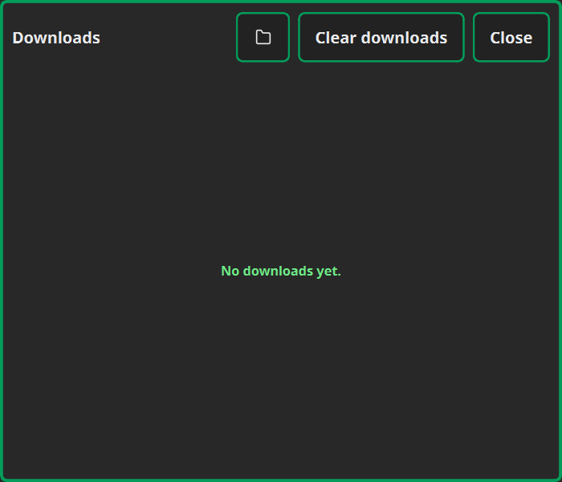

# Downloads

Open **Downloads** (the download icon in the Library and Mods Browser bars) to view downloaded mods, plugins, themes, and local imports recorded by G3M. Each item reports file transfer and installation status separately. A badge on the icon counts items that need attention.

The dialog has the **Open folder** button, **Clear downloads**, and **Close**.

## Status and actions

| Status | Buttons |
| --- | --- |
| **Downloading N%** | **Cancel** |
| **Ready to Install** | **Install**, **Delete** |
| **Installing…** | none |
| **Conflict** | **Overwrite**, **Cancel** (cancels the install) |
| **Manual Install Required** | **Continue Setup**, **Delete** |
| **Installed** | **Reinstall**, **Delete** |
| **Failed** and **Cancelled** | **Retry**, **Delete** |

**Delete** asks for confirmation and removes the history entry and G3M's copy of the file in the downloads folder. A local file you dropped into the window is copied there first, so the original stays where it is. The folder icon (**Open folder**) opens the downloads directory. **Clear downloads** clears the list. Close the window with **Close**.

A ready file is downloaded but not necessarily installed. An item in **Conflict** or **Manual Install Required** needs a decision before it becomes a Library mod. Drop local files or download URLs into the window to add them. A link from outside GameBanana asks **Start downloading from an external source?** first.

Mods that finish downloading together are installed one after another.

## Settings

**Settings > Mods Browser > Downloads** has these checkboxes:

| Checkbox | Effect |
| --- | --- |
| **Do not install downloaded files automatically** | Leaves completed files at **Ready to Install**. |
| **Delete downloaded file after use** | Removes the file after a successful install. The mod stays in its profile. |
| **Save local imports in Downloads** | Records imports from disk in the history. |
| **Always install through Manual installation** | Off (default): when the automatic scan in Manual installation sets up every file of a downloaded mod, the mod installs without opening the window and goes straight to the Library. On: the window always opens. |
| **Mark documents as info files automatically** | On by default. The scan sets `.md`, `.txt`, and similar files as info files. |
| **Use a mod right after it is installed** | Off by default. A new mod is turned on at once for the current game. |

The automatic scan opens the window anyway when no game folder is set, a file cannot be matched, or the mod has only info files. Then the item shows **Manual Install Required**; use **Continue Setup**.

History is stored in `downloads/downloads_history.json` under the data directory. Removing an archive outside G3M can leave a record without a usable file; download it again rather than using **Reinstall**.

## GameBanana Remote Install

After you pair G3M on GameBanana, mods you send from the site appear here within a minute and download without prompts. The **Refresh** button checks the queue at once. Pairing another account replaces the previous pairing. See [One-click install links](../advanced/one-click-install.md#gamebanana-remote-install).

## Failed transfers

Read the item's error before retrying. Messages name the cause: **The request timed out.**, **Failed to connect to the server.**, **The server address could not be resolved.**, **Secure connection failed.**, HTTP 403, 404, or 429 (**The server is rate-limiting requests right now**). Repeated immediate retries can prolong a rate limit.

For a completed archive that needs configuration, use **Continue Setup** to open [Manual Mod Installation](../mods/importing.md#files-without-configuration). Configure its actions and choose **Save**, or **Save and configure** to continue in Mod Editor. Cancelling setup leaves the download available for another attempt. Downloading the same file again does not supply a missing `mod_config.json` or infer an unknown destination.
