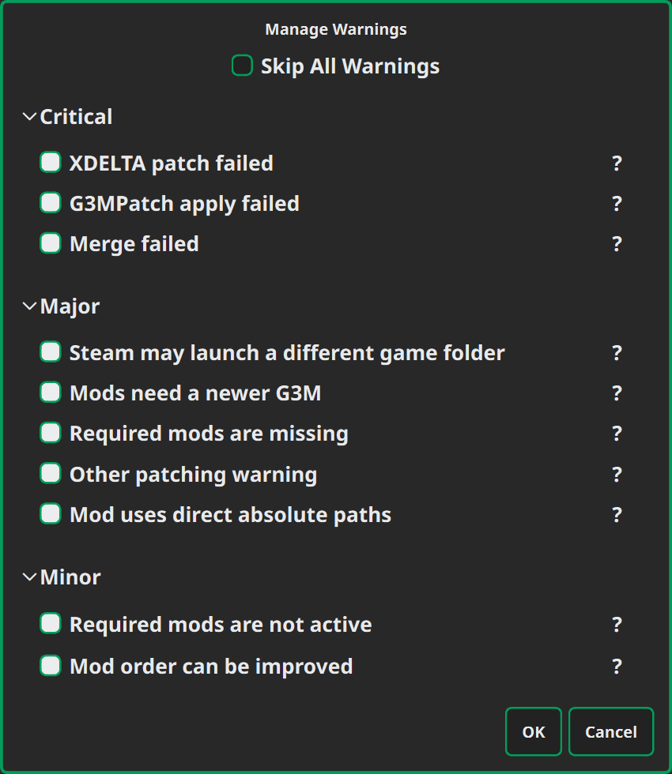

# Manage Warnings

Open **Settings > Game > Patching / Merging > Manage Warnings** to choose which warning prompts interrupt an operation. Checked entries keep their prompts enabled. Click **OK** to save the choices, or **Cancel** to discard edits to the dialog.

The **Critical**, **Major**, and **Minor** headings group the entries and collapse or expand their lists. The question-mark control beside an entry explains that warning.

| Warning | Reason for the prompt | What to check |
| --- | --- | --- |
| XDELTA patch failed | A binary patch could not apply to the selected DATA. | The exact original game file and version required by the mod. |
| G3MPatch apply failed | A resource patch could not apply cleanly. | The game version, original resource state, and preceding mod steps. |
| Merge failed | G3MTool could not combine the selected inputs. | The merge log or report and the smallest selection that reproduces the failure. |
| Steam may launch a different game folder | Steam can start an installation other than the folder G3M patched. | Whether the configured game path matches Steam's installation. |
| Other patching warning | An operation reports a patching or merging risk. Each line names the operation, the file it is about and what to do. | The listed file, and the operation log for the technical details. |
| Mod uses direct absolute paths | A mod reads or writes a fixed path outside your game folder, game data folder and its own folder. Paths inside those folders never trigger it. | Whether the listed locations are intended and whether you trust the mod's author. |
| Required mods are missing | A selected mod needs mods that are not installed, or installing them did not work. | The mod's requirements on its page, and whether the required mods exist for the selected game. |
| Required mods are not active | A selected mod needs installed mods that are not in the selection. G3M offers to activate them. | Whether you want those mods in this launch. |
| Mod order can be improved | The order of the selected mods differs from the order their authors recommend. | The proposed order. Choose **Apply recommendation**, **Launch without changes**, or **Cancel**. |
| Mods need a newer G3M | An installed mod uses a newer mod format than this G3M reads, so it is missing from the Library. | Update G3M, then check the Library again. Launching anyway runs without that mod. |

The **Mods need a newer G3M** warning is a **Major** warning: it says some installed mods were made for a newer version of G3M and are not shown in the Library, and asks to update G3M before launching.

The warning dialog buttons are **Continue**, **Cancel**, and **Open Report** where a report exists, plus **Do not show again**. After a game session in which files changed outside G3M, the dialog offers **Force restore** and **Keep external changes** instead (see [launch modes](../games/launch-modes.md#changed-game-files-after-a-session)). Long lists show the first lines and point to the log for the rest.

**Skip All Warnings** suppresses these prompts together. The individual choices become unavailable while it is enabled. This option can let a workflow continue after an incomplete patch or failed merge, so the game can start even though some selected changes were not applied. Its tooltip warns that it can also hide damaged files.

These preferences control warning prompts. Configuration validation, missing required inputs, and other errors can still stop an operation. Keep the relevant prompt enabled while investigating a failure; use [Diagnostics](diagnostics.md) and [logs](../advanced/logging.md) to inspect it.
