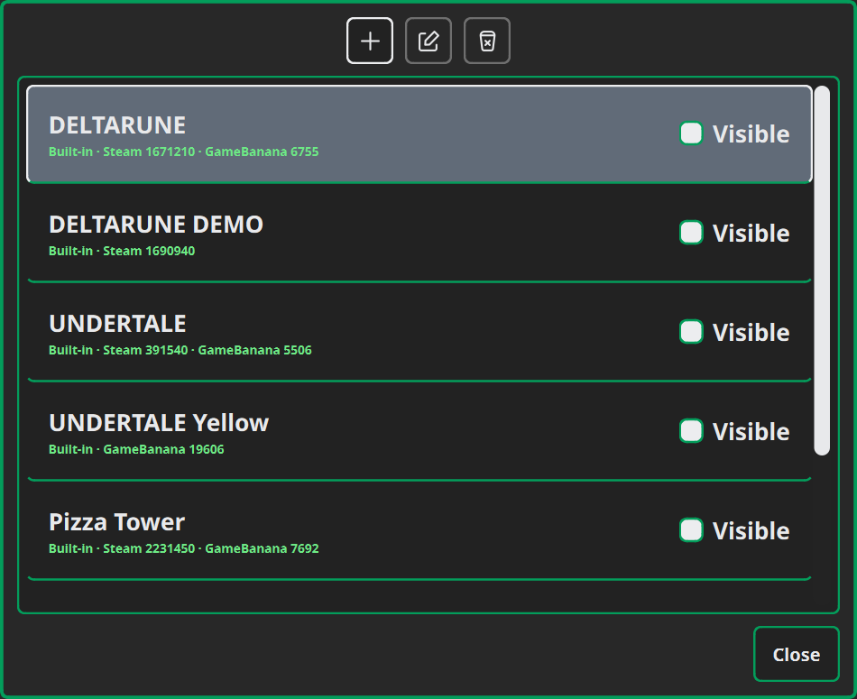

# Game Manager

Open **Game Manager** from the game controls or **Settings > Game**.

The list contains built-in and custom games. Each row has a **Built-in**, **Custom**, or **Hidden** badge, and shows its Steam App ID and GameBanana game ID when it has them. Clear the **Visible** checkbox to hide an entry from the main selector. Drag rows to reorder that selector. At least one game must remain visible.

Use the add action to define a [custom game](custom-games.md). Custom entries can be edited or removed, and a custom game's ID can be changed while editing. Built-in entries can be hidden and reordered, but their game definitions and IDs are fixed.

Changing the visible game list does not configure installation paths. Select an entry, then set its installation and user-data folders in **Settings > Game**.

## Why is a game missing from Mods Browser?

Mods Browser requires a GameBanana game ID. An entry without one can still use local mods through the Library. For a custom game, edit its optional GameBanana ID to enable online browsing.

Deleting a custom game asks to confirm with **Remove from registry only** or **Remove and clean related data**. Only custom games can be edited or deleted.
