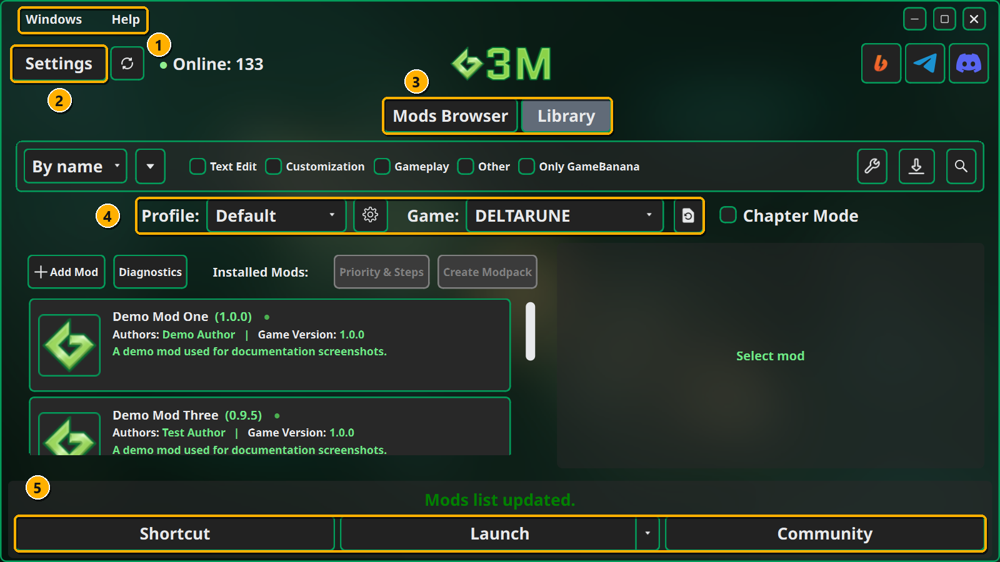
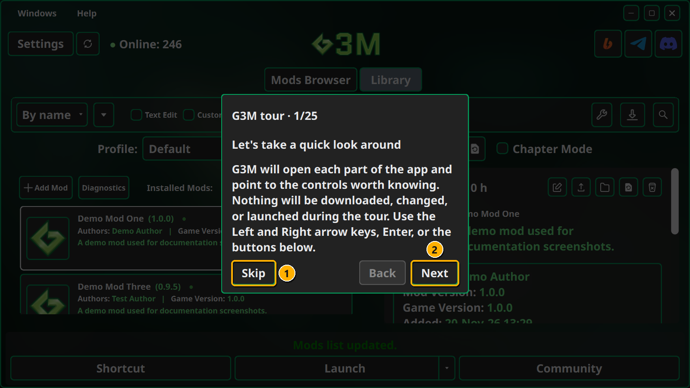

# Getting started

## Install G3M

Choose the release package for your operating system and processor from [GitHub releases](https://github.com/y114git/G3M/releases). x64 and ARM64 are separate downloads; select the architecture of the machine running G3M.

| Operating system | Minimum requirement | Architectures |
| --- | --- | --- |
| Windows | Windows 10 version 1809 | x64, ARM64 |
| Linux | glibc 2.38 | x64, ARM64 |
| macOS | macOS 13 | x64, ARM64 |

Extract the package into a folder you can write to, and open G3M. Keep the accompanying files together. Release packages contain the application runtime; Python is not required.

The requirements apply to G3M. A game's executable and a mod can have different platform requirements. An ARM64 G3M package does not convert an x64 game into an ARM64 game.

## Set the game folder

1. Choose your game in the Library.
2. Open **Settings > Game**.
3. Select the game's installation folder. This is the folder containing the executable and game resources, rather than its save folder.
4. Check the separate **data folder** setting if a mod changes saves or other per-user game files.
5. Launch without selected mods once to check the path.

G3M attempts to locate supported installed games automatically. Set the path manually if detection does not find your installation. See [game detection](games/game-detection.md) for executable overrides and platform-specific layouts.

## Install and play a mod

1. Find a mod in **Mods Browser**, open its details, and select a download. Alternatively, drop a mod archive or folder into the Library.
2. Complete the import dialog. Files without a G3M configuration open **Manual Mod Installation**. G3M first scans them and, when it can set up every file itself, installs the mod without opening the window (turn this off with **Always install through Manual installation** in **Settings > Mods Browser**).
3. Open **Library**, locate the imported mod, and click **Use**. With **Use a mod right after it is installed** enabled, the mod is already on.
4. Keep the normal **Launch** mode selected, and launch the game.
5. Let G3M finish restoring files after the game closes before launching another session.

For several selected mods, review [Priority & Steps](mods/modpacks.md). A dependency can require a separate step, and mods for the same game can still conflict.

## Find the main controls

**Settings** controls game paths, appearance, download behavior, and the Catalog. The profile selector switches independent mod libraries. **Windows** opens **Log Viewer** and **Support Packager**. **Help** has **Changelog**, **Getting Started** (the guided tour), and **About**.

1. **Windows** and **Help**.
2. **Settings**.
3. The **Mods Browser** and **Library** tabs.
4. The profile and game selectors.
5. **Shortcut**, the main action button, and **Community**.

**Help > Getting Started** opens the guided tour. It shows a numbered step, here step 1 of 25, and changes nothing in G3M.

1. **Skip** ends the tour.
2. **Next** moves to the next step. **Back** returns to the previous one.

G3M keeps settings and mods in a separate [data directory](advanced/data-directory.md). Replacing the application package does not replace that directory.
