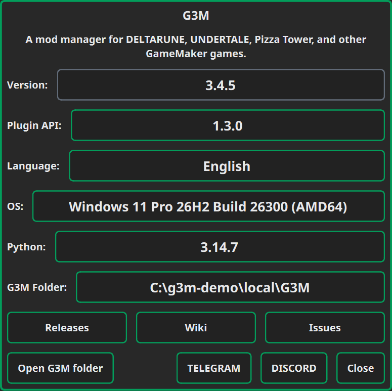

# About and changelog

Open **Help > About** for the installed G3M version, application information, and project links.

**Help > Changelog** displays release notes. Use the version shown in About when reporting a problem; an available update's version does not identify the application currently running.

For task instructions and file formats, use this wiki. Release notes describe releases rather than replacing the configuration or command references.
