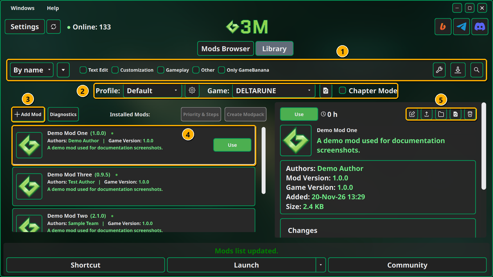

# Library

The Library displays mods installed in the active profile. Select the game and profile before choosing mods for launch. Hide the tab with **Settings > Library > Hide Library tab**.

## Controls

The row above the list holds the selectors:

| Control | Action |
| --- | --- |
| **Profile:** list and button | Switches profiles. The button opens Profile Manager. |
| **Game:** list | Chooses the game whose mods are displayed. |
| Game Versions button | Saves or applies snapshots of the selected game installation. |
| **Chapter Mode** | Shown for DELTARUNE only. Gives each section its own selection. |
| **Full Install** | Shown for games that support it. See [Full Install](../games/full-install.md). |

The filter bar has a sort list (**By name** or **By date**), a sort-direction button, tag checkboxes (**Text Edit**, **Customization**, **Gameplay**, **Other**, **CYOP/AFOM** for Pizza Tower, **FB-Addon** for FRICKBEARS3, and **Only GameBanana**), and the buttons **Update mods (N)**, Modding Tools, Downloads, and Search. **Update mods (N)** shows only when updates exist. Search asks for text and filters by name, description, author, and more; press it again to clear the search. **Hide filters in library** in settings hides the bar and moves its buttons up beside the selectors.

Above the list: **Add Mod**, **Diagnostics**, the **Installed Mods:** heading, **Priority & Steps**, and **Create Modpack**. A selected mod's cards stay selected when a filter hides them.

| Button | Action |
| --- | --- |
| **Add Mod** | Imports a file, folder, or URL, or creates a mod in the editor. |
| **Diagnostics** | Inspects the selection and can test its application. |
| **Priority & Steps** | Sets order and steps for selected mods. |
| **Create Modpack** | Builds one local mod from the current selection and steps. |
| **Update mods (N)** | Opens **Update Mods** for GameBanana-linked mods in the selected profile. |

1. The filter bar: sort list, sort-direction button, tag checkboxes, **Only GameBanana**, and the Modding Tools, Downloads, and Search buttons.
2. The selectors row: **Profile:** list, Profile Manager button, **Game:** list, Game Versions button, and **Chapter Mode**.
3. **Add Mod**.
4. The selected mod card, with **Use**.
5. The summary buttons: Edit Mod, Export Mod, open the mod's folder, Mod Versions, and Delete Mod.

In DELTARUNE **Chapter Mode**, tabs for the Main Menu and chapters 1 to 5 appear. Choose a tab before changing that section's selection. Double-click a chapter tab to turn direct launch on or off for it (a dashed border marks it); direct launch is not available for the Main Menu tab. Without Chapter Mode, the shared selection applies to every supported section.

## Mod cards

Each card shows the name, authors, and game version. A dot beside the name shows its state:

| Dot | Meaning |
| --- | --- |
| GameBanana icon | Linked to a GameBanana mod. |
| Orange warning sign | A required mod is missing, inactive, or in the wrong order, or an active mod conflicts. Red for a dependency cycle. Open Diagnostics for details. |
| Red dot | The mod is corrupted or missing files. |

Click a card to select it. A selected card shows **Use** or **Unuse**. An active card that is not selected shows a check mark. Double-click a card to open its details. Drag a card out of the window to export it as a ZIP; with saved versions, G3M asks which to include unless **Mod Versions** in settings answers for you.

## Mod summary

The panel beside the list shows the selected mod. It has **Use** or **Unuse**, **INFO** (when the mod has info files), playtime in hours, and icon buttons with these tooltips:

| Tooltip | Action |
| --- | --- |
| Open the mod page. | Opens the homepage (only if the mod has one). |
| Edit Mod | Opens the Mod Editor. |
| Export Mod | Exports to an archive. |
| Open this mod's folder. | Opens the folder. |
| Mod Versions | Opens the version manager. |
| Delete Mod | Deletes the mod and all its versions after confirmation. |

The edit, export, folder, versions, and delete buttons appear for installed local mods. The text lists authors, **Mod Version:**, **Game Version:**, **Added:**, **Updated:**, and **Size:**, then the changes the mod makes (**Show all** and **Show summary** switch the list). Dates follow the system region format. See [playtime](../games/playtime.md).

Check the [launch mode](../games/launch-modes.md) before applying mods: normal Launch restores affected files, while the other modes keep changes.
