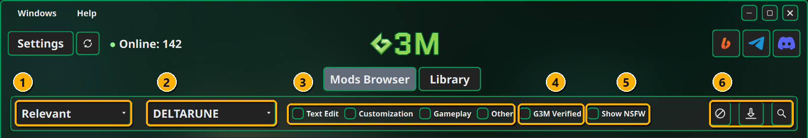
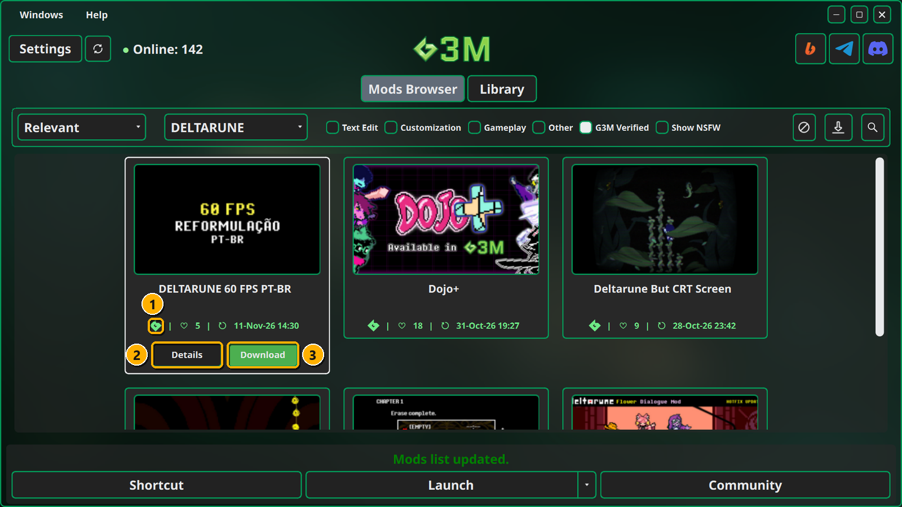

# Mods Browser

Mods Browser lists GameBanana uploads for the selected game. A game appears only if it has a GameBanana ID; add one to a custom entry in Game Manager when applicable. Hide the tab with **Settings > Mods Browser > Hide Mods Browser tab**.

## Find a mod

The bar above the list has these controls:

| Control | Effect |
| --- | --- |
| Sort list | **Relevant**, **By creation date**, or **By update date**. Mods Browser has no sort-direction button. |
| Game list | Chooses the GameBanana game. |
| Tag checkboxes | **Text Edit**, **Customization**, **Gameplay**, **Other**, and **CYOP/AFOM** (Pizza Tower only). There is no FB-Addon filter here. |
| **G3M Verified** | Lists only mods with the G3M badge. |
| **Show NSFW** | Allows mature mods in results. |
| Blocklist button | Opens the [Blocklist](../features/blocklist.md). |
| Downloads button | Opens [Downloads](../features/downloads.md). |
| Search button | Asks for text matching names, descriptions, authors, and more. While a search is active, the button clears it (tooltip **Clear search: '<text>'**). |

1. **Relevant**: the sort list.
2. **DELTARUNE**: the game list.
3. **Text Edit**, **Customization**, **Gameplay**, **Other**: the tag checkboxes.
4. **G3M Verified**: lists only mods with the G3M badge.
5. **Show NSFW**: allows mature mods in results.
6. The Blocklist, Downloads, and Search buttons.

Results load in pages. A list that is still loading keeps its cards visible. If a request fails, the list shows the error and a **Retry** button. **No mods found.** means no result matches the game, search, tags, NSFW setting, and blocklist. GameBanana limits requests to 250 per hour; when the limit is reached, G3M shows **API Rate Limit** and asks you to wait.

## Cards and details

Click a card to expand it. An expanded card shows the description and two buttons: **Details** and **Download**. For a mod that is already in the Library the second button is **Delete**, which asks **This will permanently delete the mod and all its versions. Continue?** **Details** opens the [details](mod-details.md) panel.

1. The **G3M** badge in the card header, before the likes and the update date.
2. **Details**: opens the details panel.
3. **Download**: starts the download.

The card's header shows badges before the likes and the update date:

| Badge | Meaning |
| --- | --- |
| **G3M** | The mod, or some of its files, was confirmed to install in one click without Manual installation. |
| Work in progress | The author has not finished the mod. |
| Note | The listing has additional information to read first. |

Dates follow the system region format.

## G3M Verified

The G3M creator keeps a list of confirmed mods. It records the game and the supported game version of each mod; the version appears in the mod details. A mod without the badge can still be installed through Manual installation.

## Download and import

When a mod has several files, a picker titled **Select file for '<mod>'** asks which one to download. Its details show Version, Size, Updated, Downloads, **Auto-install**, Security, MD5, and the description. **Auto-install** is **Yes** only for DeltaMod files and for mods on the G3M Verified list. The label does not mean an unconfigured mod needs the manual window. Every other file is downloaded and then goes through Manual installation: when its automatic scan can set up every file, the mod installs without opening the window. Otherwise the item stays at **Manual Install Required** and you finish it with **Continue Setup** in Downloads. **Open mod page** opens GameBanana.

The file enters [Downloads](../features/downloads.md). G3M installs the completed download by itself unless **Do not install downloaded files automatically** is on in **Settings > Mods Browser > Downloads**. With that checkbox on, press **Install** on the completed record. **Use a mod right after it is installed** is a separate setting: it only controls whether the new mod is turned on at once. A download whose checksum does not match GameBanana's is kept with a warning, and you decide whether to install it.

A local mod that is already installed appears as one card, not as a second card next to the GameBanana entry.

A successful download can still need manual setup. Appearing in search does not guarantee that G3M can infer a package's file destinations or that it works on your platform.

## Missing or failed results

Check the selected game, search, tags, NSFW setting, and blocklist. If the request fails, press **Retry** after checking connectivity. Library mods stay installed without online search.
