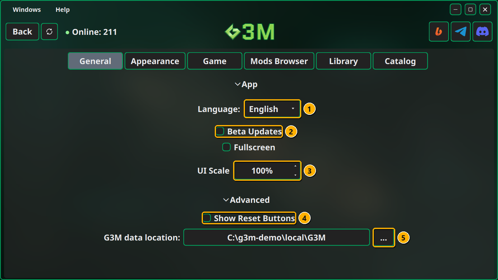
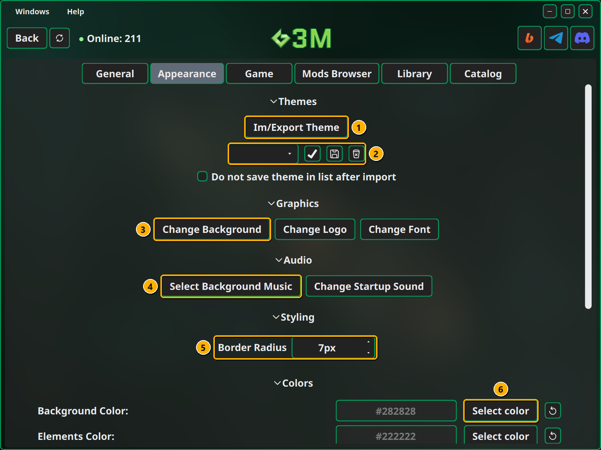
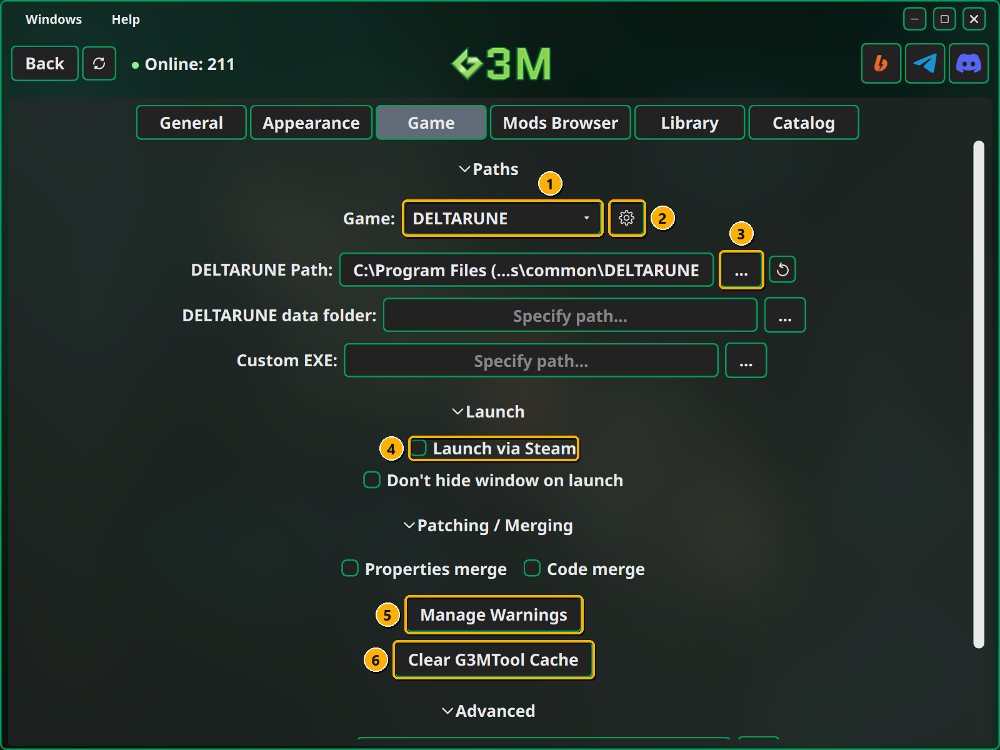
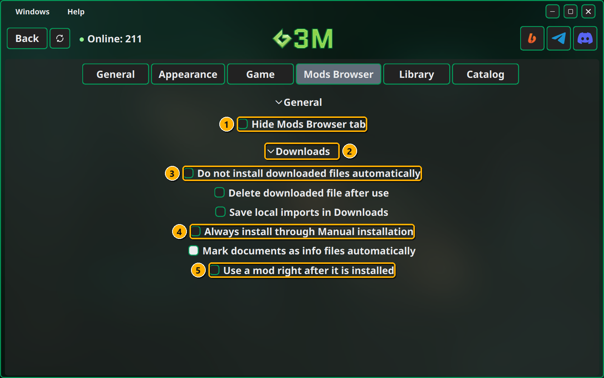
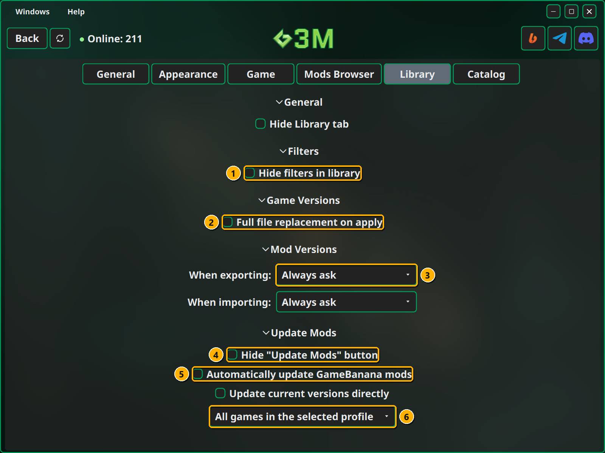

# Settings

Press **Settings** in the top bar to open the settings view. It has six tabs, in this order: **General**, **Appearance**, **Game**, **Mods Browser**, **Library**, and **Catalog**. Most changes apply when a control changes or when you finish editing a field. There is no separate save step.

Click a section heading to collapse or expand it. G3M remembers which sections are collapsed. **Show Reset Buttons** shows a reset button (tooltip **Reset**) beside individual settings and section headings. A section reset asks for confirmation, then restores that section's defaults. It does not uninstall anything or delete Library mods.

## General

| Section | Control | Effect | Default |
| --- | --- | --- | --- |
| App | **Language** | Interface language. Translated views and plugin translations follow it. | Your system language if G3M has it, otherwise English |
| App | **Beta Updates** | Include beta application updates in update checks. | Off |
| App | **Fullscreen** | Toggle the main window's fullscreen state. | Off |
| App | **UI Scale** | Scale text and controls from 50% to 200% in steps of 10%. | 100% |
| Advanced | **Show Reset Buttons** | Show the reset buttons. | Off |
| Advanced | **G3M data location:** | Read-only path of the folder that holds G3M's settings, profiles, mods, downloads, themes, and plugins. Its browse button changes it. | Platform default |

1. **Language**.
2. **Beta Updates**.
3. **UI Scale**.
4. **Show Reset Buttons**.
5. The browse button (**...**) beside **G3M data location:**.

Changing the data location asks **How should G3M use this folder?** with **Copy current data** or **Use without copying**. Copying refuses conflicting destination entries rather than replacing them. G3M must restart to use the new location, and the original data stays in place. If G3M cannot reach the configured location at startup, it offers **Try again**, **Choose another folder**, and **Use default location**. See [Data directory](../advanced/data-directory.md).

## Appearance

| Section | Control | Effect | Default |
| --- | --- | --- | --- |
| Themes | **Im/Export Theme** | Opens the theme dialog with **Import** and **Export**. | |
| Themes | Theme list with apply, save, and delete buttons | Apply, save (**Save Theme**), or delete (**Delete Theme**) a saved theme. | |
| Themes | **Do not save theme in list after import** | Apply an imported theme without adding it to the list. | Off |
| Graphics | **Disable animations** | Turn off interface animations. Progress bars then jump instead of filling smoothly. | Off |
| Graphics | **Disable background** | Hide the background image or video and keep its setting. | Off |
| Graphics | **Disable startup sound** | Skip the startup sound and keep its file. | Off |
| Graphics | **Stop music when unfocused** | Stop background music while G3M is unfocused or minimized. It restarts from the beginning on return. | Off |
| Graphics | **Change Background** / **Remove Background** | Pick or remove a custom background. The label depends on whether one is set. | |
| Graphics | **Change Logo** / **Remove Logo** | Same for the logo. | |
| Graphics | **Change Font** / **Remove Font** | Same for the font (`.ttf` or `.otf`). | |
| Audio | **Select Background Music** / **Remove Background Music** | Pick or remove background music. | |
| Audio | **Change Startup Sound** / **Remove Startup Sound** | Pick or remove the startup sound. | |
| Styling | **Border Radius** | Corner rounding from 0 to 999 px. Border thickness does not change. | 7 px |
| Colors | **Background Color:**, **Elements Color:**, **Border Color:**, **Custom hover color:**, **Custom select color:**, **Main Text Color:**, **Secondary Text Color:** | Each has a **Select color** button and accepts a hexadecimal value. An empty value uses the theme color. | Empty |
| Advanced | **Disable Discord Rich Presence** | Stop G3M from publishing activity to Discord. | Off |

1. **Im/Export Theme**.
2. The theme list, with its apply, save, and delete buttons beside it.
3. **Change Background**, next to **Change Logo** and **Change Font**.
4. **Select Background Music**, next to **Change Startup Sound**.
5. **Border Radius**.
6. **Select color** for **Background Color:**. The other color rows work the same way.

Download optional packages from [Catalog](../features/catalog.md). Installed catalog themes also appear in the theme list. See [Customization](../customization/README.md) for supported files and theme packaging.

## Game

Pick the game with **Game:** and edit its paths. The button beside the selector opens [Game Manager](../games/game-manager.md).

| Section | Control | Effect | Default |
| --- | --- | --- | --- |
| Paths | **{Game} Path:** | Installation folder (the `.app` bundle on macOS) used for launching and `${game_path}`. | Detected, or empty |
| Paths | **{Game} data folder:** | User-data location used by `${game_data_path}`. It is not the installed DATA file. | Detected, or empty |
| Paths | **Custom EXE:** | Override the executable. Saved per game. | Empty |
| Launch | **Launch via Steam** | Start the game through Steam. Disabled for a game without a Steam App ID, and for DELTARUNE while direct launch is on. | Off |
| Launch | **Don't hide window on launch** | Keep G3M visible while the game runs. | Off |
| Launch | **Use PortProton instead of Wine** | Use PortProton for Windows executables. Shown on Linux and macOS only. | Off |
| Patching / Merging | **Properties merge** | Combine structured property changes (such as JSON) when merging patches in one step. | Off |
| Patching / Merging | **Code merge** | Merge GML changes when patches edit the same code. | Off |
| Patching / Merging | **Manage Warnings** | Opens [Manage Warnings](../features/warnings.md). | |
| Patching / Merging | **Clear G3MTool Cache** | After confirmation, deletes cached G3MTool analysis files. Patching can be slower until the cache is rebuilt. | |
| Advanced | **Custom G3MTool:** | Use this G3MTool executable instead of the bundled one. | Empty |
| Advanced | **Custom XDELTA:** | Pass this xdelta executable to G3MTool. | Empty |
| Advanced | **Custom Wine:** | Preferred Wine executable for Windows games. Shown on Linux and macOS only. | Empty |
| Advanced | **Custom PortProton:** | PortProton command used when PortProton is enabled. Linux and macOS only. | Empty |

1. **Game:** list.
2. The Game Manager button.
3. The browse button (**...**) for **DELTARUNE Path:**.
4. **Launch via Steam**.
5. **Manage Warnings**.
6. **Clear G3MTool Cache**.

Each path row has a browse button and, with reset buttons enabled, a reset button. Changing a tool path does not install the tool.

## Mods Browser

| Section | Control | Effect | Default |
| --- | --- | --- | --- |
| General | **Hide Mods Browser tab** | Hide the online browsing tab. Installed mods stay in the Library. | Off |
| Downloads | **Do not install downloaded files automatically** | Leave finished downloads ready for an explicit **Install**. | Off |
| Downloads | **Delete downloaded file after use** | Remove the downloaded file after a successful install. | Off |
| Downloads | **Save local imports in Downloads** | Also record imports from disk in Downloads. | Off |
| Downloads | **Always install through Manual installation** | Off: when the automatic scan sets up every file of a downloaded mod, the mod installs without opening the window. On: the Manual installation window always opens. | Off |
| Downloads | **Mark documents as info files automatically** | The automatic scan sets `.md`, `.txt`, and similar files as info files. | On |
| Downloads | **Use a mod right after it is installed** | Turn a new mod on at once, with no need to select it and press **Use**. | Off |

1. **Hide Mods Browser tab**.
2. The **Downloads** section heading.
3. **Do not install downloaded files automatically**.
4. **Always install through Manual installation**.
5. **Use a mod right after it is installed**.

See [Downloads](../features/downloads.md) for how these options work together.

## Library

The tab is named after the Library view. Its sections are:

| Section | Control | Effect | Default |
| --- | --- | --- | --- |
| General | **Hide Library tab** | Hide the Library tab. | Off |
| Filters | **Hide filters in library** | Hide the Library's filter bar. The Downloads, Modding Tools, and search buttons then move to the row with the profile and game selectors. | Off |
| Game Versions | **Full file replacement on apply** | When applying a Game Version, delete files that are not in the archive. Game-original and custom-executable paths are never deleted. | Off |
| Mod Versions | **When exporting:** | **Always ask**, **Only the active version**, or **All versions**. Also applies when you drag a mod out of the Library. | Always ask |
| Mod Versions | **When importing:** | The same three choices for saved versions inside an imported mod. | Always ask |
| Update Mods | **Hide "Update Mods" button** | Hide the button even when updates exist. | Off |
| Update Mods | **Automatically update GameBanana mods** | Update eligible mods without opening the dialog. | Off |
| Update Mods | **Update current versions directly** | Skip the Mod Version backup during automatic updates. | Off |
| Update Mods | Scope list | **Only the selected game**, **All games in the selected profile**, or **All profiles**. | All games in the selected profile |

1. **Hide filters in library**.
2. **Full file replacement on apply**.
3. **When exporting:** (**When importing:** sits below it).
4. **Hide "Update Mods" button**.
5. **Automatically update GameBanana mods**.
6. The scope list for updates.

A Game Version is an installation snapshot, not a Mod Version. Read [Game Versions](../features/game-versions.md) before enabling full file replacement. A local mod without a GameBanana link is never updated automatically.

## Catalog

The **Plugins** and **Themes** subtabs have an **Installed only** filter. Plugins also filter by **Interface**, **Game Experience**, **Tool**, and **Other**. Themes filter by **Minimalist**, **Game-inspired**, **Animated**, and **With sound**. See [Catalog](../features/catalog.md).
