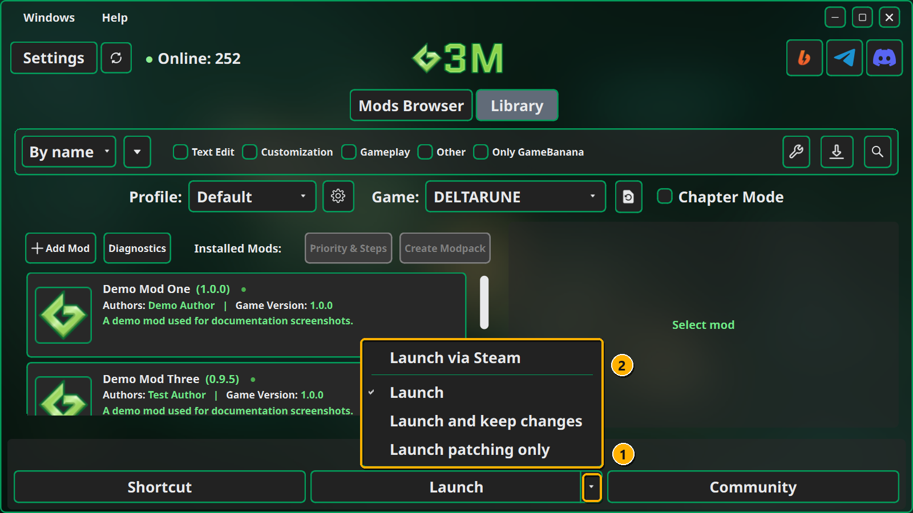

# Status and launch controls

The bottom of the main window has a status line, a progress bar, and three buttons: **Shortcut**, the main action button, and **Community**.

The status line shows task messages for downloads, patching, launch, restoration, and failures, such as **Ready**, **Launching game...**, **Game launched. Waiting for exit...**, **Game closed. Restoring files...**, and **Files restored successfully.** The progress bar appears during long tasks and fills smoothly unless animations are disabled. A completed download is separate from a completed mod import.

## Main action and mode menu

The main button starts the selected action, labelled with the current mode (**Launch** by default). Its arrow opens the mode menu:

| Item | Effect |
| --- | --- |
| **Launch via Steam** | Checkbox, the same setting as in **Settings > Game**. Unavailable without a Steam App ID. |
| Plugin options | Checkboxes added by plugins. |
| **Launch** | Launch the game and restore files after it closes. |
| **Launch and keep changes** | Launch and leave patched files in place. Cannot be undone automatically. |
| **Launch patching only** | Apply mods without launching. Patched files stay in place. |
| Plugin actions | Extra actions added by plugins. |

1. The arrow on the main action button opens the menu.
2. The menu: **Launch via Steam**, then **Launch**, **Launch and keep changes**, and **Launch patching only**.

Hover an item for its description. The selected mode is also used by shortcuts. See [launch modes](../games/launch-modes.md).

## Other buttons

**Shortcut** opens the [shortcut](../features/shortcuts.md) dialog. **Community** opens [Community](../features/community.md).

Launch can remain unavailable while a game is running or cleanup is unfinished. Wait for restoration rather than starting the game independently during that interval. If the game files changed after G3M applied mods, G3M leaves them as they are after the session and shows **Game files changed after G3M applied the mod, so they were not restored and were left as they are.**

When **Full Install** is enabled for a supported game, the main action installs that game instead of launching it. See [Full Install](../games/full-install.md).
