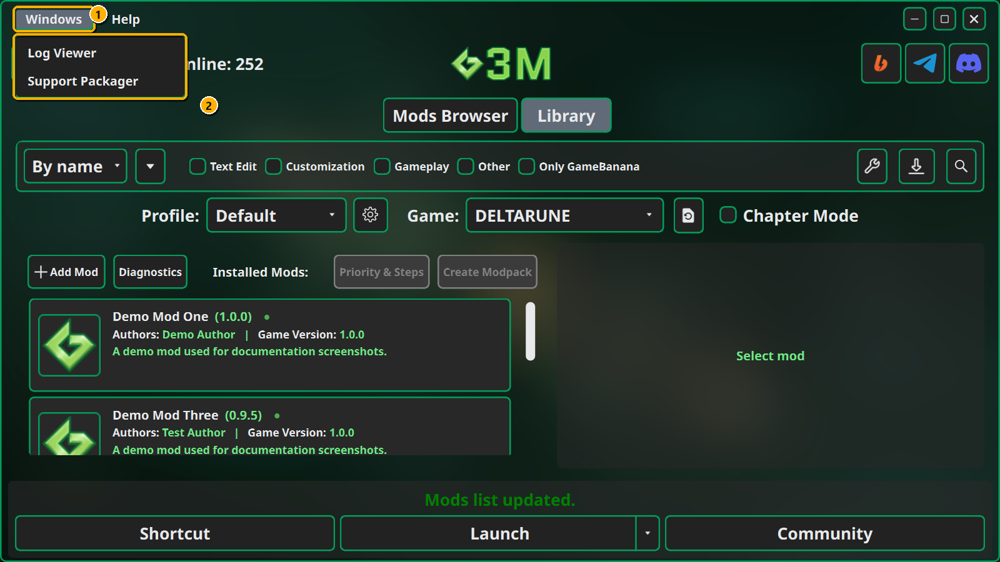
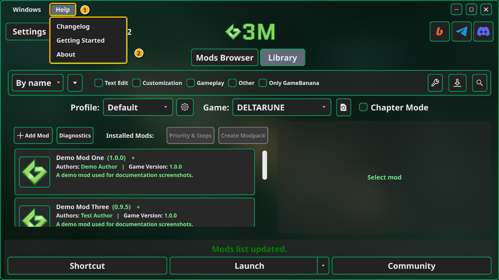

# Title bar

| Menu | Items |
| --- | --- |
| **Windows** | **Log Viewer**, **Support Packager** |
| **Help** | **Changelog**, **Getting Started**, **About** |

**Log Viewer** has the tabs **G3M**, **Patching**, and **Conflicts**, a **Latest / Live** source and **Open logs folder**. **Getting Started** restarts the guided tour. See [About and changelog](about-and-changelog.md).

1. **Windows**.
2. **Log Viewer** and **Support Packager**.

1. **Help**.
2. **Changelog**, **Getting Started**, and **About**.

The window controls minimize, maximize or restore, and close G3M. Drag empty title-bar space to move the window. Double-click empty space to toggle maximization.

If a task is running, review any close confirmation before exiting. For a modded game session, keep G3M available until [restoration](../advanced/patching-process.md) finishes.

## Top bar

Under the title bar: **Settings**, the refresh button, the **Online: N** counter, the logo, and icon buttons for **BOOSTY**, **TELEGRAM**, and **DISCORD** that open those pages. The refresh button is described in [Interface](README.md#top-bar).
