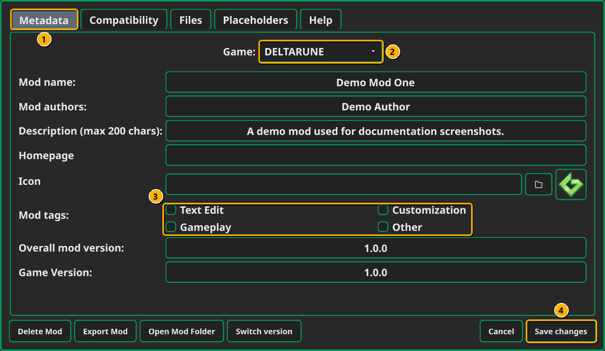
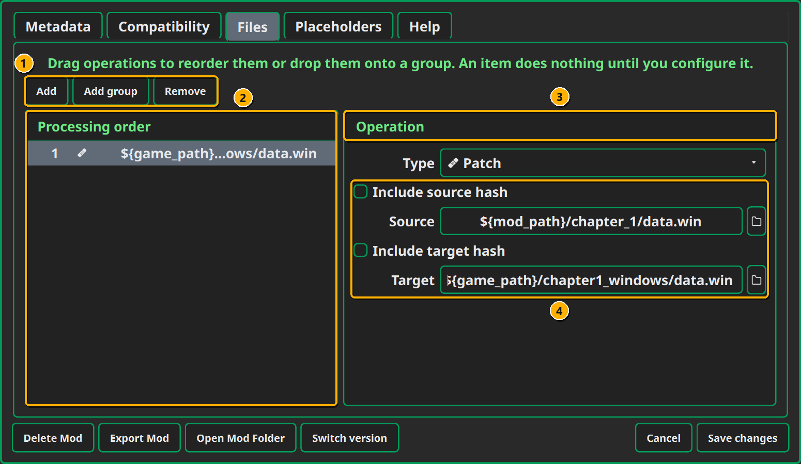

# Mod editor

The editor creates and edits local mods. It writes `mod_config.json` and keeps the files needed by the package. Open it from **Add Mod** when creating a mod, or from an installed mod's edit action.

The five tabs are **Metadata**, **Compatibility**, **Files**, **Placeholders**, and **Help**. The [configuration reference](mod-config.md) defines the values these controls write.

## Metadata

1. The **Metadata** tab, next to **Compatibility**, **Files**, **Placeholders**, and **Help**.
2. **Game**.
3. **Mod tags**.
4. **Save changes** (**Finish Creation** for a new mod).

| Control | Use |
| --- | --- |
| Game | Select a built-in game or a visible custom game. The mod belongs to that game's library. |
| Mod name | Name displayed in the library. Required; up to 128 characters. |
| Mod authors | Author names, separated by commas. |
| Description (max 200 chars) | Description of the mod. The label says 200, but the field accepts up to 16,384 characters. |
| Homepage | HTTP or HTTPS project or download page. A direct download link is rejected. |
| Icon | Bundled image path or HTTP or HTTPS image URL. **Browse...** copies the picked image into the mod folder at once and replaces the mod's previous icon, unless a file operation uses it; Cancel brings the old icon back. A path typed by hand is copied when you save, and the old icon is replaced then. The preview updates when you edit the path or URL. |
| Mod tags | Checkboxes **Text Edit**, **Customization**, **Gameplay**, and **Other**. **CYOP/AFOM** appears only while Pizza Tower is selected and **FB-Addon** only while FRICKBEARS3 is selected; switching games clears the hidden tag. A new mod starts with **Other** ticked. |
| Overall mod version | Version label for this package. |
| Game Version | Label describing the intended game release. |

The desktop editor has no Mod ID field. A new mod receives an ID of the form `local_` plus 12 hexadecimal characters, and editing an existing mod keeps its ID. To choose an ID, use the [web editor](web-editor.md) or edit `mod_config.json`. A game-version label alone does not prevent a patch from running on a different data file. Use a target hash when an exact file is required.

## Compatibility

The **Dependencies** and **Conflicts** lists each have **Add** and **Remove** controls. Select a row to edit its mod ID and **Order**.

| Order choice | Configuration value |
| --- | --- |
| No order | Bare mod ID. |
| Before this mod | `id:before` |
| After this mod | `id:after` |
| In an earlier step | `id:before-step` |
| In a later step | `id:after-step` |
| Earlier in this step | `id:before-priority` |
| Later in this step | `id:after-priority` |

The ID names the other mod. Enter a local mod ID, or paste a GameBanana mod or WIP page URL. G3M stores the URL as `gb_mod_<id>` or `gb_wip_<id>`. Dependency conditions require that mod to be selected in the specified position. Conflict conditions report a problem when the other mod is selected in the specified position. See [relationship rules](mod-config.md#dependencies-and-conflicts) for the precise position checks.

For an addon that requires an already applied base mod, use **In an earlier step**. Priority within one step chooses which conflicting changes win; it does not create a separate patched base for an addon.

## Files

1. **Add**, **Add group**, and **Remove**.
2. **Processing order**, the list of operations.
3. **Operation**, the settings of the selected row.
4. **Source**, with **Target** below it.

The left pane lists operations in processing order. The right pane edits the selected operation or group.

| Control | Action |
| --- | --- |
| Add | Add an operation after the selected item (inside a selected group). It starts as **Overwrite** with `${mod_path}/` as source and `${game_path}/` as target. |
| Add group | Ask for a group name and create the group. Names are unique, up to 128 characters, and groups nest up to 32 levels. |
| Remove | Remove the selected operation or group. Removing a group removes its contained operations. |
| Drag a row | Move an operation or group in the sequence, including into another group. The editor has no up and down buttons and no keyboard command for reordering, so moving a row needs a pointer. |
| Type | Choose patching, copying, extraction, a soft or hard variant, or information. |
| Source | Type a path, or use the folder button to pick a file. A file inside the mod is stored as a `${mod_path}` path. |
| Target | Type a path, or use the folder button to pick a folder. A folder inside the game folder, game data folder, or home folder is stored with that placeholder and a trailing `/`. A folder elsewhere is stored as a device-specific path and a warning is shown. |
| Include source hash | Store a checksum of the resolved source. |
| Include target hash | Store a checksum of the resolved existing destination. |

Groups organize the operation sequence. They are not library mod steps. An `info` operation has no destination, so target controls do not apply to it.

Hash controls resolve the path against the selected game's settings and the mod folder. A source or target that cannot be read cannot produce a valid checksum. Hashes can check files, folders, or supported archive members.

Choose **overwrite** to copy a source folder itself, or **extract** to copy its contents. The hard variants clear destination content; review the [clearing rules](mod-config.md#clear-a-destination) before using them.

## Placeholders

Use this tab to name paths that several operations share. **Add** creates a row, **Remove** deletes it, and selecting a row opens its name and path fields.

For example, a placeholder named `chapter_assets` with the value `${game_path}/chapter1_windows/assets` lets operations use `${chapter_assets}/logo.png`.

The value begins with a built-in root and a path suffix. Names cannot duplicate built-in roots or other names without regard to case. Custom placeholders cannot contain other custom placeholders. Removing a placeholder does not rewrite operation paths that use it; fix those references before saving.

## Help and validation

**Help** explains metadata, file operations, placeholders, and compatibility. Path examples use the selected game and local folders where available.

Saving checks the configuration and required paths. Invalid values receive an explanation so you can correct the affected operation or field. A valid package still needs a real test in the intended game, particularly when a patch depends on a particular game build.

Saving a local mod writes it to the current profile. The button reads **Finish Creation** for a new mod and **Save changes** for an existing one; a new mod needs a name, and a homepage, if given, must be an HTTP or HTTPS URL. For an existing mod the window also has **Delete Mod** (asks for confirmation, irreversible), **Export Mod**, **Open Mod Folder**, and **Switch version** (opens [Mod Versions](mod-versions.md)). **Export Mod** here writes the whole mod folder, including `mod_versions/`, to a ZIP; use the Library export action to choose which saved versions to include. See [Export](exporting.md) to share a ZIP. The browser editor has different save controls because it cannot write directly into a desktop library; see [Web editor](web-editor.md).
