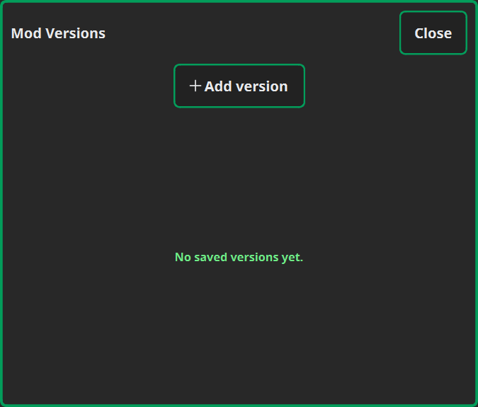

# Mod Versions

Open **Mod Versions** (the **Switch version** button in Mod Editor opens the same dialog) on a Library card to keep and switch between saved copies of that mod. Versions belong to the mod in the active profile.

## Add a version

**Add version** offers saving the current mod as a version or importing a mod version from a file. Give each checkpoint a useful name, such as `Translation test` or `Before texture edits`.

For a GameBanana-backed mod, **Download from GameBanana** can fetch another available file into its version list. Importing a package whose ID is already installed also adds it as a version.

Updating a GameBanana mod from **Update Mods** saves the current files as a version first. Choose **Update the current version directly** to skip that step. Automatic updates have the same choice in **Settings > Library**.

**Save current as version** asks for a name. **Import mod version** takes a ZIP, 7z, or RAR archive (**Choose file**) or a direct link (**Import from URL**, then **Load URL**). You can also drop files or links into the dialog. Each version is a ZIP in the mod's `mod_versions/` folder, named after the version. Characters other than letters, digits, space, `_`, `-`, and `.` become `_`, and a name already in use gets a number such as `Name (2)`.

## Switch or delete

**Switch** asks for confirmation and replaces the current mod files with the selected version. Save the current files as a version first if you want to keep edits that are not already saved.

**Delete** removes that saved archive after confirmation. It does not switch the active mod to a different version.

Exporting a mod and installing a package that carries versions both let you choose which versions are included; see [Exporting mods](exporting.md) and [Importing mods](importing.md).

A version saves the mod package, not the game installation, profile selection, or save files. For a whole profile or game snapshot, use [Profiles](../features/profiles.md) or [Game Versions](../features/game-versions.md).
