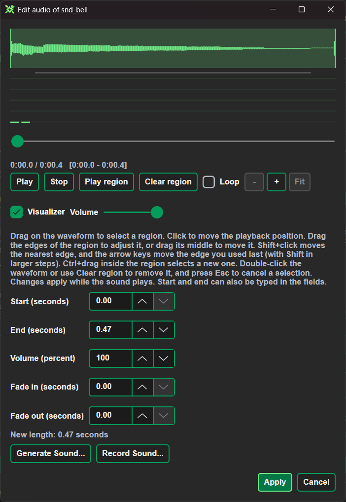

# Audio editor

The audio editor cuts a sound to a start and end, changes its volume and fades its ends. Apply writes the result back into the sound as one undo step.

## Open it

1. Select a sound that holds audio in the data file.
2. Choose **Sound** > **Edit Audio...**

The window is titled `Edit audio of {sound}`. Only a sound stored as WAV, OGG or MP3 can be edited. Otherwise the message `Only a sound stored in the file as WAV, OGG or MP3 can be edited here. Select one, or use Replace Audio.` appears. One editor can be open per sound; asking again brings it forward. A long sound is decoded first, so the window opens after a moment.

## Fields

| Field | Default | Range | Step |
|---|---|---|---|
| Start (seconds) | 0 | 0 to the sound length | 0.05 |
| End (seconds) | the sound length | 0 to the sound length (rounded up to hundredths) | 0.05 |
| Volume (percent) | 100 | 0 to 1600 | 5 |
| Fade in (seconds) | 0 | 0 to 100000 | 0.05 |
| Fade out (seconds) | 0 | 0 to 100000 | 0.05 |

The line `New length: {seconds} seconds` shows the result length. Start and End also follow the region you drag on the waveform; **Clear region** puts them back to the whole sound. **Play region** previews the cut (volume and fades are not applied in the preview). See [Player controls and waveform](player-and-waveform.md).

Volume above 100 percent clips at full scale. Fades are linear. Start and end are rounded to whole sample frames.

## Buttons

| Button | Action |
|---|---|
| **Apply** | Writes the edited audio into the sound and closes. |
| **Cancel** | Closes without changes. |
| **Generate Sound...** | Opens the [sound generator](synth.md) to replace this sound's audio. The editor closes once the audio is replaced. |
| **Record Sound...** | Opens the [recorder](recording.md) for the same purpose. |

If a risky-action warning is declined, the window stays open with `The sound was not changed. Apply again, or cancel.`

## What is stored

The result is stored in the format the sound already has:

- A WAV stays WAV, 16 bit.
- An OGG is encoded again as OGG Vorbis (variable bit rate, quality 0.5).
- An MP3 is stored as OGG.

The length of the sound updates. An edit that would leave no audio is refused with `The cut would leave no audio.`

## See also

- [Formats, import and export](formats-import-export.md)
- [Player controls and waveform](player-and-waveform.md)
- [Sound generator](synth.md)
- [Recorder](recording.md)
