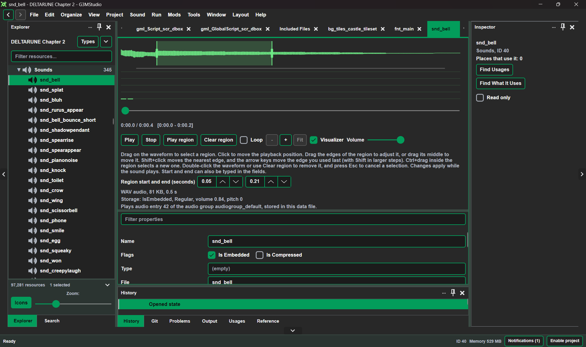

# Sounds and the sound tab

A sound is a GameMaker resource that plays one piece of audio. This page describes the sound tab, the text lines under its player, and the commands of the Sound menu.

## Open a sound

Double-click a sound under **Sounds** in the Explorer. The tab shows a player (see [Player controls and waveform](player-and-waveform.md)) with these lines under it.

| Line | Example | Meaning |
|---|---|---|
| Info | `WAV audio, 312 KB, 1.8 s` | Format found in the bytes (WAV, OGG or MP3), size in KB, length in seconds. The length comes from the data file, or from the audio itself. It shows `?` when neither tells (MP3). |
| Storage | `Storage: IsEmbedded, Regular, volume 1, pitch 1` | The flags, volume and pitch of the sound as stored in the data file. |
| Reference | `Plays audio entry 4 of the audio group snd_group, stored in this data file.` | Which audio entry the sound plays and from which audio group. |

The reference line has three other forms:

- `Plays no audio: this sound has no audio entry.` The sound has no audio entry.
- `Plays audio entry {id} of the audio group {group}, stored in the file of that group (audiogroupN.dat), which opens on its own.`
- A sound without audio data in the data file shows a **Play** button that is off, with the tip `This sound has no audio data to play.`

Sound properties named in the property lists: Audio ID, Audio File, Audio Group, Audio Length, Flags, Volume, Pitch, Type, File, Effects, Preload and Group ID. The flags are `IsEmbedded`, `IsCompressed`, `IsDecompressedOnLoad` and `Regular`. See [Storage and audio groups](storage-and-groups.md) for what embedded and compressed mean.

## Sound menu

The **Sound** menu shows while a sound tab is in front. No command has a default shortcut. You can assign shortcuts in the shortcuts editor (see [Settings](../settings/README.md)).

| Command | What it does | Needs |
|---|---|---|
| Edit Audio... | Opens the [audio editor](audio-editor.md) | A sound that stores WAV, OGG or MP3 |
| Replace Audio... | Puts a file into the sound ([details](formats-import-export.md)) | A sound |
| Generate Sound... | Opens the [sound generator](synth.md) | An open file |
| Record Sound... | Opens the [recorder](recording.md) | An open file |
| Export Audio... | Saves the audio of the sound to a file | A sound with audio in the data file |
| Export All Audio... | Saves the audio of every sound to a folder | An open file |
| Play or Pause Sound | Same as the Play button | A sound tab in front |
| Stop Sound | Same as Stop | A sound tab in front |
| Loop Sound | Toggles Loop | A sound tab in front |

The sound used by the commands is the Explorer selection when it is a sound, otherwise the tab in front. With none, the notification `Select a sound first.` appears.

In the Explorer, right-click the **Sounds** type row for **New Sound...**, **Generate Sound...** and **Record Sound...**. To make a sound from an audio file instead, see [Formats, import and export](formats-import-export.md).

## Undo

Replace Audio, Edit Audio, Generate Sound and Record Sound each make one undo step. Undo restores the old audio, length, type, file name and flags.

## See also

- [Player controls and waveform](player-and-waveform.md)
- [Formats, import and export](formats-import-export.md)
- [Storage and audio groups](storage-and-groups.md)
- [Playback settings](playback-settings.md)
- [Glossary](../reference/glossary.md)
