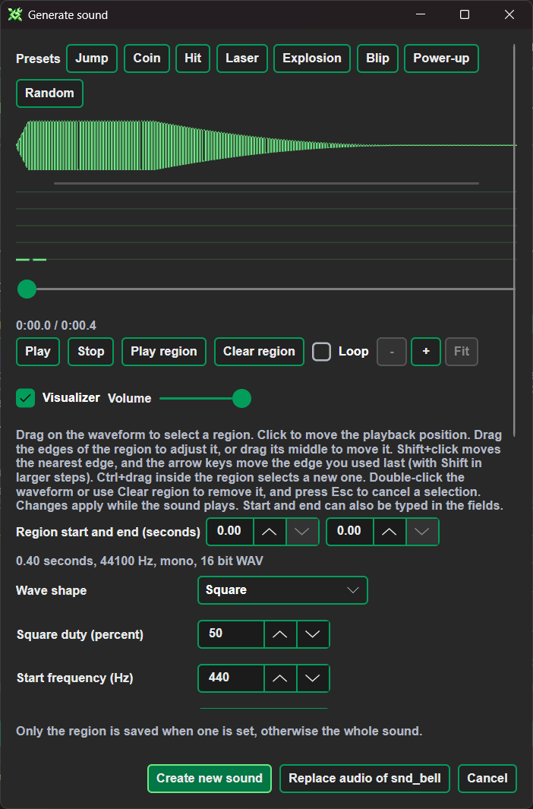

# Sound generator

The generator makes short effect sounds from an oscillator, a slide, vibrato, an envelope and a low-pass filter. The result is a new sound or the audio of the selected sound. Output is always 16 bit mono WAV at 44100 Hz.

## Open it

- **Sound** > **Generate Sound...**, or right-click the **Sounds** row in the Explorer.
- From the [audio editor](audio-editor.md), with the **Generate Sound...** button. There the dialog only replaces that sound.

The window is titled `Generate sound`. Every change makes a new sound about 60 ms after the last change, so holding a spin arrow renders once. The player and waveform show the result. See [Player controls and waveform](player-and-waveform.md).

## Presets and Random

| Button | Result |
|---|---|
| Jump, Coin, Hit, Laser, Explosion, Blip, Power-up | Fill all values with that preset. The current **Seed** is kept (it changes only the noise). |
| **Random** | Fills all values with a random sound. A new seed is drawn each press. The values are shown, so you can keep or change it. |

## Parameters

| Label | Default | Range | Meaning |
|---|---|---|---|
| Wave shape | Square | Sine, Square, Saw, Triangle, Noise | The oscillator. |
| Square duty (percent) | 50 | 5 to 95 | Share of a period the square wave is high. Off for other shapes. |
| Start frequency (Hz) | 440 | 20 to 20000 | Pitch at the start. |
| Frequency slide (octaves per second) | 0 | -8 to 8 | Negative falls, positive rises. |
| Vibrato depth (semitones) | 0 | 0 to 12 | How far the pitch bends up and down. |
| Vibrato speed (Hz) | 6 | 0 to 40 | Vibrato cycles per second. |
| Attack (seconds) | 0.01 | 0 to 10 | Rise from silence to full. At least 0.002 is used. |
| Sustain (seconds) | 0.1 | 0 to 10 | Time at full level. |
| Decay (seconds) | 0.2 | 0 to 10 | Fall back to silence. At least 0.004 is used. |
| Duration (seconds) | 0.4 | 0.02 to 10 | Length of the sound. |
| Volume (percent) | 80 | 0 to 100 | Output level. |
| Low-pass (Hz, 0 is off) | 0 | 0 to 20000 | Cuts frequencies above it. Values below 50 count as off. |
| Seed | 1 | 0 to 2147483647 | Sets the noise. The same seed and values always give the same sound. |

Values outside a range are brought back into range. If attack, sustain and decay add up to more than Duration, sustain gives way first, then attack and decay share the time. If they add up to less, silence follows. The decay is squared, which sounds like a natural fade, and the sound starts and ends at zero, so it does not click.

For the Noise shape, the frequency sets how rough the noise is.

## Use the result

| Button | Action |
|---|---|
| **Create new sound** | Makes a new sound from the name in **Name of the new sound**. Empty name: `Enter a name for the new sound.` A refused name shows its reason in the dialog. Not shown when opened from the audio editor. |
| **Replace audio of {sound}** | Puts the audio into the selected sound. One undo step brings the old audio back. With no sound: **Replace audio of the selected sound**, off, tip `Select a sound first.` |
| **Cancel** | Closes. |

If a region is set, only the region is kept; otherwise the whole sound (`Only the region is saved when one is set, otherwise the whole sound.`). The suggested name is `snd_generated` (a free number is added when taken). Replace stores the audio in the format the sound already holds (WAV or OGG).

## See also

- [Guide: make a sound effect](guide-generate-sound.md)
- [Formats, import and export](formats-import-export.md)
- [Recorder](recording.md)
