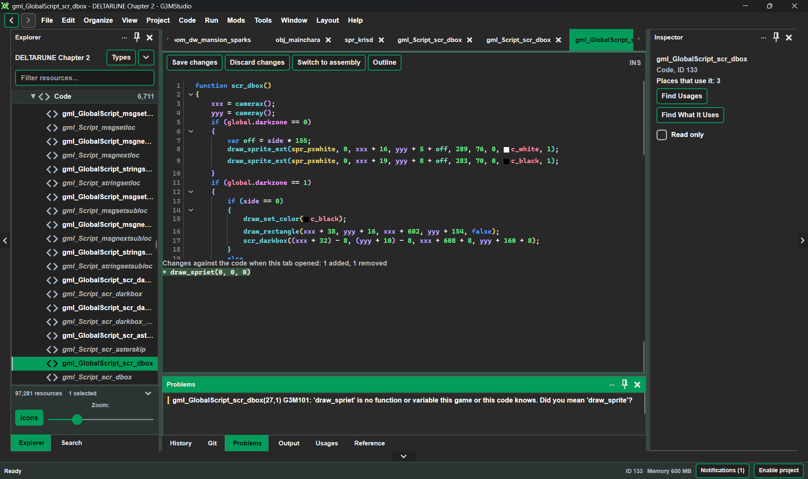

# Compare With Original

The changes panel of a code tab shows what you have changed in the entry since the tab opened. This page covers that panel, what "original" means, and where the comparison of whole data files lives.

## Show the changes

Run **Show Changes Against Original** from the **Code** menu or the command palette. It has no default key. Run it again to hide the panel.

The panel sits at the bottom of the tab, 200 px high. Its title reads "Changes against the code when this tab opened: {added} added, {removed} removed". Each line is one of:

| Prefix | Meaning | Background |
|---|---|---|
| `+ ` | A line that is in your text and was not there | green |
| `- ` | A line that was there and is gone | red |
| two spaces | An unchanged line | none |

The panel is read-only and updates 300 ms after you stop typing. It follows the code font and ligature options of the editor.

## What the original is

The original is the text the tab showed when it first loaded, after decompiling. It is not the saved file on disk and not the text before your last **Save changes**. Specifically:

- Saving does not reset it. After **Save changes** the panel still compares against the first text of the tab.
- Reloading the same text after an undo or redo keeps it.
- Switching between **Switch to assembly** and **Switch to GML** starts a new original, because the comparison is against the first text of the view you are in.
- Closing the tab and opening it again starts a new original.

To compare two data files (for example your edited file with the unmodified one), use **Mods > Compare Data Files**. Its **Code** tab shows the differences of each code entry as side by side or unified text, with the options **Ignore white space**, context lines and picture mode from **Settings > Data file comparison**. See [Compare Data Files](../projects/mod-packs.md).

## How lines are compared

Lines are compared as text after line endings are made the same. Equal lines at the start and end are cut off first. The middle is matched by the longest common subsequence. When the changed middle is very large (more than 4,000,000 table cells, for example two blocks of 2,000 lines that share almost nothing), every old line shows as removed and every new line as added.

## See also

- [Code Editor](code-editor.md)
- [Editor Shortcuts](editor-shortcuts.md)
- [Compare Data Files](../projects/mod-packs.md)
