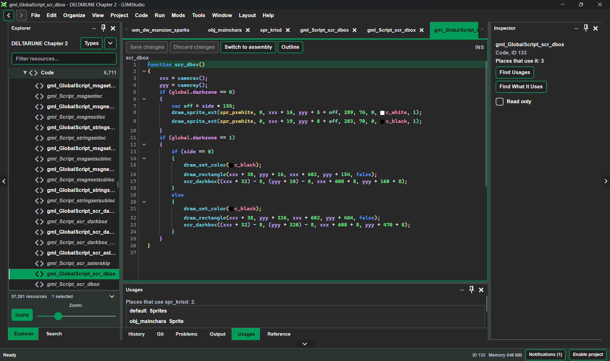

# Code Editor

The code editor shows one code entry of the data file as GML text and lets you change it. This page covers the tab layout, the buttons, how changes are saved, and the colours and gutter marks. Other pages describe the language help ([GML Intelligence](gml-intelligence.md)), the checks ([Code Checks and Lint Rules](lint-rules.md)) and every key ([Editor Shortcuts](editor-shortcuts.md)).

## Open a code entry

A code entry is one piece of GameMaker code: a script, an object event, a room creation code or a function inside another entry. See [Code Entries](code-entries.md) for what each GameMaker item maps to.

- Double-click a code entry in the Explorer, or press `Ctrl+P` and type its name.
- Press `F12` or `Ctrl+click` on a name in code to open the script or resource it names.
- Double-click a row in the Problems panel, the Usages panel or the Search panel to open the entry at that line.

The tab shows "Decompiling..." while G3MStudio turns the compiled bytecode back into GML. Decompiling runs in the background, so other tabs stay usable. If it fails, the tab shows the assembly instead (see [Code Entries](code-entries.md#assembly-view)).

## The tab

From top to bottom:

1. **Button bar.** **Save changes**, **Discard changes**, **Switch to assembly** (or **Switch to GML**), **Outline**, and a message area. On the right the typing mode shows `INS` (insert) or `OVR` (overwrite).
2. **Banner.** Appears when the tab shows assembly because the decompiler failed, or for a function inside another entry.
3. **Breadcrumb.** The functions, enums, macros and regions around the caret, outermost first, joined by `>`.
4. **Changes panel.** Hidden until you run **Show Changes Against Original** (see [Compare With Original](code-diff.md)).
5. **Editor.** Line numbers, bookmark gutter, fold arrows and the text.

### Buttons

| Button | What it does |
|---|---|
| **Save changes** | Compiles the text and writes it to the open data file as one undoable edit. Its tooltip reads "Save the code (shortcut)" with your current save key. It is disabled while nothing is pending. |
| **Discard changes** | Throws away what you typed and shows the code stored in the data file again. |
| **Switch to assembly** / **Switch to GML** | Shows the entry as VM assembly, or back as GML. Unsaved changes are saved first (tooltip: "Saves unsaved changes first"). If that save fails, the view does not switch. |
| **Outline** | Opens a list of the functions, enums, macros and regions of the entry. Choose one to move the caret there. An entry without any shows "No functions, enums or regions". The same list opens with **Go to Symbol in File** (`Ctrl+Shift+O`). |
| **Copy Details** | Appears next to an error message. Copies the message text. |

### Saving and undo

Typing changes only the text in the tab. Nothing reaches the data file until you save.

- Press **Save changes**, or press your save key (default `Ctrl+S`) while the caret is in the editor and changes are pending. With nothing pending, the key saves the data file as usual.
- The text must compile. If it does not, nothing changes, the problems appear in the Problems panel and as squiggles, and the message area shows the reason ("the text does not compile" when no better reason exists). A failed write reads "Could not save the code of 'entry': reason".
- A successful save is one step in the workspace history, so **Edit > Undo** and **Redo** take it back or repeat it.
- Typing inside the text has its own undo steps (**Undo** and **Redo** in the context menu). A line command such as **Move Line Up** is one editor undo step.
- When an undo, redo or rename reaches the data file, the tab shows the new text, unless you have unsaved typing. A tab that was hidden catches up when you show it again, with the same exception.

If the entry is locked in G3MStudio, the tab is read-only: typing and every editing command do nothing.

## Syntax colours

The editor tokenizes the whole text 300 ms after you stop typing. Between a key press and that pause, new text keeps the colour of the old text. Colours come from the theme and can be changed in **Settings > Colors**. Names are coloured by what they are:

| Colour name in Settings | Used for |
|---|---|
| Keyword | `if`, `var`, `function` and the like |
| Function | Functions of the game and of this file |
| Variable | Variables not declared in this entry |
| Local variable | Names declared with `var` or as parameters |
| Global variable | `global.` names and `globalvar` names |
| Constant | Macros and enum members |
| Asset | Names of sprites, objects, rooms and other resources |
| Built-in function | GameMaker's own functions |
| Built-in variable | GameMaker's own variables |
| Built-in constant | GameMaker's own constants |
| String, Number, Comment, Operator, Preprocessor | Literals, comments, operators, `#macro` and `#region` lines |
| Bracket level 1 to 3 | Brackets coloured by nesting depth |

The three built-in colours start out the same as the matching game colours, so nothing looks different until you pick other colours.

Hex colour literals (`$FF8800`, `0xFF8800`, `#FF8800`) and the `c_` colour constants get a small swatch in front of them. Hovering shows the value as `#RRGGBB` and as the GML number. GameMaker stores colours blue first (`$BBGGRR`), so `$0000FF` is red. Only six-digit hex numbers count as colours.

## Marks in the text

- **Bracket pair.** The bracket next to the caret and its partner are highlighted.
- **Same name.** Every use of the name at the caret is shaded, when it appears at least twice.
- **Indent guides.** Thin vertical lines at each indent level.
- **Squiggles.** Wavy underlines for problems. Hover to read the message. See [Code Checks and Lint Rules](lint-rules.md).
- **Bookmarks.** A dot in the gutter. Click the gutter to add or remove one, or use `Ctrl+F2`, then `Alt+F2` and `Alt+Shift+F2` to jump. Bookmarks follow edits and belong to the tab.
- **Folding.** Arrows in the gutter fold multi-line `{ }` blocks, `#region` blocks and multi-line `/* */` comments.
- **Plugin notes.** Plugins can add gray notes after lines. A note is only drawn: it is not in the text, so it is never saved, compiled, searched or copied. Notes refresh 350 ms after typing stops and when a plugin starts, stops or changes an option.

## Typing helpers

- Typing `(`, `[` or `{` adds the closing bracket when the next character is a closer, a space or the line end. Typing `"` or `'` adds the closing quote when the previous character is not a letter, digit or underscore and not the same quote.
- Typing a closing bracket or quote right before the same character steps over it.
- `Ctrl+Space` opens the completion list; see [GML Intelligence](gml-intelligence.md).

## Options

Set in **Settings > Code editor**. Every open editor follows a change at once.

| Option | Default | Range |
|---|---|---|
| Code font | Default (the theme's code font) | installed fonts |
| Text size | 13 px | 8 to 32 (also `Ctrl+mouse wheel` in a code view) |
| Wrap long lines | off | |
| Show line numbers | on | |
| Open the completion list while typing | on | |
| Show indentation guides | on | |
| Color brackets by nesting level | on | |
| Font ligatures in code | off | |
| Show syntax problems while typing | on | |
| Numbers that are assets (draw_sprite(5), sprite_index = 3) | Offer in the menu and by command | see [Replace Numbers with Asset Names](asset-numbers.md) |
| Tab width | 4 | 2 to 8 |
| Tooltip delay | 400 ms | 300 to 3000 (one setting for tooltips and the code info card) |

The live check skips entries longer than 200000 characters. Those are checked when you save.

## Context menu

Right-click in the text. The caret first moves to the name under the pointer.

1. When the pointer is on a number: the resources with that index (click one to open it), and for a colour value the colour name.
2. **Replace Numbers with Asset Names**, only when the option above is not "Do nothing" (see [Replace Numbers with Asset Names](asset-numbers.md)).
3. **Go to Definition**, **Peek Definition**, **Find Usages**, **Help on Name**.
4. **Rename Symbol**, **Quick Fix...**, **Toggle Line Comment**, **Tab In**, **Tab Out**.
5. **Undo**, **Redo**.
6. **Cut**, **Copy**, **Paste**, **Select All**.
7. The resource commands of the entry (rename, duplicate, copy name and the like).

Items are grayed out when they do not apply, for example editing commands in a read-only tab.

## The Code menu

The **Code** menu shows while a code tab is in front. It lists every code command in the order of [Editor Shortcuts](editor-shortcuts.md), with separators before Parameter Hints, Toggle Line Comment, Toggle Bookmark, Go to Symbol in File, Go to Line... and Delete Line. Every command can also be run from the command palette and rebound in the shortcuts settings.

## Troubleshooting

- **The tab is read-only.** The entry is locked in G3MStudio, or the text is still loading ("Decompiling...").
- **"Could not show the code of 'entry': reason".** Decompiling failed with an unexpected error. Use **Switch to assembly**, or reopen the tab.
- **Save changes does nothing and a message appears.** The text does not compile. Open the Problems panel and fix the errors.

## See also

- [GML Intelligence](gml-intelligence.md)
- [Editor Shortcuts](editor-shortcuts.md)
- [Code Checks and Lint Rules](lint-rules.md)
- [Find and Replace in Code](find-and-replace.md)
- [Code Entries](code-entries.md)
- [Guide: Edit a Script](guide-edit-script.md)
