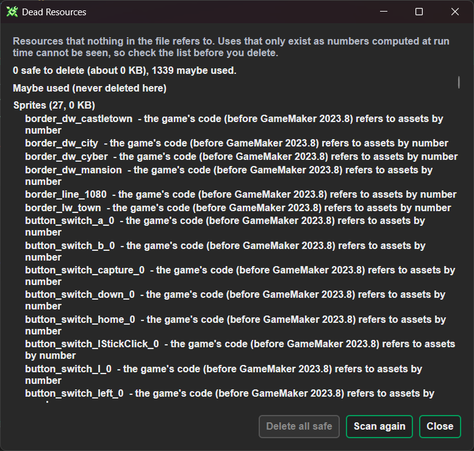

# Dead Resources

The Dead Resources window lists resources that nothing in the data file refers to, sorts them by how sure G3MStudio is, and deletes the safe ones in one step. Removing unused sprites, sounds and fonts makes the data file smaller.

## Open it

Choose **Organize > Find Dead Resources...** (needs an open data file). The window titled **Dead Resources** opens and scans at once. Text typed in code tabs is applied first, so the scan sees your latest code.

The window shows the hint: "Resources that nothing in the file refers to. Uses that only exist as numbers computed at run time cannot be seen, so check the list before you delete."

## What is scanned

The scan checks sprites, tile sets, sounds, paths, scripts, shaders, fonts, timelines, objects, rooms, sequences, animation curves and particle systems. A resource is listed when no other entry holds a reference to it. References inside the resource's own code (an object's event code, a script's own code) do not count as uses. A script is also kept off the list when any code calls its function.

## Safe and maybe used

The summary reads "{safe} safe to delete (about {size}), {maybe} maybe used." or "No dead resources found." Entries are in two sections, grouped by type with the count and size ("Sprites (4, 1.2 MB)").

**Safe to delete (uncheck to keep)** are resources with no sign of a use at run time. Each has a check box, all checked at first.

**Maybe used (never deleted here)** are resources with a hint that code or you use them in a way the index cannot see. The reason is shown next to each:

| Reason | Meaning |
|---|---|
| its name is a string in code | Code holds the exact name as text, for example for `asset_get_index`. |
| a string in code starts its name | A string literal of three or more characters is a prefix of the name. A literal of one or two characters counts only when code joins more text to it (`"s_" + name`). |
| global init script | The script runs when the game starts. |
| may be the default font | The first font in the file. |
| the game's code (before GameMaker 2023.8) refers to assets by number | In data files older than 2023.8 code names every asset by its number, which the index cannot tell from other numbers. In such a file no resource counts as safe. |
| has a nickname | You gave it a nickname. |
| has a tag | You tagged it. |
| is a favourite | You starred it. |

A resource used only by other dead resources is not found. Delete the dead ones and press **Scan again**.

## Delete

1. Uncheck anything you want to keep in the safe list.
2. Press **Delete all safe**. The question is titled "Delete {count} dead resources" and reads "Delete {count} resources that nothing uses?", then the count per type and "One Undo brings them back."
3. G3MStudio scans again first. A resource that is used or doubtful by now, or whose type cannot be deleted, is skipped and named after "Skipped {count}:" ("cannot be deleted here", "no longer certainly unused").
4. The deletion is one undo step, and tabs of deleted resources close. The result reads "Deleted {count} dead resources." or "Nothing was deleted."

Press **Scan again** after any change.

## Dead Resources versus Find Unreferenced Assets

**Edit > Find Unreferenced Assets** lists unused assets in the Usages panel without the safety sorting, and lets you exclude rows and delete the rest. The Dead Resources window is the safer tool. See [Find Usages](find-usages.md).

## See also

- [Find Usages](find-usages.md)
- [Replace Numbers with Asset Names](asset-numbers.md)
- [Code Entries](code-entries.md)
