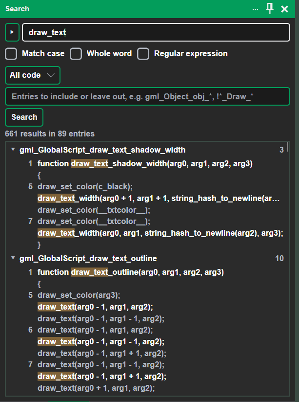
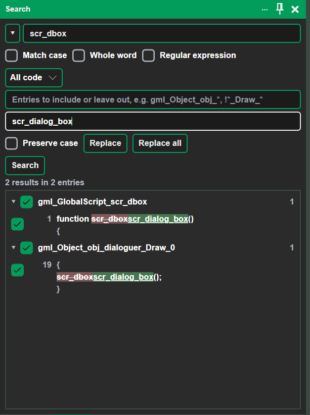

# Find and Replace in Code

G3MStudio has two searches for code. The find box inside a code tab searches that one entry. The Search panel searches every code entry of the data file and can replace text in many entries as one undoable step.

## Find in the open entry

Press `Ctrl+F` with a code tab in front. A find box opens at the top of the editor and the caret goes into it.

| Control | Shortcut | What it does |
|---|---|---|
| Find... box | | Type the text. Matches are marked in the text. |
| Match case | | Respect upper and lower case. |
| Match whole words | | Match only complete words. |
| Use regular expressions | | Read the text as a regular expression. |
| Find next | `F3` | Goes to the next match. |
| Find previous | `Shift+F3` | Goes to the previous match. |
| Switch between find and replace | | Shows or hides the Replace with... box. |
| Replace with... box | | The text that replaces a match. |
| Replace next | `Alt+R` | Replaces the current match. |
| Replace all | `Alt+A` | Replaces every match in the entry. |

The find box starts in replace mode. Replacing changes the text in the tab like typing does, so use **Save changes** to apply it, or the editor's undo to take it back. In a read-only tab nothing is replaced. The "n matches" counter is shown in English in every language.

`Ctrl+F` in other views opens the find box of that view (text files, shader sources and the like). With the focus in the Explorer, or when no code tab is in front, it moves to the Explorer filter instead.

## Search in all code

Open the **Search** panel with **Find in Code...** (`Ctrl+Shift+F`) or **Replace in Code...** (`Ctrl+Shift+H`). `Ctrl+Shift+F` puts the caret in the query box, `Ctrl+Shift+H` opens the replace box and puts the caret there. Both are in the **Edit** menu. If a word is selected on one line of the code tab in front, `Ctrl+Shift+F` puts it in the query box.

G3MStudio decompiles every top-level code entry (child functions are part of their parent's text) and lists the lines that match. Entries with unsaved typing in a tab are saved first, as **Save changes** does. Entries that cannot be decompiled are skipped and counted.

The panel keeps its query, options, scope, folded entries and the last 20 queries while it is hidden and shown again. Press `Up` or `Down` in the query box to walk through the recent queries. `Esc` in the query box clears it. A query joins the list when the query box loses the focus.

### Search while you type

The search starts about 120 ms after the last key and replaces the one that is still running. The status line reads "Searching... 120 of 5000 entries, 31 matches so far" and the list fills while it runs. At the end it reads "{hits} results in {entries} entries". You can turn this off in **Settings > Code editor** with **Search while typing in the Search panel** and search with `Enter` or **Search** instead. **Cancel** stops a running search ("Search cancelled.").

The regular expression matches one line at a time, so a pattern cannot span lines (`\n` never matches). An invalid regular expression shows its error under the query box at once and the list stays empty until the pattern parses. A pattern that runs longer than 1 second on a line stops with "The pattern takes too long on a line. Make it simpler."

### Options and scope

| Option | Default | Meaning |
|---|---|---|
| **Match case** | off | Case matters. |
| **Whole word** | off | The match must not touch a letter, digit or underscore. |
| **Regular expression** | off | The query is a .NET regular expression. |
| Scope list | **All code** | **All code**, **Current entry** (the code tab in front), **Selected entries** (code entries, or the objects, scripts and rooms selected in the Explorer), **Objects only** (`gml_Object_`), **Scripts only** (`gml_Script_` and `gml_GlobalScript_`), **Rooms only** (`gml_Room_` and `gml_RoomCC_`). |
| Entries box | empty | Name patterns separated by commas, semicolons or spaces. `*` and `?` are wildcards. A pattern without them matches part of a name. A leading `!` leaves matching entries out. Case does not matter. `Enter` in the box searches. |

Example: `gml_Object_obj_*, !*_Draw_*` searches the events of every object except Draw events.

### Read the results

Results are grouped by code entry. Each heading shows the entry name and its number of matches. Click a heading, or press `Enter` on it, to fold or unfold it. Folded headings stay folded when you type more of the query. Under a heading each row shows the line number and the line with the match in bold. A line with several matches is one row. A long line is cut to start a little before the first match, with an ellipsis. The lines above and below the match are shown dimmed, as many as **Settings > Code editor > Context lines in search results** says (0 to 3, default 1).

The list stops at **Most results listed** in the same section (500 to 100000, default 5000). The last row then reads "Showing the first 5000 results. Show more"; press it to list 5000 more.

- Double-click a row, or press `Enter`, to open the entry with the caret at the match and the match selected. It opens as a tab of its own, not as a preview.
- `Up` and `Down` move between rows. `Down` in the query box moves into the list, `Up` on the first row goes back to the query box. `Left` and `Right` fold and unfold a heading.
- `F4` and `Shift+F4` open the next and the previous match while the cursor is in the Search panel.
- Right-click a row for **Open**, **Copy** (the line as `entry(line)  text`) and **Copy all**.
- Hover a row to see the info card of the entry.
- Every open code tab marks the matches of the query in its text.

In low-memory mode the search decompiles one entry at a time, which is slower and uses less memory.

The first search decompiles every entry. The text is kept in a cache so the next search is fast. The cache shares its size with the decoded pictures and is limited by **Settings > Advanced > Cache limit** (default 128 MB, 16 to 65536). When the cache is full, older text is dropped and read again when needed, so a search is slower but never wrong.

### Replace in all code

1. Press the arrow left of the query box (**Show or hide Replace**, or `Ctrl+Shift+H`) to open the **Replace with** box.
2. Type the text to find, then the replacement. Every row now shows what would change: the old text struck out in red, the new text after it in green. Nothing is written yet. A plain search replaces the literal text. With **Regular expression**, group references such as `$1` or `\1` work in the replacement. **Preserve case** gives a replacement the case of what it replaces: `foo`, `Foo` and `FOO` become `bar`, `Bar` and `BAR`.
3. Uncheck the rows you want to keep. A check box on a heading checks or unchecks the whole entry.
4. **Replace** (or `Enter` in the replace box) changes the selected row (the first checked row when none is selected). **Replace all** (`Ctrl+Alt+Enter` in the replace box) asks "Replace {matches} matches in {entries} entries? One Undo takes them all back." and writes the checked rows when you press **Replace**.

Rows that were replaced leave the list. Rows you left unchecked stay, so you can go on with them.

Result line: "Replaced {lines} lines in {entries} entries. Undo takes it back in one step." One **Edit > Undo** takes back the whole replacement.

Two things are left alone and named in the status:

- "Left unchanged because they do not compile: {entries}." An entry whose new text does not compile is not changed. Every other entry is still written.
- "Skipped because the code changed since the preview: {entries}." A line that no longer reads as it did in the preview is skipped.

Example: to rename a state value, turn on **Whole word**, search `state_idle` and type `state_wait` as the replacement. The list shows 14 results in 6 entries. Uncheck the two rows in `gml_Object_obj_menu_Step_0`, press **Replace all** and confirm. Twelve lines change in 5 entries and the two unchecked rows stay in the list.

Preview before replacing in strings that code compares against (resource names, event names). A replacement does not know what a string means. For renaming a name safely, use [Rename Symbol](rename-symbol.md).

## Troubleshooting

- **"This pattern is not valid: reason".** The regular expression does not parse.
- **Nothing happens on Search.** The query box is empty or no data file is open.
- **A hit points at a line that looks different in the tab.** Search reads the decompiled text of the data file. Text you typed but did not save is applied first, but a decompile setting change can move lines.

## See also

- [Code Editor](code-editor.md)
- [Find Usages](find-usages.md)
- [Rename Symbol](rename-symbol.md)
- [Editor Shortcuts](editor-shortcuts.md)
