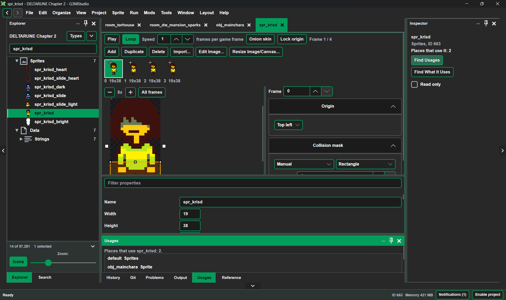

# Find Usages

Find Usages lists every place that refers to a name. It works from code (the name under the caret) and from the Explorer (the selected resource), and shows the result in the **Usages** panel. A related command lists what a resource itself uses.

## Commands

All are in the **Edit** menu and the command palette.

| Command | Default key | Result |
|---|---|---|
| **Find Usages** | `Shift+F12` | Every place that refers to the name or resource. |
| **Find What It Uses** | none | The assets the selected resource's own properties and code refer to. |
| **Find Unreferenced Assets** | none | The assets nothing in the file refers to. |
| **Find Child Objects** | none | The objects whose parent is the selected object. |

In a code tab, **Find Usages** is also in the context menu, and the **Function Reference** panel has a **Find Usages** button. The key works in a code tab for the name under the caret.

## From code

With the caret on a name, **Find Usages** does one of three things:

1. **A `var` local or a parameter.** The result is the uses inside the function around the caret (or in the code outside every function). Such a name belongs to that function alone, so other entries with the same name are not listed.
2. **A resource** (a name of an object, sprite, script, room, and so on, or its one-word nickname). The result is every place that refers to that resource: code and properties of other resources.
3. **Any other name** (a global, a variable, a function, an enum, a macro). The result is every code entry that uses the name as a name. Strings and comments are not matches.

Text you typed in code tabs is applied first, as **Save changes** does. When a tab's text does not compile, it is left out and the panel says "Unsaved text of {entry} does not compile and was left out of the search. The results show its saved state."

## The Usages panel

Open it from **View > Panels > Usages**. Every Find Usages, **Find What It Uses** and **Find Unreferenced Assets** run fills the same panel and does not open a second one. If you moved the panel to another dock, the result goes there. A panel in a folded dock opens that dock, a floating one comes to the front, and a closed one returns. See [Docking and layouts](../interface/docking-and-layouts.md#sizes-and-panels-that-moved). The status line shows one of:

- "Looking for uses of {name}..." then "Places that use {name}: {count}." or "{name} is not used anywhere."
- "Could not search for {name}: {reason}"
- for **Find What It Uses**: "Looking for what {name} uses...", then "Assets used by {name}: {count}. Double click one to open it." or "{name} does not use any asset."

An empty panel says "No usages to show yet. Use Find Usages on a resource."

Each row names the entry that holds the reference and how it is held: a property, or a kind of use in code with the line (`12: text of the line`). Double-click a row, or press `Enter`, to open the entry. For code, the use is selected in the text, on the line given or at the matching occurrence.

Resource usages come from the reverse reference index of the data file, so a use held only as a number is found too.
Example: right-click a sprite in the Explorer and choose **Find Usages**. The Usages panel shows "Places that use spr_coin: 7" and one row per place. Double-click a row to open the object or room that holds the reference.

## Find Unreferenced Assets

The panel lists every asset (sprites, objects, rooms, sounds and the other asset types) that no entry refers to: "Assets that are not used anywhere: {count}." or "No asset is unused." Some rows can be in use anyway: "Assets that the game finds by name while it runs (asset_get_index, a room started by name, the first room, an object created by name) can be listed here although they are in use. Exclude them before you remove anything."

For this list the panel shows two buttons:

| Button | What it does |
|---|---|
| **Exclude selected** | Takes the selected rows off the list. "Excluded rows come back with the next search." |
| **Delete selected** | Deletes the selected assets through the usual delete question. |

Select several rows with `Ctrl+click` and `Shift+click`. For a more careful list with reasons, use [Dead Resources](dead-resources.md).

## Find Child Objects

Lists the objects that name the selected object as their parent, in the Usages panel.

## See also

- [Rename Symbol](rename-symbol.md)
- [Dead Resources](dead-resources.md)
- [Code Editor](code-editor.md)
- [Find and Replace in Code](find-and-replace.md)
