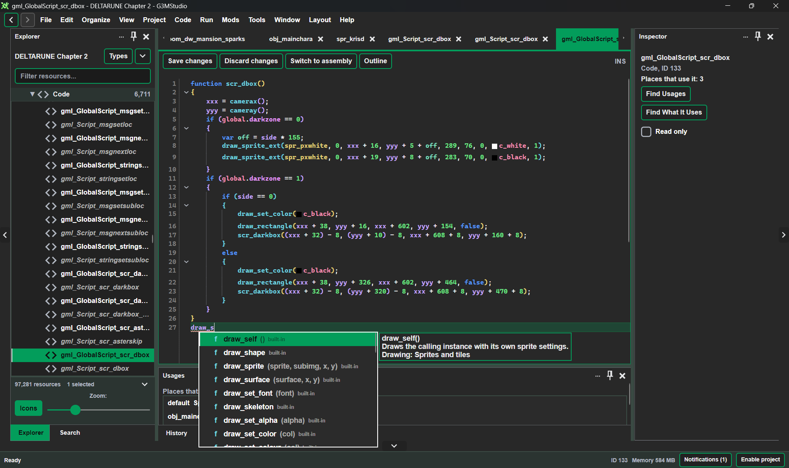

# GML Intelligence

GML is GameMaker's scripting language. This page covers the help the code editor gives while you write it: completion, parameter hints, hover cards, go to definition, peek, outline, snippets, quick fixes and the Function Reference panel. The help knows the built-in names of the GameMaker version of the open data file, the resources of the file, and the names its code declares.

## Completion

The completion list opens while you type, after two letters of a name, or after a dot. `Ctrl+Space` opens it at any time, also when **Open the completion list while typing** is off in **Settings > Code editor**.

What the list holds:

- Names the text itself declares come first: local variables and parameters, its functions, its macros and enums.
- Resources of the data file (scripts as functions, other resources as assets), then GameMaker's built-in functions, variables and constants.
- Keywords and the snippet names (`if`, `for`, `switch` and the others from [Snippets](#snippets)).
- Nicknames that are one word. Choosing one inserts the real name of its resource.

Names that start with what you typed come before names that contain it, and an exact-case match comes first. The list shows at most 200 entries. Typing a number, or starting with a digit, opens nothing.

Choosing a function inserts `name(param, param)` with one tab stop on each required parameter. Press `Tab` to move to the next parameter and `Shift+Tab` to go back. `Esc` ends the walk. Past the last stop, the caret goes after the closing bracket. A function with only optional parameters gets `name()` with the caret inside.

### After a dot

The list after a dot is a guess made from the text, because GML has no declared types:

| Left of the dot | The list shows |
|---|---|
| `global` | The globals the text uses |
| An enum of this text | The enum's members |
| A name made with `new Constructor(` | What that constructor assigns |
| A name that holds a struct literal | The struct's keys |
| An object name, `self` in an object's own code, a `with` block, or a variable set from `instance_create_layer`, `instance_create_depth`, `instance_find` and similar calls | The variables the object's Create code assigns (parents included), plus the built-in instance variables |
| Anything else | The built-in instance variables and every member name already used after a dot in the text |

## Parameter hints

Typing `(` or `,` inside a call shows a hint under the caret with the signature, the active parameter in bold, and a line with that parameter's type and meaning followed by what the function does. `Ctrl+Shift+Space` shows the hint on demand. The hint closes when the caret leaves the call.

The hint works for built-in functions, for scripts of the open file (parameter names are read from their code) and for functions declared in the same text. A `///` doc comment above a function in the text supplies the `@param` descriptions. Optional parameters appear in square brackets.

## Hover

Rest the pointer on a name (delay set by **Tooltip delay**, default 400 ms). The hover shows:

- The compiler message and code of a problem, when the pointer is on a squiggle.
- A colour literal: `#RRGGBB` and the GML number.
- For a `#macro` or enum of this text: its source line. For one declared in another entry: the declaring line and "defined in" the entry.
- For built-in names: the signature and return type, a one-line description, the category, and flags such as "deprecated" and "read only". For functions of the game: the signature, the documented parameters, "game function" and where it is defined.
- A plain classification when nothing else is known: "keyword", "local variable", "global variable", "variable", "asset", "built-in constant", "built-in variable". For a local, a global or a variable this text assigns, the card adds the type of the first value when it can be told from a literal (`real`, `string`, `bool`, `array`, `struct`, `function`, `undefined`, or a constructor name), the summary of a `///` comment above the line, "line {line} of this code" and the use count.
- For a resource name: the shared info card (kind, name or nickname, ID, picture) and under it how many times this code uses it ("N uses in this code").

Typing, scrolling or leaving the text closes the card.

## Go to Definition and Peek Definition

`F12` (or `Ctrl+click`) on a name:

- A local, a parameter, a `globalvar`, or a function, enum or macro declared in this text: the caret moves to the declaration.
- A script: opens its code in a tab. Another resource: opens its tab.
- A built-in name has no definition and nothing happens.

`Alt+F12` opens a read-only popup with the definition instead. For a function in another script, the popup shows that whole script scrolled so the definition is the first line. `Esc` closes it. The context menu entries **Go to Definition** and **Peek Definition** are grayed out when the name has no target.

## Outline and breadcrumb

**Go to Symbol in File** (`Ctrl+Shift+O`) and the **Outline** button list the functions, enums, macros and regions of the entry. Each row starts with its kind (Function, Enum, Macro, Region). The breadcrumb above the text shows the same blocks around the caret.

## Snippets

**Insert Snippet** (`Ctrl+J`) opens a list of templates at the caret. Each template keeps the indentation of the line it starts on, and the caret lands inside it.

| Name | Inserts |
|---|---|
| `if` | `if ()` with a block |
| `ifelse` | `if ()` and `else` blocks |
| `for` | `for (var i = 0; i < ; i++)` |
| `foreach array` | A `for` loop over `array_length()` |
| `while` | `while ()` |
| `repeat` | `repeat ()` |
| `switch` | `switch ()` with `case 0:` and `default:` |
| `with` | `with ()` |
| `function` | `function ()` |
| `trycatch` | `try`, and `catch (e)` with `show_debug_message(e.message);` |
| `enum` | `enum` with members `a` and `b` |
| `region` | `#region` and `#endregion` |

## Quick fixes

**Quick Fix...** (`Ctrl+.`, or the context menu) lists fixes for the name or problem at the caret. With no fix it shows "No quick fixes here". Fixes come from the code checks first, then from the name at the caret.

| Fix | When it appears | What it does |
|---|---|---|
| Change to 'name' | An unknown name close to a known one (up to three suggestions, at most two letters different) | Replaces the name |
| Declare 'name' as a local variable | An unknown name used outside a call | Adds `var name = 0;` above the statement |
| Make 'name' a global variable | Same | Writes `global.name` |
| Comment out this line | The line has a problem | Comments the line out |
| Change = to == | The assignment-in-condition check | Replaces the `=` |
| Remove the ; | The empty-body check | Deletes the `;` |
| Add new | The missing-`new` check | Writes `new ` before the constructor |

The fix list is built for the text as it was when the menu opened. If you edit while the menu is open, choosing an entry does nothing.

## Function Reference panel

The **Function Reference** panel (tab label **Reference**, open it from **View > Panels > Function Reference**) is a searchable copy of the bundled GML reference.

- **Search functions, variables, constants**: filter box. `Down` moves into the list, `Enter` inserts.
- Category box: **All categories**, **Favourites**, **Game functions**, then each category. **Only current file** keeps only names the code in front uses.
- The right side shows the title (signature and return type), description, category, flags and the parameters.
- **Insert** (or double-click, or `Enter`) puts the name with its parameters at the caret of the code tab in front.
- **Open in manual** opens the GameMaker manual page. It is disabled for game functions.
- **Find Usages** and **Go to Definition** (game functions only).
- **Add to favourites** and **Remove from favourites**: stars a function. Starred names are kept across games.

`Ctrl+F1` (**Help on Word Under Caret**) shows the word in the panel. **Open in Manual** (no default key) opens the manual page of the word, or the manual index when the word has no entry.

## Project symbols

Macros and enums declared in other code entries, `globalvar` names and names created by `variable_instance_set` and similar calls with a string literal are collected into an index in the background. The index is rebuilt after edits, and code checked before it was ready is checked again when it is done. This is why the check does not report such names as unknown. See [Go To and Project Symbols](project-symbols.md).

## See also

- [Code Editor](code-editor.md)
- [Code Checks and Lint Rules](lint-rules.md)
- [GML Language Support](gml-language.md)
- [Find Usages](find-usages.md)
- [Rename Symbol](rename-symbol.md)
