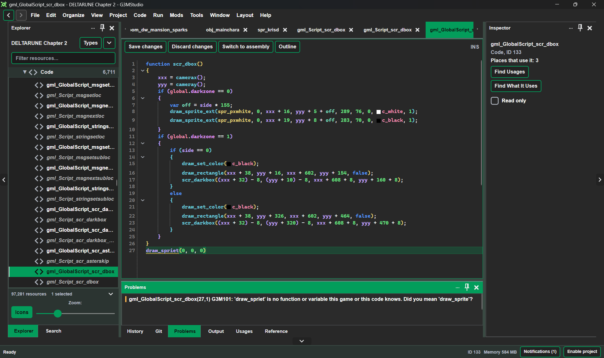

# Guide: Edit a Script

This guide changes a script, checks it and saves it. Expected result: the new code is in the open data file and one **Edit > Undo** reverts it.

To start from an empty script instead, choose **File > New > New Script...**, type a name and press **Create**. The box **Global script (runs at start, its functions can be called by name)** is checked by default (**Settings > Code editor** changes the default). A global script has the code entry `gml_GlobalScript_name`, and its functions can be called from any code by name. Then continue with step 2.

1. Press `Ctrl+P`, type `scr_move` and press `Enter`. The tab shows "Decompiling..." and then the code.
2. Click in the text and edit. Squiggles appear 400 ms after you stop typing if something is wrong; hover one to read it.
3. Press `Ctrl+Space` for completion, and `Ctrl+Shift+Space` inside a call for its parameters.
4. Press `F8` to jump to the next problem and fix it, or use `Ctrl+.` for a quick fix.
5. Press **Save changes** (or `Ctrl+S` in the editor). If the text does not compile, the message area says why and nothing changes.
6. Press `Ctrl+S` again with nothing pending to save the data file.
7. To see what you changed, run **Show Changes Against Original** from the **Code** menu.
8. To test it, press `F5` (**Run Game**). Output shows the lines the game writes.

## See also

- [Code Editor](code-editor.md)
- [Editor Shortcuts](editor-shortcuts.md)
- [Compare With Original](code-diff.md)
- [Find and Replace in Code](find-and-replace.md)
