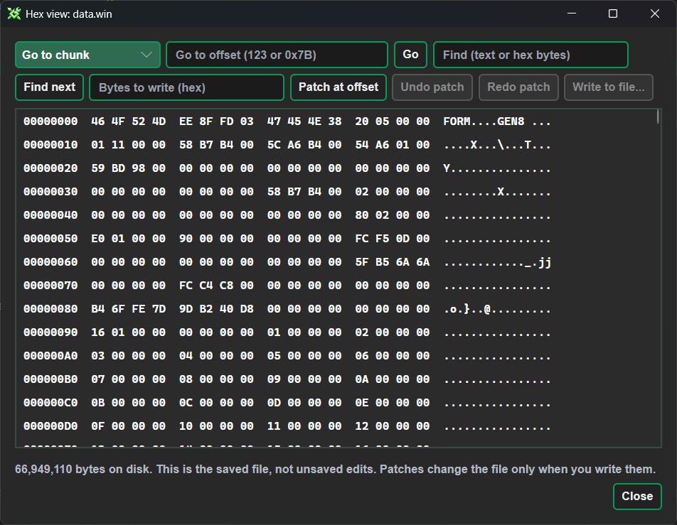

# Hex View and Raw Chunks

These tools work on the bytes of the data file on disk, below everything the editors show. The hex view reads and patches single bytes. The chunk commands export or replace a whole chunk, the named block that data files are made of. Use them only when no editor can do the job: a wrong byte can make the file unreadable.

A GameMaker data file (a `FORM` file) is a sequence of chunks such as `GEN8`, `STRG`, `CODE` or `TXTR`. Each chunk has a 4-letter name, a length and its data.

## Hex view

Choose **Tools > Hex View of Data File...** (needs an open data file that exists on disk). The window is titled "Hex view: {file}". It shows the saved file, not unsaved edits: "{bytes} bytes on disk. This is the saved file, not unsaved edits. Patches change the file only when you write them."

Each row holds 16 bytes: the offset in hex, the bytes in groups of four, and the same bytes as text with `.` for bytes that are not printable. The offset column is as wide as the file size needs. The file is read in blocks, so big files open at once.

### Move and search

| Control | What it does |
|---|---|
| **Go to chunk** | A list of the chunks with their offsets. Choose one to jump to its header. The list is empty for a file that is not a `FORM` file. |
| **Go to offset (123 or 0x7B)** | Type an offset as a decimal number or as `0x` and hex digits, then press `Enter` or **Go**. A bad entry shows "Enter an offset as a number or as 0x and hex digits." An offset past the end shows "Offset 0x{offset} is beyond the end (0x{end})." |
| **Find (text or hex bytes)** | Type text, or two or more hex byte pairs (`DE AD BE EF`, `DEADBEEF` or `0xDE 0xAD`). Text is searched as UTF-8. Press `Enter` or **Find next**. The result is "Found at 0x{offset}." or "No match for '{text}'." |

### Patch bytes

1. Go to the place you want to change.
2. Type the new bytes as hex pairs in **Bytes to write (hex)**.
3. Type the offset in **Go to offset (123 or 0x7B)**, then press **Patch at offset**. The bytes are written at that offset and the view scrolls there.
4. The message reads "{count} bytes patched, last at 0x{offset}. Not written yet."
5. **Undo patch** and **Redo patch** step through your patches.
6. **Write to file...** commits all patches to the file on disk.

A patch overwrites bytes only: the file never grows or shrinks. A patch that would pass the end of the file shows "Enter the bytes as hex pairs, and an offset that leaves room for them in the file." Each press of **Patch at offset** is one undo step.

**Write to file...** first asks "Write the patched bytes into {name}?" with "This writes raw bytes into the data file on disk." If you have unsaved changes it also warns: "You have unsaved changes. The file is loaded again after this write, so they are dropped. Save first if you are unsure." If G3MStudio is set to refuse risky actions, nothing is written. The old file is copied to `{file}.bak` first, replacing an older backup. Afterwards the data file is loaded again, and the message reads "Written to the file."

The view works only on the data file that is open. For another one: "The data file in use is no longer the one this action started with. Nothing was written."

## Write Chunk Offset Map

**Tools > Write Chunk Offset Map** writes a text file next to the data file named `{file}.offsetmap.txt` and reports "Written {file}." The file has one line per chunk: `0x` and the offset of the chunk header in 8 hex digits, the chunk name, and the length of its data in bytes. Only the chunk level is listed, not the items inside a chunk.

## Export Raw Chunk

**Tools > Export Raw Chunk...** saves the data of one chunk of the file on disk as a `.bin` file.

1. Choose the chunk ("Chunk of the data file on disk").
2. Choose where to save ("Save the chunk bytes as").
3. The result reads "Chunk {name} written to {file}."

The output must be a different file from the data file and its backup: "The output must be a different file from the data file and its backup." The file is written to a temporary name first, so a failed export leaves an existing file untouched. A file that is not a `FORM` file says "The file on disk has no chunks (it is not a FORM file)."

## Replace Chunk from File

**Tools > Replace Chunk from File...** puts the bytes of a file in place of one chunk of the data file on disk.

1. Choose the chunk.
2. Choose the file with the new chunk bytes.
3. Confirm "Replace chunk {name} with the file?" (and the unsaved changes warning, if any).
4. The result reads "Chunk {name} replaced from {file}. The file is loaded again."

The data file is loaded again after the write, and the edit history of the old bytes is set aside as a `.stale` journal file in the user data folder. If the file cannot be opened again, the message reads "The data file could not be opened again after the write. The backup {file} holds the file from before the write." The file from before the write is copied to `{file}.bak` first, replacing an older backup.

## Troubleshooting

- **The menu command does nothing.** The data file does not exist on disk (for example a new file that was never saved). Save it first.
- **The data file does not open after a patch.** Restore the `.bak` file next to it.

## See also

- [Debug Data](debug-data.md)
- [Code Entries](code-entries.md)
- [Strings Editor](strings-editor.md)
