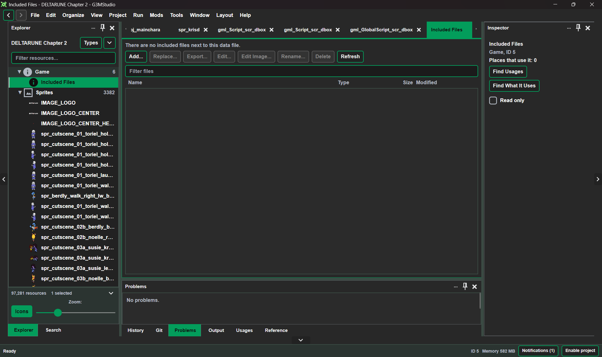

# Included Files

Included Files are the loose files that ship next to a game's data file: configuration files, JSON, extra pictures, audio, libraries. The Included Files view lists them and lets you add, replace, export, rename and delete them. These are changes to the game folder, not to the data file.

## Open it

Open **Included Files** in the Game group of the Explorer. It opens a tab with the folder view for the folder of the open data file (and all its sub folders).

## What is listed

Every file below the data file's folder, except:

- the data file itself and files whose name starts with the data file's name and a dot (backups and the like),
- audio group files (`audiogroupN.dat`),
- the temporary files G3MStudio makes (`.g3mtmp` files and `g3mstudio_run.tmp`),
- folders that are links, which could lead out of the game folder.

Rows are sorted by path. The summary line reads "{folder}: {count} files, {size} MB". When there are more than 10,000 files, only the first 10,000 are listed: "{folder}: showing the first {count} files, {size} MB". An unreadable folder is skipped.

| Column | Content |
|---|---|
| **Name** | Path relative to the folder, with `/` |
| **Type** | **Audio** (ogg, wav, mp3, flac), **Images** (png, jpg, jpeg, bmp, gif, webp), **JSON and text** (json, txt, xml, ini, csv, md, yaml, yml), **Libraries** (dll, so, dylib), **Other** |
| **Size** | In KB |
| **Modified** | `yyyy-MM-dd HH:mm` |

Type in **Filter files** to narrow the list. With no files the view says "There are no included files next to this data file."

## Buttons

Buttons that need a file are disabled until one is selected ("Select a file in the list first."). The file dialogs of **Add...**, **Replace...** and **Export...** open in the folder of the last pick (kept in `last-folder.txt` in the user data folder).

| Button | What it does |
|---|---|
| **Add...** | Copies the files you choose into the folder. "Added {added} files, skipped {skipped} that already exist." A file that cannot be copied is reported ("Could not copy: {files}"). |
| **Replace...** | Replaces the selected file with the content of a file you choose. |
| **Export...** | Saves a copy of the selected file where you choose. |
| **Edit...** | Opens the file in a tab of the editor that fits it: the image editor for PNG, JPG, JPEG, BMP and GIF, a text editor for the JSON and text types, the sound player for OGG, WAV and MP3. Any other file does nothing. Double-click a row does the same. |
| **Edit Image...** | Opens the image editor on the selected picture. Only for PNG, JPG, JPEG, BMP or GIF ("Select a picture file (PNG, JPG, BMP or GIF) in the list first."). |
| **Rename...** | Asks "New name for {name}" and renames within its folder. |
| **Delete** | Moves the file to the `trash` folder of G3MStudio's user data, into a sub folder named by the date and time. That folder is the way back. |
| **Refresh** | Reads the folder again. |

## Undo and risky changes

Changes here write straight to the game folder. They are not on the undo stack.

A **Rename** or **Delete** of a file that a sound or a string names is refused first with a warning (the risky action question, "Rename {name} anyway?" or "Delete {name} anyway?"). You can go on, or cancel. If G3MStudio is set to refuse risky actions, it refuses. Saving a text, picture or audio edit into the game folder asks "Write the text into the game folder?", "Write the picture into the game folder?" or "Write the audio into the game folder?".

Every path is checked to stay inside the game folder. A path that leaves it is refused: "'{path}' is outside the game folder and was not used."

## Related

- A sound that keeps its audio outside the data file shows "This sound keeps its audio outside the data file ({file})." Its audio file appears in this view.
- **Mods > Compare Data Files** and mod export packages treat included files separately. See [Projects](../projects/).

## See also

- [Strings Editor](strings-editor.md)
- [Hex View and Raw Chunks](hex-view.md)
- [Code Editor](code-editor.md)
