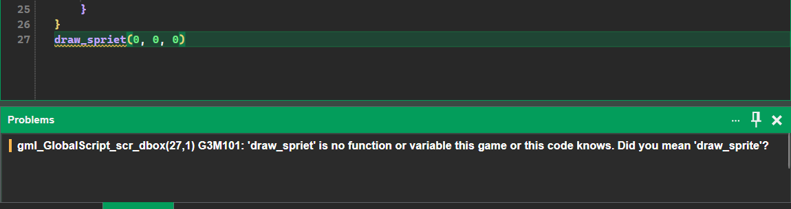

# Code Checks and Lint Rules

While you type, G3MStudio checks the code of the tab in front and marks problems with squiggles and rows in the Problems panel. This page explains when the checks run, what the Problems panel shows, and every check by its id and message.

## When checks run

- **Live check.** About 400 ms after the last key press, the text is parsed on a background thread. A key press cancels the run in flight, so typing never waits and a squiggle never lands on the wrong place. Turn it off in **Settings > Code editor** with **Show syntax problems while typing**.
- **Code check.** When the parse finds no error, the lint rules below run on the same text. On text the parser rejects they wait, because they read brackets and statements.
- **Compile on save.** **Save changes** compiles the text. Compile errors replace the live findings until the next edit. The warnings and hints come back after the usual pause.
- Entries longer than 200000 characters, and the assembly view, are not checked while typing.
- The check is also run again when the index of names from other entries finishes building, so a name declared in another script is not reported while the index is still loading.

The checks report only what they are sure of. A name they cannot judge is left alone.

## Squiggles and the Problems panel

A squiggle is coloured by severity, with the same colours as the bar in the panel: red for Error, the info colour for Info, the warning colour for everything else. Hover a squiggle to read its code and message.

Open the panel from **View > Panels > Problems**. Each row reads `entry(line,column) code: message`. Double-click, or press `Enter`, to open the entry at that position. A row hovers with the info card of its entry. Compile errors, code check findings and run errors (code `RUN`, from a game that crashed) appear here. A `RUN` row opens the code line the crash output names, or shows the **Output** panel when the output names none. The panel shows "No problems." when empty.

`F8` and `Shift+F8` move the caret to the next or previous problem of the entry in front.

## Rules

Warnings are for code that is almost certainly wrong. Info is for code that runs but is likely not what you meant.

| Id | Severity | Message | Notes |
|---|---|---|---|
| G3M101 | Warning | `'{name}' is no function or variable this game or this code knows.` | A call of an unknown name. Adds "Did you mean '{name}'?" when a close name exists (for the first 30 unknown names of a run). Quick fix: **Change to '{name}'**. |
| G3M102 | Warning | `'{name}' takes {expected} arguments, this call gives {count}.` | `{expected}` is a number, "{min} to {max}" or "at least {min}". Applies to built-in functions, and to functions of this text or other scripts when the least number of arguments is certain. A parameter with a default value, or one the body tests for `undefined`, is optional. |
| G3M103 | Warning | `'{name}' is read-only; it can not be assigned.` | Assignment to a read-only built-in variable or constant. |
| G3M104 | Warning | `'{name}' is set nowhere in this game or this code, so reading it fails.` | Reading an unknown variable. Adds the "Did you mean" part. |
| G3M105 | Info | `The local variable '{name}' is never read.` | A `var` that is only declared and written. A local named `_` is skipped. |
| G3M106 | Warning | `This code never runs: the code before it always leaves the block.` | Code after `return`, `exit`, `break`, `continue` or `throw` in the same block. |
| G3M107 | Info | `'{name}' is deprecated.` | A call of a deprecated built-in function. |
| G3M108 | Info | `= in a condition compares; write == to say so.` | In the condition of `if`, `while` or `until`. Quick fix: **Change = to ==**. |
| G3M109 | Warning | `{escape} is no escape sequence; write \\ for a backslash.` | A backslash before a character that is no escape (`"C:\new"` holds a line break). Only checked for GameMaker Studio 2 and later data. |
| G3M110 | Warning | `This ; ends the statement: its body is empty and the next line always runs.` | `if (...);`, and the same after `while`, `for`, `with` and `repeat`. Quick fix: **Remove the ;**. |
| G3M111 | Warning | `This case value is already used above, so this case never runs.` | Only single literals or names are compared. |
| G3M112 | Info | `Not every path through '{name}' returns a value; the others return undefined.` | A function that returns a value on some paths and can reach the end of its body. |
| G3M113 | Info | `'{name}' is read here before this code first sets it.` | Only in scripts. In events, another event may set the name first. A guard such as `variable_instance_exists(id, "hp")` suppresses it. |
| G3M114 | Info | `The parameter '{name}' is never used.` | Parameters that start with `_` are skipped, and so is a function whose body reads `argument0`, `argument1` and so on. |
| G3M115 | Info | `The local variable '{name}' hides the built-in function of the same name.` or `... the built-in variable of the same name.` | `var image_index` or `var draw_text`. |
| G3M116 | Warning | `'{name}' is a constructor: call it with new.` | Quick fix: **Add new**. |
| G3M117 | Info | `This compares a string with a number; convert one side with real() or string() first.` | Only literals and locals set from literals are judged. |

The id and message are shown in the Problems panel and the hover. Messages are translated like the rest of the interface. Names that are resources with a nickname show the nickname and the name behind it.

## What counts as known

A name is known when it is:

- built into GameMaker for the version of the data file (functions, variables, constants), or in the bundled reference,
- a resource of the file, a script, or a function or variable the compiled code of the game already uses, or a function of an extension,
- declared in the text (`var`, `globalvar`, `static`, a parameter, a function, a macro, an enum) or in another entry (macros, enums, globals, names made with `variable_instance_set` and similar calls),
- `true`, `false`, `undefined`, `noone`, `all`, `global`, `self`, `other`, `pi`, `infinity`, `NaN`, `constructor`, `argument`, `argument_count`, `argumentN`.

A script of the game with the same name as a built-in function is the game's own function: its calls are not judged by built-in rules. The format functions `string`, `show_debug_message`, `string_ext` and `show_debug_message_ext` accept any number of extra arguments.

## Troubleshooting

- **No squiggles appear.** The live check is off in **Settings > Code editor**, the entry is over 200000 characters, or the tab shows assembly. Save the entry to compile it.
- **A name from another script is reported as unknown for a moment.** Findings made before the symbol index is ready are checked again when it finishes.
- **A rule fires on a name set by another event.** G3M104 and G3M113 are about this code and the names the game uses. See [GML Language Support](gml-language.md).

## See also

- [Code Editor](code-editor.md)
- [GML Intelligence](gml-intelligence.md)
- [Rename Symbol](rename-symbol.md)
