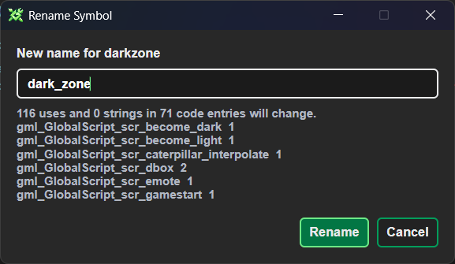

# Rename Symbol

Renaming in code has three forms: a local name inside one entry, a resource name, and a name used across all code. A fourth tool renames many resources by pattern. This page explains which form runs when you press `F2`, and what each one changes.

## Which rename runs

Put the caret on a name in a code tab and press `F2` (**Rename Symbol** in the context menu). G3MStudio picks the first form that fits:

1. **Local rename.** The name is declared in this entry with `var`, `static`, `globalvar` or as a parameter, and is not after a dot (`global.name` counts as the plain name). Only this entry changes.
2. **Resource rename.** The name is a resource of the data file (an object, sprite, script, room and so on). The usual resource rename window opens. See [Rename](../world/resources.md#rename).
3. **Rename across all code.** Any other name: a global, a variable, a function, an enum or a macro. Every code entry changes.

`F2` outside a code editor renames the resource selected in the Explorer. In a read-only tab, or with the caret on no name, nothing happens.

## Local rename

The window titled **Rename Symbol** asks for the new name and shows a preview line under the box: the warnings first, then "{count} places in this code will change. You can still rename."

The rename changes only the uses of that variable: a local belongs to its function, so a same-named local of another function stays. Strings and comments are never touched. A name that only the function itself declares is not mixed up with the instance or global variable of the same name used in other functions. The change is in the editor text, one undo step. Press **Save changes** to apply it to the data file.

Warnings (the rename can still go on):

| Warning | When |
|---|---|
| The new name is not a valid GML name. | Characters other than ASCII letters, digits, underscore, or a keyword. |
| The new name is the same as the old one. | |
| Another name in this code already uses the new name. Rename anyway? | The new name is declared or used here, or is a known built-in name or resource. |

"Nothing to rename." appears when nothing would change.

## Rename across all code

The same window opens for a name that is not local. It decompiles every entry that mentions the name and rewrites its tokens, and also string literals that are exactly the name (for example `variable_instance_get(id, "hp")`). Unsaved text in code tabs is saved first.

The warnings are the first three of the table above: invalid name, same name, and the name is already used (as a built-in name, a resource, or a name found in any code entry). The preview reads: "{uses} uses and {strings} strings in {entries} code entries will change." (or "Nothing to rename.") followed by up to six entries with their number of uses.

Uses after a dot (`other.name`, struct keys, enum members) are not renamed, because their owner is unknown. `global.name` and `self.name` are renamed (`self.name` only when the entry has no local of that name). The preview lists up to six of them as "{count} uses after a dot (other.name, structs, enums) are not renamed because their owner is unknown. Check them by hand:" with `entry:line` rows.

The rename is one undo step for all entries. If one entry does not compile after the change, the others are reverted and the reason is shown in the window.

## Rename Symbol versus Find in Code

A text replace in the Search panel does not know what a name is. Rename Symbol only touches uses of the name as a name. Use the Search panel only for plain text. See [Find and Replace in Code](find-and-replace.md).

## Rename with Pattern

**Organize > Rename with Pattern...** renames several selected resources at once. The window title reads "Rename {count} entries".

| Control | Meaning |
|---|---|
| **Rename mode** | **Add at the start**, **Add at the end**, **Replace text**, **Regular expression** |
| **Find** | The text or pattern to find. Enabled for **Replace text** and **Regular expression** only. |
| **Text** | The text to add or to put in place of each match. `$1` works in **Regular expression** mode. |
| **Names before and after** | The preview, `old  >  new` for each resource. |
| **Rename** | Applies every rename that can run, as one undo step. |

The summary reads "{count} will be renamed, {problems} cannot be, {same} stay the same." When no name can change, it reads "No name can be changed." After the rename: "Renamed {count} entries." A name that cannot be used shows its reason in brackets:

| Reason | Meaning |
|---|---|
| The pattern is not valid. | The regular expression does not parse, or ran longer than 200 ms. |
| The new name is empty. | |
| The new name has spaces or control characters. | |
| Two entries get this name. | |
| The name is already used. | Also when another rename of the batch gives that name up: such chains and swaps are refused. |

## See also

- [Code Editor](code-editor.md)
- [Find Usages](find-usages.md)
- [Find and Replace in Code](find-and-replace.md)
- [Editor Shortcuts](editor-shortcuts.md)
