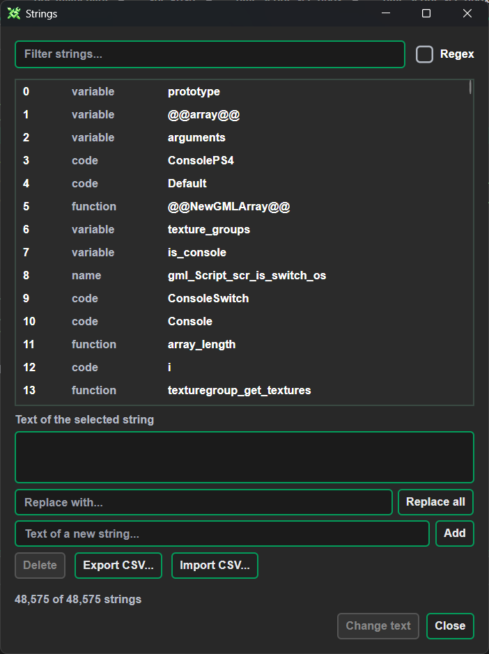

# Strings Editor

A GameMaker data file keeps one table of all text strings: the text in code, the names of resources, variable and function names. The Strings window lists that table, filters it, and lets you change, add, delete, export and import strings. Changing a string changes it everywhere it is used, in one step.

## Open it

Choose **Tools > Strings...** (needs an open data file). The window is titled **Strings**. It stays open while you work in the main window.

## Read the list

The box **Filter strings...** narrows the list as you type, ignoring case. Tick **Regex** to read the filter as a regular expression. An invalid expression shows "This is not a valid regular expression, so no string matches." A pattern that runs longer than 200 ms on one string stops the list there: "The pattern took too long on one string, so the list stops there. Use a simpler pattern."

The count under the list reads "{shown} of {total} strings".

Each row shows its number in the table, its kind and the text. The kind says what the string is used for:

| Kind | Meaning |
|---|---|
| name | A resource name |
| text | Text that code or a property uses as text |
| code | Code text |
| variable | A variable name |
| function | A function name |
| other | Something else |
| unused | No place uses the string |

The kind comes from an index of where each string is used. G3MStudio builds the index in the background, so for a moment the kind is only a guess: a string equal to the name of a resource is a name, the rest is text. In low-memory mode the index is never built. Delete then asks you to confirm every string.

Select a row to read the full text in the box **Text of the selected string**. Below it: "Places that use it: {count}. Changing the text changes all of them. To change one use only, edit that property in its own tab."

## Change a string

1. Select the row.
2. Edit the text in the **Text of the selected string** box.
3. Press **Change text**.

The change is one undo step and reaches every place that uses the string. When some of them are names or text that code compares against, a question appears: "{count} strings will change in every place that uses them, as one step." and "{risky} of them are resource names or text that code compares against. Changing those can break the game."

## Replace all

1. Type the text to find in **Filter strings...**.
2. Type the new text in **Replace with...**.
3. Press **Replace all**.

Replace all changes the strings that are shown. With an empty filter it says "Type the text to find in the filter first. Replace all changes the strings that are shown." The result reads "Text replaced in {count} strings, as one step." A string cannot take text that another string already has: "Left out because another string has the text already: {held}."

## Add and delete

- **Add**: type the text in **Text of a new string...** and press **Add**. An empty box says "Type the text of the new string in the box next to Add first." The result is "String added."
- **Delete**: removes the selected string. The result is "String deleted." Undo brings it back until you save.

A string that nothing uses is deleted at once. A string that is used, or whose use is not known yet, asks first: "Delete this string?" with "This string is used, or G3MStudio cannot tell yet whether anything uses it. Deleting it can break the game or the data file. Undo brings it back until you save." If G3MStudio is set to refuse risky actions, the string is not deleted: "G3MStudio is set to refuse risky actions, so this string was not deleted. Allow them in Settings, or change the text instead." The **Delete** tooltip tells what to expect: "Pick a string in the list first." with no row selected, "This string is used. Delete asks you to confirm first." for a used string, "The kind column is not ready yet, so G3MStudio cannot tell whether this string is used. Delete asks you to confirm first." while the index is building, and "Low-memory mode keeps the kind column off, so G3MStudio cannot tell whether this string is used. Delete asks you to confirm first." in low-memory mode.

## Export and import CSV

**Export CSV...** writes the strings that are shown, so a filter limits the export. The file has the header `index,text` and one row per string, with the text in quotes and doubled quotes inside. The default file name is `string_table.csv`. The file is written as UTF-8 with a byte order mark and an existing file stays whole until the new one is complete. The result reads "{count} strings written to {name}."

**Import CSV...** sets the text of strings by their number, as one undo step. The header line is optional, and a line that is not `number,text` is an error. Limit: a file larger than 64 MB is refused ("The CSV is too large to read (limit 64 MB)."). The result reads "Changed {count} strings, as one step. Numbers not in the table: {skipped}." Failures read "Could not import: {reason}" and "Could not export: {reason}".

The file dialogs open in the folder of the last file or folder you picked (kept in `last-folder.txt` in the user data folder).

Use export and import to translate or review a game's text outside G3MStudio. Keep the numbers: the number is what ties a row to a string.

## Other things in strings

Resource names and text in code also change when you rename the resource ("Also rename matching strings" in the rename window) or run **Rename Symbol** across all code. See [Rename Symbol](rename-symbol.md).

## See also

- [Rename Symbol](rename-symbol.md)
- [Find and Replace in Code](find-and-replace.md)
- [Included Files](included-files.md)
