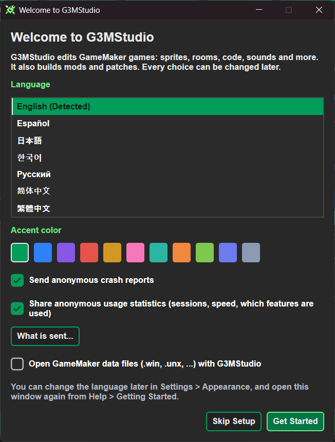
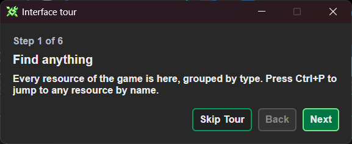

# First launch

On the first start G3MStudio opens a welcome window, then shows the Start page. This page covers the welcome window, the interface tour and how to open both again.

## The welcome window

The window is titled **Welcome to G3MStudio**. It appears until it has been closed once. The language of the operating system is chosen for you when G3MStudio has it, otherwise English (see [Languages](languages.md)).

| Control | What it does | Default |
| --- | --- | --- |
| **Language** | Shows the interface in the chosen language. The detected one is marked **Detected**. | Language of the system |
| **Accent color** | Sets the accent color of the interface. | The theme accent |
| **Send anonymous crash reports** | Allows a crash report after an error. | On |
| **Share anonymous usage statistics (sessions, speed, which features are used)** | Sends a usage summary per session. Only sent while crash reports are on. | On |
| **Open GameMaker data files (.win, .unx, ...) with G3MStudio** | Registers the data file types for your user. Shown on Windows and Linux only. | Off |
| **What is sent...** | Opens a window that lists what each switch sends. | |
| **Get Started** | Saves the answers and closes the window. | |
| **Skip Setup** | Closes the window. | |

Nothing is sent before the window is closed. The note under the controls reads: "You can change the language later in Settings > Appearance, and open this window again from Help > Getting Started."

A crash report holds the error text and stack, program and system facts, the commands and kind of tab in use, a few settings and format facts of the data file. File and folder names, resource names, and the game's code, strings and files are not sent. Both switches change later in **Settings > Privacy**.

## The interface tour

The tour is a series of steps, each pointing at one part of the window. Controls: **Back**, **Next**, **Done**, **Skip Tour**. The counter reads "Step {n} of {total}".

| Step title | What it says |
| --- | --- |
| Find anything | Every resource is in the Explorer, grouped by type. `Ctrl+P` jumps to a resource by name. |
| Open many things | A single click previews a resource in an italic tab. Edit it or double-click to keep it. |
| See what is selected | The Inspector shows type, name, how many places use it, and the layers of the room in front. |
| Every command is searchable | `Ctrl+Shift+P` searches every command. The menus show the shortcuts. |
| See what went wrong | Warnings and errors from loading, saving and compiling collect in the Problems panel. Double-click one to jump to it. |
| Safe saving, quick testing | Save writes a new file and keeps a backup. Run Game starts the game with your changes without touching the original. |

## Open them again

- **Help > Getting Started...** opens the welcome window.
- **Help > Interface Tour...** opens the tour.

## Restore the last session

When you start G3MStudio without a file and the last session had one open, a window asks "Open {name}, where you stopped last time?" with **Open it** and **Go to Home**.

## See also

- [Start page](start-page.md)
- [Opening a data file](opening-files.md)
- [Languages](languages.md)
