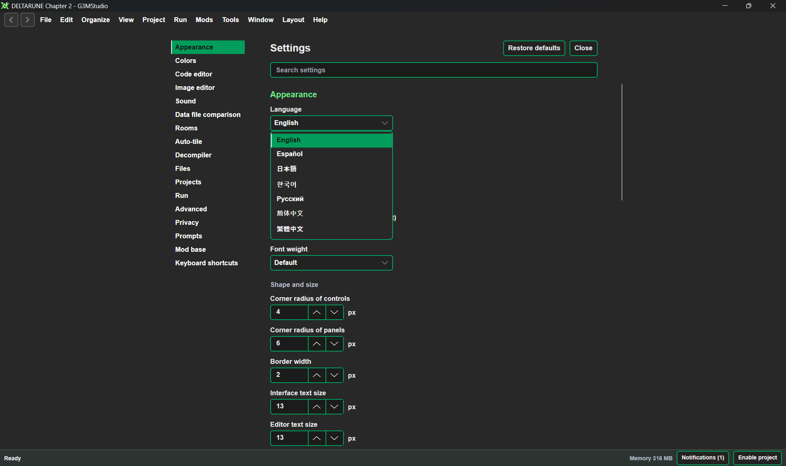

# Languages

G3MStudio ships seven interface languages inside the program. This page lists them and explains how the language is chosen and changed.

## Available languages

| Code | Name shown in the list |
| --- | --- |
| `en` | English |
| `ru` | Русский |
| `es` | Español |
| `ja` | 日本語 |
| `ko` | 한국어 |
| `zh_cn` | 简体中文 |
| `zh_tw` | 繁體中文 |

A missing text falls back to English. Plural forms follow the language: Russian has three forms, Japanese, Korean and Chinese one, the others two.

## How the first language is chosen

On the first start G3MStudio matches the operating system language to the list. Chinese is split by script or region: Traditional script and the regions TW, HK and MO give `zh_tw`, all other Chinese gives `zh_cn`. No match gives English. The welcome window shows the result as **Detected** and lets you change it (see [First launch](first-launch.md)).

## Change the language

Open **Settings > Appearance** and pick another language. The interface switches at once. The choice is saved in `settings.json` in the data folder (default `en`).

## See also

- [First launch](first-launch.md)
- [Data folder](user-data.md)
