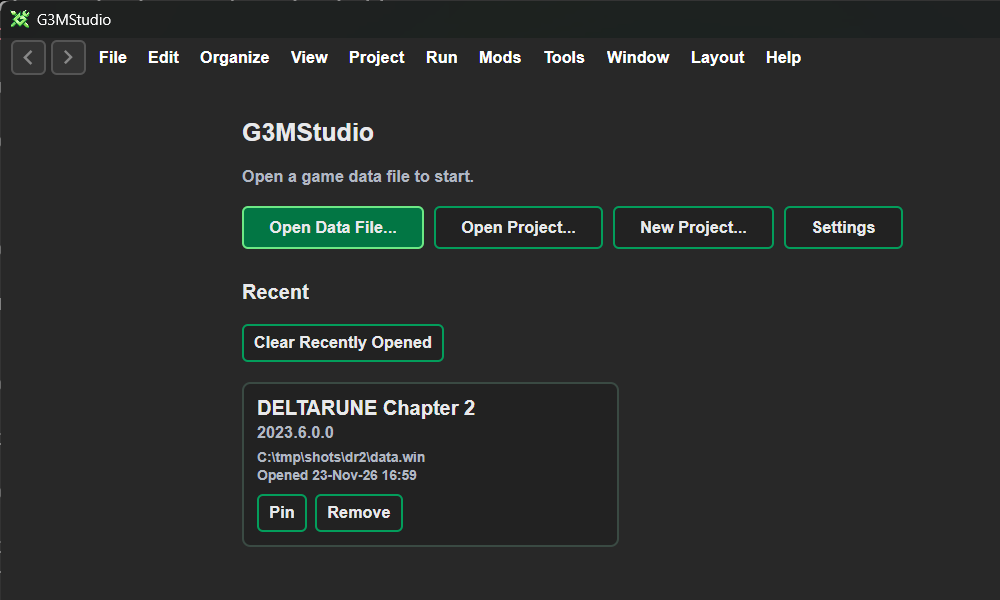

# Start page

The Start page is what G3MStudio shows when no data file is open. It holds four buttons and the list of recent files.

## Layout

| Element | What it does |
| --- | --- |
| Heading `G3MStudio` and the text "Open a game data file to start." | Title and hint. |
| **Open Data File...** | Opens the file picker (same as **File > Open**, `Ctrl+O`). |
| **Open Project...** | Opens a project folder (same as **Project > Open Project...**). See [The Project menu](../projects/project-menu.md). |
| **New Project...** | Asks you to pick a data file, then enables a project for it and asks for the projects folder (see **Project > New Project...** in [The Project menu](../projects/project-menu.md)). |
| **Settings** | Opens Settings. |
| **Recent** | Heading of the card list. |
| **Clear Recently Opened** | Empties the list. Shown only when the list has cards. |
| "No recent files." | Shown when the list is empty. |
| Drop box: "Drop a data file here to open it." | Shown only when the list is empty. Click it, or press `Enter` when it has focus, to choose a file. |

## Recent cards

Each card shows the file name, the game version text, the full path and "Opened {time}". Click anywhere on a card to open the file. Each card has two buttons:

| Button | Effect |
| --- | --- |
| **Pin** / **Unpin** | A pinned card stays in the list. Unpinned entries are capped (see below). |
| **Remove** | Removes the card from the list. The file stays on disk. |

A card whose file is gone shows the warning "File not found". Opening it starts the lost file flow (see [Opening a data file](opening-files.md)).

The list keeps at most 50 unpinned files. It is stored in `recent.json` in the data folder (see [Data folder](user-data.md)). The grid uses as many columns as fit the window width, with cards at least 272 pixels wide.

## See also

- [Opening a data file](opening-files.md)
- [First launch](first-launch.md)
