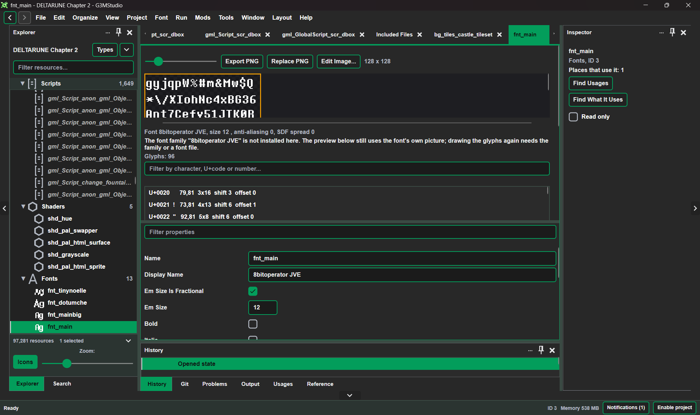

# Fonts

A font tab shows the font's sheet picture, its glyph list with editing tools, kerning pairs, a text preview and the command that draws the glyphs again from a font file. This page covers all of them.

A GameMaker font in a data file is a bitmap: one picture (the sheet) and a list of glyphs. Each glyph is a rectangle on the sheet plus how far it moves the pen (shift) and its offset. Kerning pairs adjust the space between a glyph and the next character.

## Font tab layout

1. The sheet viewer (150 pixels high, drag the handle under it to change the height) with a zoom slider, **Export PNG**, **Replace PNG** and **Edit Image...**. See [Textures and texture pages](textures.md).
2. A line with the font settings: `Font {family}, size {size} {style}, anti-aliasing {aa}, SDF spread {sdf}`. The style is `B` for bold, `I` for italic, both or nothing.
3. A warning when the family is not installed: `The font family "{family}" is not installed here. The preview below still uses the font's own picture; drawing the glyphs again needs the family or a font file.`
4. The glyph list (`Glyphs: {count}`) with a filter box.
5. The editing buttons and presets.
6. The preview.
7. The property list of the font.

## Glyph list

Each row reads `U+0041  A   x,y  WxH  shift {n} offset {n}` (character code, the character, sheet position, size, shift and offset). Selecting a row outlines its rectangle on the sheet, and a click on the sheet picks the glyph under it. The filter box (`Filter by character, U+code or number...`) accepts a character, `U+0041`, `0x41` or a decimal number.

A selected glyph opens its kerning pairs and a property list for its fields below the list.

The selected glyph is outlined on the sheet, and you can change its rectangle there. Drag the outline to move it, drag its bottom right corner to resize it, or click the sheet and press the arrow keys to move it by 1 pixel (`Shift` + arrow resizes by 1 pixel). Each gesture sets the four rectangle values as one undoable step. A rectangle the font cannot hold is refused with a message and the outline goes back.

## Add and remove glyphs

The box beside **Add glyph** (`U+code, character or range (A-Z)`) accepts a character from any script, `U+0041`, `0x41`, a decimal number or a range such as `A-Z`, `a..z` or `U+0410-U+044F`. Rules:

- A line under the box shows what the text means: one character, or the two ends and the length of a range. A glyph holds only U+0000 to U+FFFF. A single code above it shows `Too high: a font glyph holds only U+0000 to U+FFFF.` In a range, higher codes are skipped: `{count} characters above U+FFFF were skipped: a font glyph cannot hold them.`
- A bad entry shows `Not a character, code or range. Try A, U+0041, 0x41, 65 or A-Z.`
- A range holds at most 2048 characters: `Too long: a range holds at most {count} characters.`
- More than 20 glyphs ask first: `Add {count} glyphs to {font}?`

| Button | Meaning |
|---|---|
| **Add glyph** | Adds an empty glyph (no picture on the sheet yet) for each character that the font lacks. One undoable step. |
| **Remove** | Deletes the picked glyph. |
| **Delete range** | Deletes the glyphs that match the box. More than 20 ask `Delete {count} glyphs from {font}?` |
| **Edit glyph image** | Opens the [image editor](image-editor.md) on the glyph rectangle. Needs a picked glyph: `Select a glyph in the list first.` |
| **Replace from font file...** | See below. |

Preset buttons add an empty glyph for every character of the set that the font lacks:

| Button | Characters |
|---|---|
| **Normal** | U+0020 to U+007E |
| **Digits** | `0` to `9` |
| **Letters** | `A` to `Z` and `a` to `z` |
| **Cyrillic** | U+0400 to U+04FF |
| **Greek** | U+0370 to U+03FF |
| **Latin Extended** | U+00A0 to U+024F |
| **Hiragana** | U+3040 to U+309F |
| **Katakana** | U+30A0 to U+30FF |
| **CJK basics** | U+3000 to U+303F, U+FF00 to U+FFEF, U+4E00 to U+51FF |
| **Hangul basics** | U+3131 to U+3163, U+AC00 to U+B1FF |
| **Symbols** | U+2000 to U+206F, U+20A0 to U+20CF, U+2190 to U+21FF, U+2500 to U+25FF |

The same confirmation applies when a preset adds more than 20 glyphs. **Add from text...** shows a box (`Paste text: every distinct character in it gets a glyph`) and an **Add glyph** button.

Added glyphs are empty. Paint them with **Edit glyph image** or draw the whole sheet again with **Replace from font file...**.

## Kerning pairs

With a glyph picked, **Kerning pairs of this glyph** lists `U+code  char  shift`. Type the **Next character** and a **Shift** (a whole number, -32768 to 32767) and press **Set pair**. **Remove** deletes the picked pair. Each change is one undoable step. The character box accepts the same forms as above.

## Replace from font file

**Replace from font file...** (also **Replace Font File...** in the Font menu, command `edit.replaceFont`) draws every glyph the font already has again from a TrueType or OpenType file at the font's size. Set the size first in the property list (Em size).

1. Press the button and pick the file (`Pick a TrueType or OpenType font`). The **Font** menu, shown on a font tab, has the same command (next to **Edit Image...**).
2. Confirm: `Draw {name} again from {file} at size {size}? The glyphs are redrawn into the font's own texture. Undo restores the old one.` The question can be silenced with **Don't ask again** (prompt `Replace a font` in the prompts settings).
3. The result is `{name} was redrawn.`

Limits: the file must be a TrueType, OpenType or font collection file of at most 16 MiB (`This file is not a TrueType or OpenType font, or it is larger than 16 MiB.`). Each glyph is one sharp bitmap with no kerning and no signed distance field spread. The glyphs must fit the existing texture region: use a smaller size if not. A failure shows `The font could not be replaced: {reason}`. Memory pressure shows a memory notice.

## Text preview

The preview draws sample text from the font's own sheet, so it shows what the game shows. Controls: **Preview text:** box (default `The quick brown fox 0123456789`), **All glyphs** (fills the field with every character the font has, without control characters), **Background:** (**Chequer**, **Dark**, **Light**, **Green**), **Zoom:** (1x, 2x, 3x, 4x, 6x, 8x, default 2x), **Show glyph boxes**. Characters without a glyph are listed: `No glyph for: {characters}`. If the sheet is not available it says `The preview draws the glyphs from the font picture, which is not available here.`

## Add a font

**File** > **New** > **New Font...** makes a font with the family `Arial`, size 12, the range 32 to 127 and no glyphs. It also has no sheet picture yet, so **Replace from font file...** on it answers `The font could not be replaced: The font has no texture.` The reliable way to a new working font is to copy an existing one, because a copy owns its own sheet.

1. Select an existing font in the Explorer and choose **Edit** > **Duplicate Resource...**. Type `fnt_title` as the name of the copy and confirm.
2. Open `fnt_title`. In the property list set the size (**Em Size**).
3. If the font must show more characters, press a preset such as **Cyrillic** or **Greek**. A preset adds empty glyphs, and the redraw in the next step gives them pictures.
4. Press **Replace from font file...**, pick a `.ttf` or `.otf` file and confirm. The result is `fnt_title was redrawn.`
5. Check the **Preview text:** box. `No glyph for: {characters}` lists what is missing.
6. Use it in code: `draw_set_font(fnt_title); draw_text(16, 16, "Hello");`

The glyphs must fit the sheet of the font you copied. If the redraw says they do not, use a smaller size or copy a font with a larger sheet.

## See also

- [Image editor](image-editor.md)
- [Textures and texture pages](textures.md)
- [Image formats and limits](image-formats.md)
