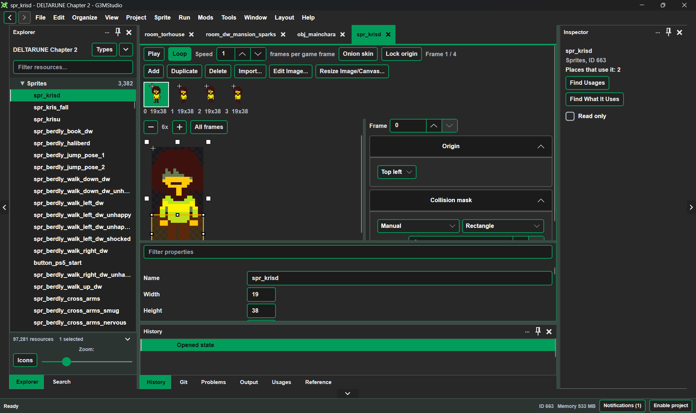

# Guide: import a sprite strip

This guide turns a PNG strip of 8 frames, saved as `spr_coin.png`, into a new sprite `spr_coin`. Result: a sprite with 8 frames that animates in the sprite editor and can be used by an object.

You need a PNG with the frames side by side in one row, all the same size. The sprite takes the file name as its name (other characters become `_`). A file named `spr_coin_strip8.png` starts the dialog as 8 frames in one row, but the sprite is then called `spr_coin_strip8`; rename it with `F2`.

## Steps

1. Right click the **Sprites** heading in the Explorer and choose **New Sprite from Sheet or Strip...**. The command is also in **File** > **Transfer Resources...** and the Command palette.
2. Pick the file (`Choose a sheet, strip or GIF`).
3. In **Import sheet or strip** choose **Cut by frame count**. Set **Columns** to 8 and **Rows** to 1. The summary reads `8 frames of {width} by {height} pixels.` Check that the width and height are what you drew. If not, switch to **Cut by frame size** and type **Frame width** and **Frame height**. Use **Offset X** and **Gap X** when the strip has a border or space between frames.
4. Press **OK**. The sprite `spr_coin` opens in its own tab.
5. Press **Play** above the frame strip to watch the animation. **Speed** changes how fast it runs.
6. Open the **Origin** list in the tools panel and pick **Center** (or drag the cross on the canvas) so the sprite turns around its middle.
7. Press `Ctrl+S` to save the data file.

## Add frames to a sprite you already have

1. Open the sprite and press **Import...** above the frame strip.
2. Pick the file and cut it as above.
3. The frames must have the size of the sprite. If they do not, tick **Replace the current frames and take the new size**. That drops the old frames and rebuilds the collision masks.

## Use it in an object

Open an object, press **Set...** in the **Sprite** row and pick `spr_coin`. See [Guide: make an object and place it in a room](../world/guide-object-in-room.md).

## If it goes wrong

- `The picture format is not supported. Use PNG, BMP, GIF, JPEG or WebP.` Save the picture in one of those formats.
- `The sprite is {width} by {height}. Tick Replace to take the new size.` The frames differ from the sprite you are adding to.
- Frames cut in the wrong places: change **Columns**, **Rows**, **Offset** and **Gap** until the summary matches your picture. A cell that does not lie fully inside the sheet is left out.

## See also

- [Sprite frames and import](sprite-frames.md)
- [Sprite editor](sprite-editor.md)
- [Image formats and limits](image-formats.md)
