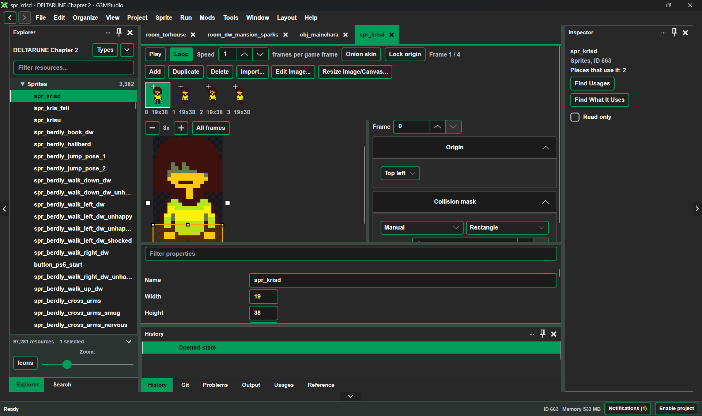

# Sprite editor

The sprite tab shows one frame of a sprite on a zoomable canvas with the origin cross, the collision box and the nine-slice guides, and a tools panel for the origin, the collision mask and the nine-slice borders. This page covers the canvas, the tools panel and the **Sprite** menu. Frames, playback, import and export are on [Sprite frames and import](sprite-frames.md).

A sprite is a list of frames plus an origin (the point that sits on the instance position), a collision mask (the pixels that collide) and a playback speed. Every change here is one undoable step.

## Layout

The tab has the frame strip and its buttons on top, then the canvas on the left and the tools panel on the right. When the tab is 900 pixels wide or less, the tools panel moves under the canvas and the whole tab scrolls. In the wide layout a splitter between canvas and panel changes the panel width (default 420 pixels, kept until you close the program). The canvas is never shorter than 260 pixels.

Above the canvas: a zoom out button, the zoom text (for example `4x`), a zoom in button and, for sprites with more than one frame, the **All frames** toggle. `Ctrl` with the mouse wheel zooms the canvas around the pointer, wherever the canvas is scrolled; the wheel alone scrolls, and a horizontal wheel or a touchpad swipe pans sideways.

Zoom is a whole number from 1x to 32x. Every zoom change (the buttons or `Ctrl` + wheel) is stored in your settings, so a sprite tab you open later, also in a later session, starts at that zoom (cut down when the sprite would not fit). Before you have ever zoomed, a tab starts at `256 / the longer side` of the sprite, between 1x and 16x. The canvas is limited to 8192 screen pixels on a side, so a large sprite cannot reach 32x. A sprite that grows (a resize or an undo) lowers the zoom if it no longer fits.

A hint under the canvas shows the handle keys: `Drag an edge or corner of the picture to change the canvas size. Shift keeps the aspect, Ctrl stretches the picture too, Esc cancels.` For sprites with several frames the hint adds the key that applies the resize to all frames (`Alt` by default).

## Canvas

| Item | How to use it |
|---|---|
| Origin cross | Drag it. The new origin is stored when you release the button. |
| Collision box | Eight handles (corners and edge middles) and a body. Drag a handle to resize and the body to move. The box stays inside the picture and is at least one pixel. Shown only in Manual mode (see below). |
| Nine-slice guides | Four dashed lines, shown when **Nine slice** is on. Drag a guide. Opposite guides never cross. |
| Outer handles | Handles outside the picture change the canvas size (see below). |
| `Esc` | Cancels a drag in progress. |

The origin, the box and the guides are drawn over the frame. With **Onion skin** on, the neighbouring frames are drawn faintly behind the current one.

### Change the canvas size with handles

Drag an outer handle to change the size of the sprite. The hint line shows `Canvas {w} x {h}`; with `Ctrl` it shows `Stretch {w} x {h}`. Modifiers:

| Modifier | Effect |
|---|---|
| `Shift` | Keeps the aspect ratio. |
| `Ctrl` | Stretches the picture with the canvas (Resize image). Without it only the canvas changes (Resize canvas). |
| `Alt` (default, see below) | Applies the new size to every frame. |
| `Esc` | Cancels. |

With the **All frames** toggle on, every drag applies to all frames. The key for all frames is **Alt** by default. It is stored with the Resize dialog choices and can be Alt, Control, Shift or Meta. A drag stops at 4096 pixels and the hint adds `, at the limit of 4096 pixels`. The result is one undoable step. If the texture pages cannot take the new size, the edit is refused with a notification and nothing changes. See [Resize and fit](resize-and-fit.md).

## Tools panel

### Frame

The **Frame** box picks the frame whose mask **Edit mask image...** opens. It follows the frame you click in the strip.

### Origin

The **Origin** list has nine presets: Top left, Top center, Top right, Middle left, Center, Middle right, Bottom left, Bottom center, Bottom right, and **Custom** (shown when the origin matches no preset). A preset sets the origin to `column * width / 2, row * height / 2` of the sprite. Drag the cross for any other position.

### Collision mask

| Control | Values |
|---|---|
| Mode (first list) | **Auto**, **Full image**, **Manual** |
| Shape (second list) | **Rectangle**, **Rotated rectangle**, **Ellipse**, **Diamond**, **Precise**, **Precise per frame** |
| **Tolerance** | 0 to 255. Pixels with alpha above this value count as solid. Not stored in the file: it starts at 0 each time the tab opens. |
| **Box left, top, right, bottom** | Four number boxes, 0 to 65535. Editable only in Manual mode; otherwise they show the box and are disabled with `Set the mask mode to Manual to edit the bounds.` |
| **Edit mask image...** | Opens the [image editor](image-editor.md) on the mask picture of the frame in the **Frame** box (white is solid). |

What the modes do:

- **Auto** finds the smallest box that holds every pixel above the tolerance in every frame. If no pixel is solid it uses the whole picture.
- **Full image** uses the whole picture.
- **Manual** keeps the box you set with the number boxes or the handles. Dragging the box on the canvas switches to Manual.

What the shapes do:

- **Rectangle** and **Rotated rectangle** store a rectangular box (the rotated type is a separation type of the file).
- **Ellipse** and **Diamond** are written as mask bits of the shape inside the box. The file itself stores them as a precise mask.
- **Precise** keeps only the solid pixels of the box, built from the first frame, in one shared mask.
- **Precise per frame** builds one mask per frame.

From GameMaker 2024.6 the stored mask covers only the box. Older files store a mask for the whole picture. Studio writes the right form for the file version.

The command **Recalculate Collision Mask** builds the masks again from the frame pictures with tolerance 0 (a pixel is solid above alpha 0). It keeps as many masks as the sprite had and changes only the mask bytes. **Import Mask...** and **Export Mask...** are described on the next page.

### Nine slice

**Nine slice** is a check box with four number boxes (left, top, right, bottom border, 0 to 65535) and five lists that set how each of the five parts is drawn: **Stretch**, **Repeat**, **Mirror**, **Blank repeat**, **Hide**. Nine-slice data needs a sprite saved in format version 3 or later opened from a project. Otherwise the controls are disabled with `Nine-slice needs a sprite saved in format version 3 or later, opened from a project.` A tab opened read-only says `This view is read-only. Open the item from a project to edit it.`

## Lock origin

**Lock origin** (button above the canvas, or **Lock Origin** in the Sprite menu) disables the **Origin X** and **Origin Y** rows in the property list. Their tooltip says `The origin is locked. Clear Lock origin in the sprite editor to change it.` The lock does not stop a drag of the cross on the canvas or the origin presets. Playback, zoom, onion skin, the frame and the lock are kept when the tab is rebuilt after a language change.

## Edit Image and Resize

- **Edit Image...** opens the [image editor](image-editor.md) on the selected frame.
- **Resize Image/Canvas...** opens the [Resize dialog](resize-and-fit.md) for the frame in view. Choose **Apply to** "all frames" there to resize every frame.

Both are disabled with `This sprite has no frames.` when the sprite has no frames.

## Sprite menu and commands

The **Sprite** menu appears when a sprite tab is in front. All of its commands are unbound by default; bind keys in Settings.

| Menu entry | Command id |
|---|---|
| Edit Image... | `edit.editImage` |
| Add Sprite Frame | `edit.addFrame` |
| Duplicate Sprite Frame | `edit.duplicateFrame` |
| Delete Sprite Frame | `edit.removeFrame` |
| Replace Sprite Frame... | `edit.replaceFrame` |
| Import Sheet or Strip... | `edit.importSheet` |
| Resize Image/Canvas... | `edit.resizeSprite` |
| Play or Pause Sprite | `edit.spritePlay` |
| Loop Sprite Playback | `edit.spriteLoop` |
| Onion Skin | `edit.spriteOnion` |
| Lock Origin | `edit.spriteLockOrigin` |
| Recalculate Collision Mask | `edit.recalculateMask` |
| Import Mask... | `edit.importMask` |
| Export Mask... | `edit.exportMask` |
| Export as GIF... | `edit.exportGif` |

Outside a sprite tab these commands report `Open a sprite and click the frame to replace.`

## Troubleshooting

| Message | Cause and fix |
|---|---|
| `This sprite has no frames.` | The sprite has an empty frame list. Add or import a frame first. |
| `Set the mask mode to Manual to edit the bounds.` | Choose **Manual** in the mode list. |
| `Delete the last frame of {name}?` | Deleting the only frame is a warned refusal that you may overrule. See the next page. |

## See also

- [Sprite frames and import](sprite-frames.md)
- [Image editor](image-editor.md)
- [Resize and fit](resize-and-fit.md)
- [Textures and texture pages](textures.md)
- [Image settings](image-settings.md)
