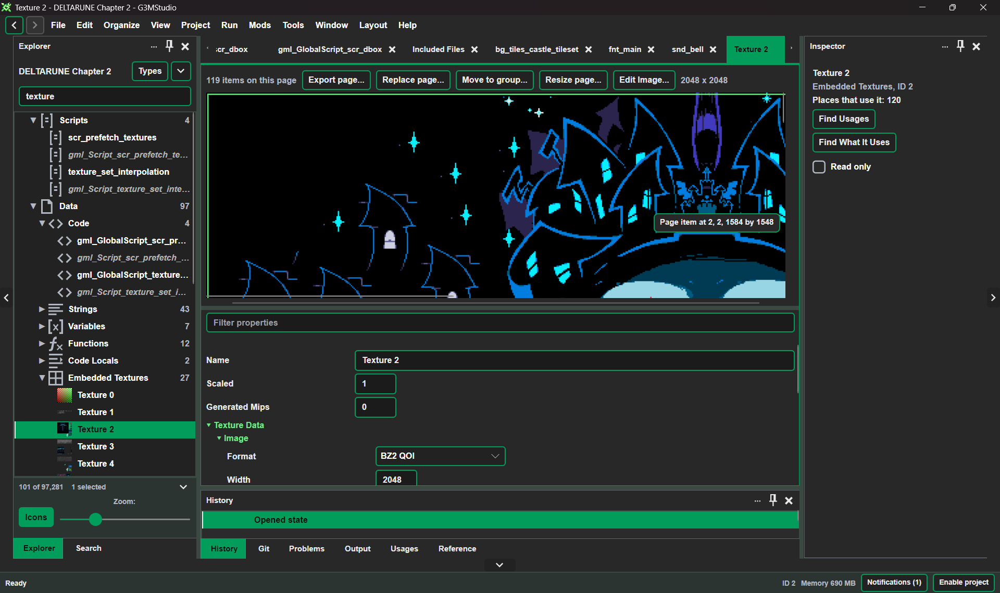

# Textures and texture pages

A texture page is one large picture inside the data file that holds many smaller pictures: sprite frames, tile sets, fonts and more. This page covers the page tab, page items, export and replace, resizing a page, repacking and texture groups.

Each small picture is a texture page item: a rectangle on a page, plus an offset inside the bounding box the game draws. Studio places the pictures you import when you save.

## Texture page tab

Open a page from **Embedded Textures** in the Explorer. The tab shows the page at its real size in a scroll view, with a chequer pattern behind transparent pixels, and the property list below. Above the picture:

| Control | Meaning |
|---|---|
| `{count} items on this page` | The number of page items on the page. |
| **Export page...** | Saves the page as a PNG (`Save the page as`). Message `Saved {page} to {path}.` |
| **Replace page...** | Asks for a PNG (`Choose a PNG of the page's size`). One undoable step. Message `Replaced the picture of {page}.` |
| **Move to group...** | Opens the Texture Groups window. |
| **Resize page...** | See [Resize and fit](resize-and-fit.md). |
| **Edit Image...** | Opens the [image editor](image-editor.md) on the page. A double click on the picture does the same. |
| Size | The page size, for example `2048 x 2048`. |

The picture fills the tab down to the splitter above the property list. Drag the splitter to give the properties more or less room.

### Moving around the page

| Action | Result |
|---|---|
| Hover | Outlines the page item under the pointer. The line is drawn just outside the item's pixels, so no pixel of the item is covered and none lies outside the line, at every zoom. The tooltip says `Page item at {x}, {y}, {width} by {height}`. Where items overlap, the smallest one wins. |
| Click an item | Opens that page item in its own tab. |
| `Ctrl` + wheel | Zooms in steps from 0.25x to 8x. The wheel alone scrolls. |
| Hold the pan button and drag | Moves the picture freely. While it is held nothing under the pointer reacts: no outline, no tooltip, no click. The pan button is the middle button; change it in [Image editor settings](../settings/image.md) (**Pan the view with**: middle, back or forward button). |
| Right click | The context menu has **Find Usages**. |

### Use an area of the page as a sprite

You do not need a new page for a sprite that lives on a page you already have. Pick an area of the page and use it as it is:

1. Hold `Shift` and drag over the pictures you want. The picked area is outlined with a dashed line and a small panel at the top right shows `Area {x}, {y}, {width} by {height}`. `Ctrl` + click on an item picks exactly that item.
2. Press one of the buttons in the panel:
   - **New sprite from area** makes a sprite named `spr_area` (a number is added when the name is taken) with the area as its only frame, and opens it.
   - **Add area to sprite...** asks for a sprite and adds the area as its last frame. The sprite must have the same size as the area, otherwise Studio says `The sprite is {sw} by {sh}, the area is {width} by {height}.`
   - **Make page item** only adds the page item.
   - **Clear selection** drops the pick.

No pixels are copied and no page is added: the new frame points at the rectangle you picked. If a page item already covers exactly that rectangle, it is reused. The whole action is one undoable step (`Use page area as frame` in the History list). If you later paint such a frame, Studio gives it its own picture first so the other users of those pixels stay as they are.

The same commands are in the **Tools** menu: **Export Texture Page...**, **Replace Texture Page...**, **Resize Texture Page...**. They act on the page selected in the Explorer. With none they say `Select a texture page first.`

A replacement picture of another size is a warned refusal: `Replace the page with a picture of another size?` The warning says that every sprite frame, glyph and tile on the page points at a rectangle on it, so another size can show the wrong part or nothing. You may overrule it. Undo brings the old picture back until you save.

A failed export or replace shows `'{name}' cannot be used: {reason}`.

## Page items, embedded images and fonts

A font, tile set, **Texture Page Items** entry or **Embedded Images** entry shows its picture in a viewer with a zoom slider (1x to 8x; `Ctrl` + wheel zooms too, at any scroll position) and the buttons **Export PNG**, **Replace PNG** and **Edit Image...**. The pan button drags the picture here too. The outline of a picked tile or glyph is drawn just outside its pixels, like the hover outline of a page. A **Texture Page Items** or **Embedded Images** tab fills the space above the property list the same way a page tab does.

Export asks for a file (default `texture.png`). The caption shows `Saved to {path}` or `Could not save: {reason}`. Replace asks for `Picture for {name}` and shows `Picture of {name} replaced.` If the item sits in a larger bounding box, the box is outlined and the picture is drawn where the game draws it.

## Texture groups

**Texture Groups...** (Tools menu) lists groups, their members and the target group. Pick members, choose **Move picked to** a group and press **Move**. The message is `Moved {count} to {group}.` Groups can be made (**New group**) and renamed (**Rename group**). A name that is not plain (letters, digits and underscores, not starting with a digit) asks `Use this name?` because GML code cannot use it. A data file without groups says `This data file has no groups.` A sprite can also change group in the Resize dialog.

## Repack texture pages

**Repack Texture Pages...** (Tools menu) plans a new packing of every texture group. The question shows page counts: `The pages of every texture group would go from {before} to {after}. This cannot be undone: save to keep it, or revert to the saved file. Repack now?` It needs a file without unsaved changes. Afterwards: `Repacked: pages went from {before} to {after}. Save to keep it, or revert to the saved file.` The question can be silenced with **Don't ask again** (see the prompts settings in `../settings/`).

## Unknown formats

`Textures in a format that cannot be shown: {count}. They are kept as they are when you save.` appears for textures the reader does not decode.

## See also

- [Resize and fit](resize-and-fit.md)
- [Image editor](image-editor.md)
- [Sprite frames and import](sprite-frames.md)
- [Image formats and limits](image-formats.md)
