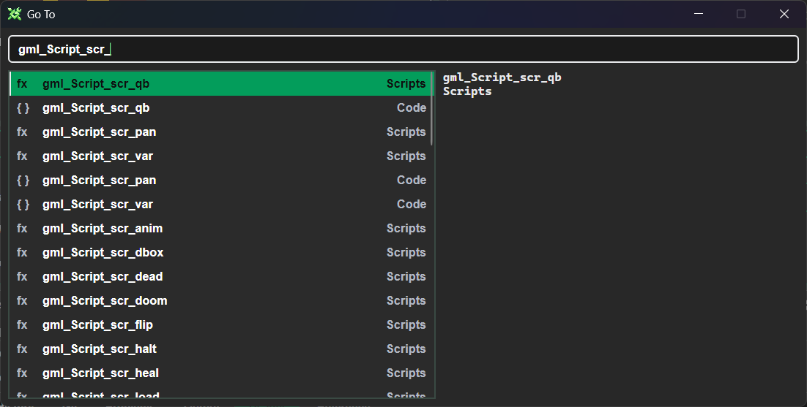

# Command palette and Go To

Go To is one search box that finds resources, code entries, strings, functions, variables, commands, settings pages and open tabs. The command palette is the same box opened with the `>` prefix typed. This page explains the three ways to open it, the prefixes and how results are ranked.

## Opening the box

| Command | Name | Shortcut | Result |
|---|---|---|---|
| `go.goTo` | Go to... | `Ctrl+T` | Empty box over everything. Needs an open data file. |
| `go.quickOpen` | Go to Resource... | `Ctrl+P` | Same box limited to resources and code entries. Needs an open data file. |
| `view.commandPalette` | Command Palette... | `Ctrl+Shift+P` | Box with `>` typed, window title "Commands". Works without an open data file. |

All three are also in the **View** menu. The window is 880 px wide, centred over the main window, and closes on `Escape`.

## Using the box

1. Type a name. Results update on every key.
2. Move with `Up` and `Down`. The selection wraps at both ends.
3. Press `Enter` (or double-click) to open the selected entry. Press `Shift+Enter` to open it in a split beside the tab in front.
4. The right half previews the selected entry (see below). The box shows the hint "Type a name. o: objects, @ symbols, # strings, > commands, t: tabs" until you type.

If the focus is in the result list, typing or `Backspace` goes back to the text box.

With nothing typed and no prefix, the list shows the recently opened entries: first what the Explorer lists under **Recent**, then the open tabs, latest first. With a prefix and no text, every entry of that kind is listed. At most 60 results show.

When nothing matches, the box shows "No results for '{text}'." and the prefix hint:

```text
Prefixes: o: objects, s: sprites, r: rooms, x: scripts, c: code, f: functions, v: variables, @ symbols, # strings, > commands, t: tabs, p: settings
```

## Go to Object and Go to Sprite

Two commands follow a link from what is in front to the resource it uses. They are not part of the search box above.

| Command | Name | Shortcut | Works when |
|---|---|---|---|
| `go.object` | Go to Object | `Ctrl+F12` | One instance is selected in the room in front. |
| `go.sprite` | Go to Sprite | `Alt+Shift+F12` | The thing in front shows a sprite or a tile set. |

They sit beside `F12` (Go to Definition), `Shift+F12` (Find Usages) and `Alt+F12` (Peek Definition) of the code editor.

**Go to Sprite** works on a selected room instance (the sprite of its object), a tile layer (its tile set), a background layer or sprite element (its sprite), an object tab and an object row in the Explorer. When there is nothing to go to, a toast says "Nothing here to go to."

Where to find them:

- The end of the **Edit** menu, and the command palette.
- The Inspector of a room tab: the buttons **Go to Object** and **Go to Sprite** appear next to the object box when exactly one instance is selected (see [Room instances and elements](../world/room-instances.md)).
- The right-click menu of the room canvas.
- The right-click menu of an object in the Explorer or on its tab: **Go to Sprite**, first item.

Example: open a room, click one instance and press `Ctrl+F12`. The object opens in a tab. Press `Alt+Shift+F12` there and its sprite opens.



## Prefixes

| Prefix | Narrows to |
|---|---|
| `>` | Commands |
| `@` | Functions and variables |
| `#` | Strings |
| `f:` | Functions and the built-in function reference |
| `v:` | Variables |
| `c:` | Code entries |
| `t:` | Open tabs |
| `p:` | Settings pages |

A resource type prefix, written as `prefix:text`, narrows to resources of one type. Both the short and the long forms work, and they match the Explorer filter prefixes.

| Type | Prefixes |
|---|---|
| Objects | `o:` `obj:` |
| Sprites | `s:` `spr:` |
| Rooms | `r:` `room:` |
| Scripts | `x:` `scr:` |
| Sounds | `a:` `snd:` |
| Fonts | `n:` `fnt:` |
| Shaders | `shd:` |
| Timelines | `tl:` |
| Sequences | `seq:` |
| Animation Curves | `curve:` |
| Particle Systems | `ps:` |
| Paths | `path:` |
| Tile Sets | `bg:` |
| Extensions | `ext:` |

Prefixes are not case sensitive. Text after the prefix is trimmed.

## What is searched

- **Resources** and **code entries** show their nickname when they have one. The real name matches too.
- **Commands**: only commands that work right now. A panel command is named "Show {panel}" and an image editor command carries its menu path, for example "Image > Selection > Copy". A command with extra search text also matches that text: **Apply Patch...** matches "Apply Patch to the Current Data File, Save Patched Data File as New", **Apply Mod...** the same with "Mod", and **Run Script...** matches "Run Script from the Scripts Folder, Run Script File".
- **Settings** pages: Appearance, Colors, Code editor, Image editor, Sound, Data file comparison, Rooms, Auto-tile, Decompiler, Files, Projects, Run, Advanced, Privacy, Prompts, Mod base, Keyboard shortcuts. Choosing one opens that page.
- **Tabs**: the open editor tabs.
- **Reference**: the built-in functions and variables with a one-line description. Choosing one opens the **Function Reference** panel on it.

Strings, functions, variables and reference entries are large lists. Without a prefix they appear only after two letters are typed, and they come after the names of resources, commands and tabs.

## Ranking

The text is matched against each name without regard to case. The score, best first:

1. Exact match.
2. The name starts with the text (shorter names rank higher).
3. The text appears inside the name (higher at a word start, and nearer the start).
4. The letters appear in order (higher when close together and on word starts).

Word starts follow `_`, `-`, space, `.`, `/`, `:` or a change from lower to upper case. Ties go to the entry used most recently, then to the kind, then to the name.

## Result rows and preview

Each row has a two-letter mark for resources and code (`{ }` code, `fx` script, `ob` object, `sp` sprite, `rm` room, `sn` sound, otherwise the first two letters of the type), the name, and on the right the kind or type plus a detail (the shortcut of a command, the description of a reference entry). Hover a row for the full text and, for resources, a [hover card](explorer-hover-cards.md).

The preview shows:

| Entry | Preview |
|---|---|
| Resource | Name and type, plus a picture up to 128 by 128 px when it has one |
| Code entry | The first 40 lines of the decompiled code |
| String | The text, cut at 600 characters |
| Command | Name and shortcut |
| Function or variable of the data file | Name and the word Functions or Variables |
| Reference entry | Name and description |
| Settings page | Its name |
| Open tab | Name and type, or the decompiled code for a code tab |

## Troubleshooting

- **Ctrl+T does nothing.** No data file is open. Open a file, or use `Ctrl+Shift+P` for commands.
- **A command is missing from the palette.** Its condition is not met (see the **Works when** column in the [Command reference](command-reference.md)).
- **A string or function does not appear.** Type two letters, or use `#`, `@`, `f:` or `v:`.

## See also

- [Command reference](command-reference.md)
- [Explorer](explorer.md)
- [Menus](menus.md)
