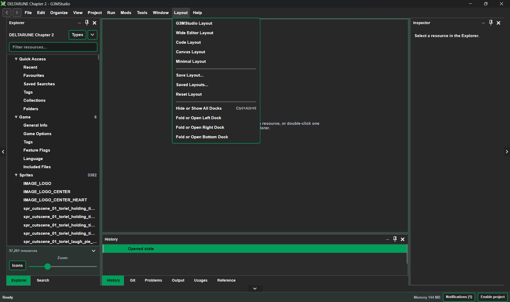

# Docking and layouts

The work area is built from three tool docks (left, right, bottom) around the editor area. Panels live in the tool docks, editor tabs live in the editor area. This page explains how to move, fold, float and close panels, the built-in layouts, and how to save your own.

## Default arrangement

| Dock | Panels (tab order) | Share of the width or height |
|---|---|---|
| Left | Explorer, Search | 19 percent of the width |
| Centre | Editor area above the bottom dock | the rest |
| Right | Inspector | 19 percent of the width |
| Bottom | History, Git, Problems, Output, Usages, Reference | 18 percent of the height, under the centre only |

The side docks run the full height. If the window is shorter than 700 px at the first start the bottom dock starts folded. A layout you saved is never changed by this rule. The state of the layout is saved with each data file's view state and comes back when you reopen the file.

## Panels

Each panel has a header with a title and buttons:

| Button | Tooltip | Action |
|---|---|---|
| Pin | "Unpin: auto-hide this panel to the side" or "Pin: keep this panel docked" | Switches between docked and auto-hide. An auto-hidden panel shows as a button at the edge and slides out when you press it ("Show this panel"). |
| Menu (three dots) | "More options" | Opens the panel menu. |
| Close | "Close panel" | Removes the panel from the layout. |

The panel menu has: **Float**, **Dock**, **Dock as tab**, **Auto hide**, **Move to** (**Left dock**, **Right dock**, **Bottom dock**), **Close**. For a floating panel **Dock** puts it back at its old place.

Panels can also be dragged by their header or tab onto the markers that appear over a dock. A panel is never narrower than 160 px; a smaller space scrolls it. The Function Reference needs at least 360 by 220 px. A bottom dock is at least 140 px high. A floating panel window is at least 320 by 220 px.

### Sizes and panels that moved

The size of each side dock is remembered. A dock that loses its last panel and returns later comes back at the size it had, and so does a panel that returns from auto-hide. Folding a dock keeps its size for opening again. A panel that floats again opens at the size and place its window had when you last closed it. This is kept while G3MStudio runs, not after a restart. A panel that floats for the first time opens at the size of the dock it left.

Commands that fill a panel, such as **Find Usages** or **Find in Code**, show the panel wherever it is now. A panel in a folded dock opens that dock. A floating panel comes to the front. A panel in auto-hide or closed returns. A panel you moved to another dock is used there, not added a second time.

### Showing a panel again

**View > Panels > {panel}** shows a panel that was closed. A panel missing from the layout (closed, or from a layout saved before it existed) is added to the bottom dock; **Open Editors** is added to the left dock. **Layout > Reset Layout** brings all back.

### Floating

Choose **Float** in the panel menu, or drag a panel out of the window. A floating panel is a window of its own. It has the same menu, so you can dock it or move it to a side dock. Closing the floating window returns its panels to their old place. A floating window that no longer holds a panel closes itself.

## Folding the docks

A fold gives a dock a share of 0 and keeps its old share for opening again.

- The chevron strips at the left, right and bottom edge of the work area fold or open that dock. The tooltip shows the command and its key: **Fold or Open Left Dock**, **Fold or Open Right Dock**, **Fold or Open Bottom Dock**.
- **Layout > Hide or Show All Docks** (`Ctrl+Alt+H`) folds all docks while any dock is open, and opens all docks when every dock is folded.
- **Window > Show All Windows** opens every dock and every panel.

The chevron points to where the dock goes when it folds, and back to the edge when it is folded.

## Layouts menu

| Item | Result |
|---|---|
| **G3MStudio Layout** | The default arrangement. Same as **Reset Layout**. |
| **Wide Editor Layout** | Slim side docks (12 percent each) and a bottom dock of 16 percent. |
| **Code Layout** | Left 18 percent, right 14 percent, bottom 28 percent. The bottom dock starts on Problems. |
| **Canvas Layout** | Left 13 percent, right 15 percent, bottom 10 percent, for rooms and sprites. |
| **Minimal Layout** | Left 15 percent. The right and bottom docks are folded. |
| **Save Layout...** | Asks for a name and saves the current arrangement. |
| **Saved Layouts...** | Opens the **Saved layouts** window. |
| **Reset Layout** | Back to the default arrangement. Every panel returns. |
| **Hide or Show All Docks**, **Fold or Open Left Dock**, **Fold or Open Right Dock**, **Fold or Open Bottom Dock** | See above. |
| **Move Editor Tabs** | Steps the **Settings > Appearance > Editor tabs** choice one further: along the top, list at the left, list at the right, and back to the top. |

Every preset keeps every panel and keeps the open editor tabs. A preset does not add **Open Editors**, but it keeps that panel when it is open. These items need an open data file.

### Saved layouts

**Layout > Save Layout...** opens the **Save current layout** window with **Layout name**. Press **Save**. A name has 1 to 60 characters and cannot be one of the built-in names (`studio`, `wide`, `code`, `canvas`, `minimal`). Saving under an existing name replaces it. A refused name shows: "Use a name of 1 to 60 characters that is not a built-in layout name and not taken."

**Layout > Saved Layouts...** opens **Saved layouts**:

| Control | Function |
|---|---|
| List | The saved layouts, sorted by name. Double-click loads one. |
| **Load** | Applies the layout. Panels move, open editors stay. |
| **Rename** | Asks for a new name (same rules; a name already taken is refused). |
| **Delete** | Removes the layout. |
| **Layout name** and **Save current layout** | Saves the current arrangement under a name. `Enter` in the box saves. |

An empty list says "No saved layouts yet." A layout that cannot be read shows "The saved layout could not be read." Saved layouts are stored in the settings, not per data file.

## Editor groups

The editor area can hold up to 4 groups of tabs side by side. **Split Right** (`Ctrl+\`) moves the tab into a new group at the right. It does nothing when the group has only one tab or 4 groups exist. Drop a tab on a dock marker to split, or on the empty part of a tab strip to join that group. See [Tabs](tabs.md).

The tabs of the editor groups sit along the top by default. **Settings > Appearance > Editor tabs** can show them as a list at the left or right of the editor instead, one tab per row, with a width set in **Width of the tab list**. **Show a picture in editor tabs** adds a small picture of the resource to each tab, in both layouts. The choice applies to every group, also to groups made later. For tabs anywhere in the layout, open the **Open Editors** panel (see [Panels](panels.md)): it lists the tabs, can sit in any dock or float, and can hide the tab strips. See [Appearance settings](../settings/appearance.md).

## Troubleshooting

- **A panel disappeared.** Use **View > Panels** or **Layout > Reset Layout**.
- **A dock is a thin strip.** It is folded. Press its chevron or `Ctrl+Alt+H`.
- **The layout looks wrong after an update.** **Layout > Reset Layout**. Open tabs stay.

## See also

- [Panels](panels.md)
- [Tabs](tabs.md)
- [Menus](menus.md)
- [Command reference](command-reference.md)
