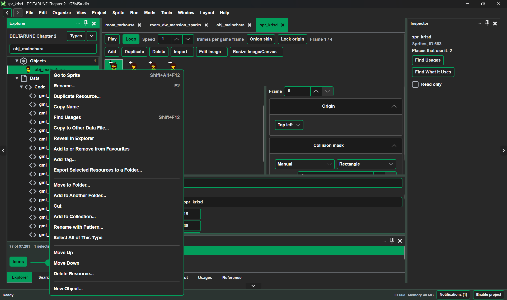

# Explorer context menus

Right-click a row in the Explorer to get the commands that apply to it. This page lists the menu for each kind of row, then explains the Delete, Duplicate and New dialogs. Every item is a command that also exists in the menu bar or the command palette (see the [Command reference](command-reference.md)).

A right click on an unselected row selects it first. A right click on a row inside a multi-selection keeps the selection. The menu does not open while no data file is open.

## Entry row (one entry selected)

In order. A group of items ends with a line.

| Item | Shown for |
|---|---|
| **Go to Sprite** | First item, for an object that has a sprite. Opens that sprite in a tab (see [Go to Object and Go to Sprite](command-palette-and-go-to.md#go-to-object-and-go-to-sprite)). |
| **Rename...** | Every type except **Game** |
| **Edit Image...** | Types that have a picture (sprites, tile sets, fonts and other picture resources) |
| **Duplicate Resource...** | Types that can be duplicated |
| **Copy Name** | All |
| **Find Usages** | All. Searches the entry that was clicked, not the word under a code caret. |
| **Copy to Other Data File...** | Types that can be copied between files |
| **Reveal in Explorer** | All |
| **Add to or Remove from Favourites** | All |
| **Add Tag...** | All |
| **Resize Image/Canvas...** | Sprites only |
| **Export Selected Resources to a Folder...** | All |
| | |
| **Move to Folder...**, **Add to Another Folder...**, **Cut**, **Add to Collection...**, **Rename with Pattern...**, **Select All of This Type** | All |
| **Remove from Folder, Collection or Tag** | When the entry is listed under a folder, collection or tag |
| | |
| **Move Up**, **Move Down** | Entries that can move in their list. Each shows only when that direction is possible. |
| **Delete Resource...** | Types that can be deleted, and table entries such as functions and variables |
| | |
| **New {type}...** | Types that can be created. Sounds also get **Generate Sound...** and **Record Sound...**. |

Entries of the **Code** type behave like any other entry. The playback and onion skin toggles of a sprite are not here; they are in the **Sprite** menu.

## Several entries selected

Only commands that work on all of them:

**Export Selected Resources to a Folder...**, **Duplicate Resource...**, **Copy to Other Data File...**, a line, **Move to Folder...**, **Add to Another Folder...**, **Cut**, **Add to Collection...**, **Rename with Pattern...**, **Move to Texture Group...**, **Move to Audio Group...**, **Select All of This Type**, **Remove from Folder, Collection or Tag** (when listed under one), **Delete Resource...**, then **New {type}...**.

## Type heading

Right-click a heading such as **Sprites**:

| Item | Notes |
|---|---|
| **New {type}...** | Types that can be created. Sounds also get **Generate Sound...** and **Record Sound...**. |
| **Select Everything in the Group** | When the type has entries (not **Game**). |
| **Export All {type} to a Folder...** | Types that can be exported to files. Choosing it for another type shows "{type} cannot be exported as files." |
| **Import Pictures, Sounds and Scripts from Files...** | Sprites, Sounds, Scripts. |
| **New Sprite from Sheet or Strip...** | Sprites. |
| **Copy All Names** | Puts one name per line on the clipboard. Not for **Game**. |
| **Show Only {type}** | Types the filter prefix, such as `spr:`, in the filter box. |
| **Expand All Types** | Opens every type heading and **Data**. |
| **Collapse All Types** | Folds them. |

The **Data** group heading has only **Expand All Types** and **Collapse All Types**. The pinned heading at the top of the list has the same menu as the heading in the list.

## Folder, collection and tag rows

| Row | Items |
|---|---|
| Folder | **Open Folder**, **New Subfolder...**, **Paste into Folder** (when something is cut), **Rename...**, **Set Colour...**, **Delete Folder (keep the entries)**, a line, then the bulk items below |
| Collection | **Open Folder**, **Rename...**, **Set Colour...**, **Delete Collection**, a line, then the bulk items |
| Tag | The bulk items only |

Bulk items first select everything the row holds and then run: **Select Everything in the Group**, **Export Selected Resources to a Folder...**, **Copy to Other Data File...**, **Rename with Pattern...**, **Move to Folder...**, **Add to Collection...**, **Move to Texture Group...**, **Move to Audio Group...**, **Export as Package...**, **Delete Entries**.

## Quick Access headings

| Row | Items |
|---|---|
| **Folders** heading | **New Folder...**, and **Paste into Folder** when something is cut |
| **Recent** heading | **Open Folder** (narrows the list to the recent entries) |
| Saved search | **Open Folder**, **Remove saved search** |

## Other places with the same resource commands

The right-click menu of an editor tab, the code editor and the room canvas list the same resource commands for the entry in front, in the same order. The tab menu starts with the tab commands (see [Tabs](tabs.md)). The menu of the room canvas starts with **Go to Object** and **Go to Sprite** when they apply, then a line. The tab menu of an object has **Go to Sprite** at the top of its resource commands.

## Delete Resource

`Delete` or **Edit > Delete Resource...** deletes the selected entry. Every delete is one undo step. Undo brings it back until the file is saved.

1. G3MStudio searches where the entry is used.
2. With no uses, the window **Delete {name}** asks "Delete {name}? Undo brings it back until the file is saved."
3. With uses, the window **Delete {name} anyway?** lists up to 8 places ("Places that use {name}: {count}"). The uses are set to none or taken out of their lists. A use in code cannot be cleared and stops the delete. The game can behave differently or stop working.
4. Open tabs of the entry close. The entry leaves its folders, collections, tags and favourites.

With several selected, **Delete resources: {count}** lists up to 8 names and the uses outside the selection ("Places outside the selection that use them: {count}").

Functions and variables have their own prompts:

| Entry | Behaviour |
|---|---|
| Function | **Delete function {name}?** Removes the script and its code entry, or the function declaration inside a code entry (the entry is decompiled, the block is removed and the entry is compiled again). Callers stay and name a function that no longer exists. |
| Variable | **Delete variable {name}?** Removes only the entry, and only when no code uses it. Otherwise "{name} is used by code in {count} places, so its entry stays", with the places listed. |

A function without a code entry of its own (a built-in or extension function) shows "{name} has no code entry in this file (a built-in or extension function), so there is nothing to delete."

Deleting a code entry that other code uses shows **Delete {name} and leave the code that uses it?**. The code keeps pointing at something that no longer exists.

## New and Duplicate

**New {type}...** (File > New, or the context menu) opens **New {type}** with **Name of the new {type}** and the button **Create**. **Duplicate Resource...** opens **Duplicate {name}** with **Name of the copy**. With several selected, copies are named `name_copy` and the notification reads "Resources copied: {count}."

Two warnings stop a name until you press the button again:

- "'{name}' is not a plain name (letters, digits and underscores, not starting with a digit). GML code cannot use it, and other tools may fail on it. Press the button again to use it anyway."
- "A resource or code entry named '{name}' exists already. With two of one name, the editor and delete reach only the first. Press the button again to use the name twice anyway."

## See also

- [Explorer](explorer.md)
- [Folders, collections and tags](explorer-organizing.md)
- [Menus](menus.md)
