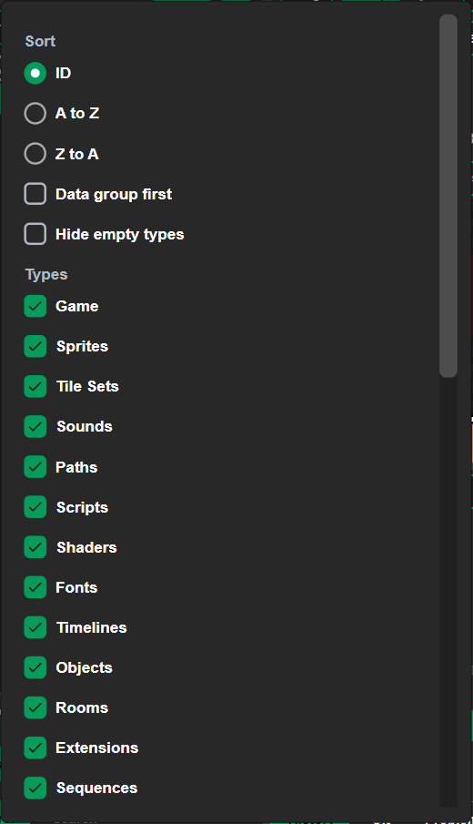

# Explorer filter and sorting

The filter box narrows the Explorer to entries whose name matches. The **Sort and filter** button opens a popup with the sort order, the types to show, the rules for child code entries and a tag filter. This page explains each control and the prefixes the filter box understands.

## The filter box

Type in the box under the title row ("Filter resources..."). The list updates about 150 ms after you stop typing.

- The text matches any part of an entry name, without regard to case. A nickname matches too.
- While a filter is typed the **Quick Access** block is hidden, every type that has a match opens, and the footer reads "{matches} of {total}".
- An entry typed in full always matches, even when the hide settings would leave it out. A search by exact name therefore never reads as "missing".
- Clicking a heading while a filter is active folds it only until the filter changes.
- Opening a data file clears the filter.
- Matches in **Data** and **Code** open on their own. The other data lists (Strings, Variables, Functions and so on) open only when **Open Strings, Variables and the other data lists when I search** is on in [Explorer settings](../settings/explorer-settings.md). **Leave out the data lists** in the same place removes them from the list altogether, so they cannot match.

### Type prefixes

Write `prefix:text` to search one type only. The text after the colon can be empty to list the whole type.

| Prefix | Type | Prefix | Type |
|---|---|---|---|
| `spr` | Sprites | `obj` | Objects |
| `bg` | Tile Sets | `room` | Rooms |
| `snd` | Sounds | `ext` | Extensions |
| `path` | Paths | `seq` | Sequences |
| `scr` | Scripts | `curve` | Animation Curves |
| `shd` | Shaders | `ps` | Particle Systems |
| `fnt` | Fonts | `code` | Code |
| `tl` | Timelines | `str` | Strings |
| `game` | Game | | |

Prefixes are not case sensitive. An unknown prefix is searched as plain text. The right-click menu of a type heading has **Show Only {type}**, which types the prefix for you.

[Go To](command-palette-and-go-to.md) accepts these long forms and some shorter ones.

## Saved searches

Type a filter, open **Sort and filter**, and press **Save this search** (enabled only when the box has text). The text is listed under **Quick Access > Saved Searches** with its match count. Click it to run it in the filter box. Right-click it for **Open Folder** (narrows the list to the matches, with a breadcrumb) and **Remove saved search**. Saved searches belong to the data file's view state, not to the data file itself.

## Sort and filter popup

The popup is rebuilt every time it opens and every control applies at once. The state is stored with the data file's view state.

| Control | Options | Effect |
|---|---|---|
| **Sort** | **ID**, **A to Z**, **Z to A** | **ID** keeps the order in the data file (the resource ID). The other two sort entries by displayed name, nickname first. The default for a new file is set in Settings as **Default sort order of the Explorer**. |
| **Data group first** | check box | Lists **Data** above the resource types. |
| **Hide empty types** | check box | Leaves out types with no entries. |
| **Types** | one check box per resource type | An unchecked type is not listed. The **Data** group types are not in this list. |
| **Code entries** | see below | How child code entries show. |
| **Tag** | **Any** and one choice per tag | Narrows the list to entries with that tag. Only shown when a tag exists. |
| **Save this search** | button | See above. |

If the popup is taller than the window it scrolls.

## Code entries

Some code entries have no text of their own. The compiler makes them from a function written inside another entry, and they lead only to the entry they belong to. G3MStudio calls them child code entries and sorts them into three kinds:

| Setting label | Entries it covers |
|---|---|
| **Anonymous functions in code** | `gml_Script_anon_...` |
| **Struct constructors in code** | `gml_Script____struct___N_...` |
| **Other functions inside code entries** | Any other function defined inside a code entry that has a name of its own |

A script resource counts as its code entry. The `gml_Script_name` entry the compiler makes for a function of a global script is a child entry too, so the three choices also apply to the scripts that stand for a child code entry.

Each kind has three choices:

| Choice | Result |
|---|---|
| **Show** | Listed like any entry. |
| **Gray out** | Listed in italics with reduced opacity. This is the default for all three kinds. |
| **Hide** | Left out and counted in the "{count} hidden" footer. |

Two check boxes follow:

| Check box | Result (default off) |
|---|---|
| **Hide code that cannot be decompiled (and scripts using it)** | The decompiler is tried in the background. Entries that fail drop out of the list as the results arrive. |
| **Hide broken resources and entries with errors** | Leaves out resources that point at nothing, such as a sprite frame without its picture. |

The same choices are in Settings (see [Explorer settings](../settings/README.md)); the popup and the Settings page share one setting.

## Hidden entries

The footer "{count} hidden" counts entries the hide settings leave out. Click it to open the popup and change the settings. A jump that points at a hidden entry (a link in code, Go To, Find Usages) lists it for the rest of the session or until the hide settings change.

## Related Settings

| Setting label | Default |
|---|---|
| Show the Explorer as folders instead of resource types | off |
| Show counts in the Explorer | on |
| Open folders and collections when they appear | on |
| Default sort order of the Explorer | ID |
| Size of the Explorer icons at 100% zoom | 22 px (16 to 96) |
| Show null entries in the resource tree | off |
| Show previews and IDs on hover | on |

## See also

- [Explorer](explorer.md)
- [Folders, collections and tags](explorer-organizing.md)
- [Command palette and Go To](command-palette-and-go-to.md)
