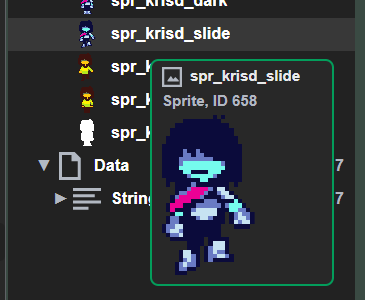

# Hover cards

A hover card is the small tooltip that appears when you rest the pointer on the name of a resource. It shows the type icon, the name, the type and ID, and a picture for types that have one. This page lists where cards appear and what they contain.

## Content

| Line | Content |
|---|---|
| Title | The nickname if the resource has one, otherwise the name, in semibold. Next to the type icon. |
| Real name | Shown under a nickname only. |
| Type and ID | "{type}, ID {id}", for example "Sprite, ID 12". Without an ID only the type. |
| Extra text | Added by the surface that shows the card (the description of a function in Go To, for example). |
| Picture | Up to 128 by 128 px, for sprites, tile sets, fonts, rooms, objects, sequences, particle systems, paths, animation curves, texture page items, embedded textures and embedded images. The space is reserved, so the card does not jump when the picture arrives. |

The card is at most 420 px wide and longer text wraps. Pixel art stays sharp. The picture is fetched when the card opens and given up when it closes. While memory is low no picture loads (see [Status bar](status-bar.md)).

For a row that is not a resource (a heading, a folder) or when previews are off, the card is the plain name text.

## Where cards appear

- Explorer rows (type headings and folders show their name only).
- Rows of the [Go To box](command-palette-and-go-to.md).
- Names in code, and the code completion list.
- Other lists that name resources, and editor tabs.

## Turning cards off

**Settings > Appearance > Show previews and IDs on hover** (default on). Off leaves every card as plain text.

The picture of a sprite is its first visible frame: a first frame that is fully transparent is skipped. **Settings > Appearance > Sprite previews start at** switches this to **First frame** (see [Explorer settings](../settings/explorer-settings.md)).

## See also

- [Explorer](explorer.md)
- [Command palette and Go To](command-palette-and-go-to.md)
- [Appearance settings](../settings/README.md)
