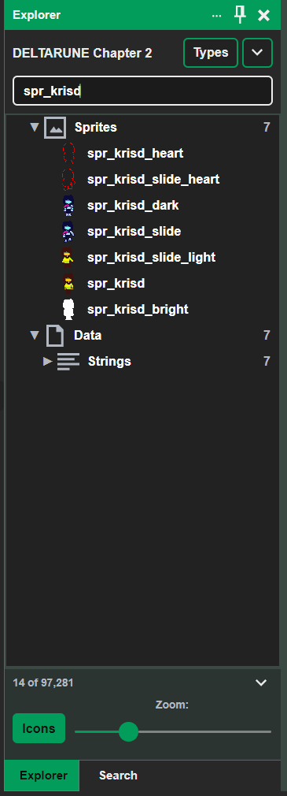

# Explorer

The Explorer is the panel on the left that lists everything in the open data file: resources such as sprites and objects, and the raw data lists such as strings and functions. This page describes its layout, its rows, how to open and select entries, and the footer controls. Sorting, filtering and hiding are on [Explorer filter and sorting](explorer-filter.md).

## Layout of the panel

From top to bottom:

1. **Title row.** The name of the data file, then the view button (**Types** or **Folders**) and the **Sort and filter** button.
2. **Filter box**, with the hint "Filter resources...".
3. **Breadcrumb**, only while the list is narrowed to a folder, collection, saved search or Recent. See [Folders, collections and tags](explorer-organizing.md).
4. **Tree**, a scrolling list of rows.
5. **Footer**: the entry count, the hidden count, the selected count, and a chevron that folds the icon options.
6. **Icon options** (unless folded): the **Icons** toggle and the **Zoom:** slider.

The tooltip of the fold chevron is "Hide icon options" or "Show icon options". The state is remembered.

## Tree structure

The tree has up to three kinds of block, in this order:

| Block | Content |
|---|---|
| **Quick Access** | **Recent**, **Favourites**, **Saved Searches**, **Tags**, **Collections** and, in the type view, **Folders**. Hidden while a filter is typed. |
| Type headings | One heading per resource type that the data file has. |
| **Data** | The raw data lists of the file. |

With **Data group first** checked in the filter popup, **Data** comes before the type headings.

The type headings, in this order: Game, Sprites, Tile Sets, Sounds, Paths, Scripts, Shaders, Fonts, Timelines, Objects, Rooms, Extensions, Sequences, Animation Curves, Particle Systems. In a GameMaker Studio 1 file **Tile Sets** reads **Backgrounds**. A type the file has no section for is not listed.

The **Data** group holds: Code, Strings, Variables, Functions, Code Locals, Texture Page Items, Embedded Textures, Embedded Images, Embedded Audio, Texture Groups, Audio Groups, Filter Effects, UI Layers.

The **Game** type holds the singleton entries of the file: General Info, Game Options, Tags, Feature Flags, Language and the included files entry. It has no **Rename**.

Each heading shows its entry count at the right. A heading with no entries has no chevron. A count of 0 is never shown, and the **Show counts in the Explorer** setting hides all counts.

### Opening and folding

- Click a heading, or press `Enter`, `Space` or `Right` on it, to open it. `Left` folds an open heading. `Left` on an entry moves to the heading above it.
- Types start open. A type with more than 5000 entries starts folded when a file opens, because a very long list is slow to lay out. A filter opens every type that has a match. A click, or opening by hand, overrides this and the state is kept across files.
- The right-click menu of a heading has **Expand All Types** and **Collapse All Types**.
- A heading stays pinned at the top while you scroll through its entries. Click the pinned heading to fold it, or right-click it for its menu.
- With the filter active, folding a heading hides it only until the filter changes.

### Null entries

Newer data files may contain empty list slots. With **Show null entries in the resource tree** on in Settings (see [Explorer settings](../settings/README.md)) they appear as `[n] (null)` rows that cannot be opened. They are off by default.

## Row types

| Row | Look | Click |
|---|---|---|
| Heading | `►` closed, `▼` open, name, count | Opens or folds |
| Entry | Name, or nickname (the real name shows in the tooltip) | Single click opens a preview tab. Double click or `Enter` opens a tab that stays. |
| Folder, collection | Folder row with a coloured dot when coloured | Opens or folds. Double click narrows the list to it. |
| Tag | Under **Tags**, with its colour dot | Opens or folds |
| Saved search | Under **Saved Searches**, with the match count | Click runs it in the filter box |
| Null entry | `[n] (null)` | Cannot be opened |

A dimmed row (italic, 65 percent opacity) is a child code entry. See [Explorer filter and sorting](explorer-filter.md).

### Icons and pictures

The **Icons** toggle (tooltip: "Shows an icon or a small picture before every entry. Sprites, tile sets and other types with a picture show that picture. Hovering a row shows a larger preview. The zoom slider sets the size. Pictures are decoded and kept in memory, so this uses more RAM, most with large games.") adds a small icon before each entry. The icon shows the type, in one colour: muted on a plain row, the text colour under the pointer, the highlight text colour on the selection.

Every type heading, and each Quick Access heading, has an icon of its own: Recent, Favourites, Saved Searches, Tags, Collections and Folders each have a distinct mark. A type with no icon of its own gets a plain document icon.

These types show a real picture instead of the icon once it has loaded: Sprites, Tile Sets, Fonts, Rooms, Objects, Sequences, Particle Systems, Paths, Animation Curves, Texture Page Items, Embedded Textures, Embedded Images. A sprite shows its first visible frame, so a sprite whose first frame is empty is still recognisable (**Settings > Appearance > Sprite previews start at**, default **First visible frame**). Pictures up to 48 by 48 px stay sharp when enlarged; larger ones are smoothed. While memory is low (see [Status bar](status-bar.md)) no pictures load.

**Zoom:** (50 to 250 percent, tooltip "Zoom 50 to 250 percent") scales the row height, the text and the pictures. The picture size at 100 percent is set in Settings (16 to 96 px, default 22). `Ctrl` + wheel over the list changes the zoom in steps of 10 percent and keeps the row under the pointer in place. The zoom is saved in the settings and comes back at the next start. A picture never takes more than a third of the list width.

## Selecting

- Click selects one row. `Ctrl` or `Shift` click selects several; these clicks do not open tabs.
- `Organize > Select All of This Type` and `Select Everything in the Group` select by type or container.
- Type letters to jump to the next row that starts with them. A pause of one second starts a new word.
- Selecting an entry shows it in the [Inspector](panels.md#inspector). Opening a tab selects its entry in the Explorer.

## Keyboard

| Key | Action |
|---|---|
| `Enter` | Opens the selected entry, runs a selected saved search, folds or opens a heading |
| `Ctrl+Enter` (Cmd on macOS) | Narrows the list to the selected folder, collection, tag or Recent |
| `Backspace` | Goes one level up out of a folder view |
| `Delete` | Runs **Delete Resource...** on an entry, folder or collection |
| `Ctrl+X` | Cut: runs `organize.cutToFolder` |
| `Ctrl+V` | Runs `organize.pasteIntoFolder` |
| `F2` | **Rename...** |
| Middle click | Opens the entry in a tab that stays |

## Footer

| Item | Meaning |
|---|---|
| "{count} resource" or "{count} resources" | Number of entries in the file. |
| "{matches} of {total}" | While a filter is typed. |
| "{count} hidden" | Entries left out by the hide settings. Underlined. Click it to open the filter popup. Tooltip: "Some entries are left out by your hide settings. Click to change them." Not shown while filtering. |
| "{count} selected" | Number of selected entries, when more than one. |

With a filter that matches nothing the list shows "No resources match '{filter}'."

## Troubleshooting

- **An entry I know exists is not listed.** Check the "{count} hidden" footer, the type checkboxes in the filter popup, **Hide empty types** and the active tag. A search by the exact name finds an entry even when it is hidden.
- **A type is missing.** The data file has no section for it. **New** items for it are greyed out with the same reason.

## See also

- [Explorer filter and sorting](explorer-filter.md)
- [Folders, collections and tags](explorer-organizing.md)
- [Explorer context menus](explorer-context-menus.md)
- [Hover cards](explorer-hover-cards.md)
- [Tabs](tabs.md)
