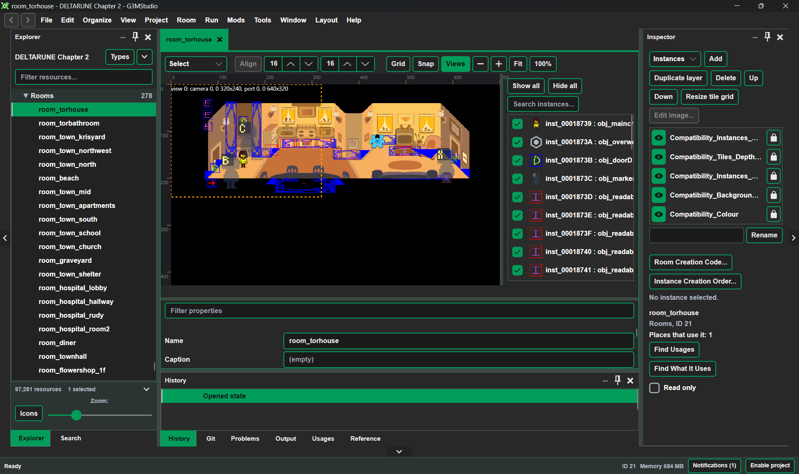

# Main window

The main window holds the menu bar, the work area with the docked panels and editor tabs, the status bar and the toast area. This page names each part and explains how the window title, the full screen mode and the focus regions work.

## Parts of the window

| Part | Where | What it does |
|---|---|---|
| Back and forward buttons | Left of the menu bar | Step through the tabs in the order they were in front. They run **Previous Tab (History)** and **Next Tab (History)**. |
| Menu bar | Top | One menu per command group. See [Menus](menus.md). |
| Start page | Centre, while no data file is open | Recent files and the buttons Open Data File, Open Project, New Project and Settings. See [Start page](../getting-started/start-page.md). |
| Work area | Centre, while a data file is open | The dock layout with panels and editor tabs. See [Docking and layouts](docking-and-layouts.md). |
| Fold chevrons | A 20 px strip at the left, right and bottom edge | One chevron folds or opens that dock. |
| Status bar | Bottom | Status message, asset ID, memory, run state, project button and notifications button. See [Status bar](status-bar.md). |
| Toasts | Bottom right, over the work area | Short messages that fade out. See [Notifications](notifications.md). |
| Progress overlay | Over the work area | Shown while a file opens or an export runs, with a **Cancel** button. The message and the bar are centered; a long message wraps, and a very long name in it is shortened in the middle. |

The window opens at 1100 by 700 pixels. A settings page, when open, covers the work area (see [Settings](../settings/README.md)).



## Window title

While no data file is open the title is `G3MStudio`. With a file open it is built as three parts joined by ` - `:

```text
<active tab title> - <workspace name>* - G3MStudio
```

The asterisk after the workspace name marks unsaved changes. The first part is left out when no tab is open.

## Opening files by drag and drop

Drop a data file anywhere on the main window to open it. Only files from this computer are accepted. A drop from another source shows: "Only files from this computer can be opened. Drop a data file from a folder." If the file is open in another G3MStudio window the message is "'{name}' is in use by another G3MStudio window. Finish there first."

## Full screen

**View > Toggle Full Screen** (`F11`) switches the window between normal and full screen.

## Zoom

**View > Zoom In** (`Ctrl++`), **Zoom Out** (`Ctrl+-`) and **Reset Zoom** (`Ctrl+0`) scale the whole interface. Each step is 10 percent. The range is 50 to 200 percent. **Reset Zoom** returns to the automatic scale. The value is saved as the interface scale setting (see [Appearance settings](../settings/README.md)).

`Ctrl` + mouse wheel zooms the picture or list under the pointer, not the interface. It works in the sprite editor, the texture viewer and the [Explorer](explorer.md) (zoom slider, 10 percent per notch). The point under the pointer stays where it is, and the wheel never scrolls while `Ctrl` is held. In a code view it changes the font size, and in the room editor it zooms the room. The sprite editor opens at the zoom you used last (it fits the sprite until you change it), and the Explorer remembers its zoom.

Try it: open a small sprite, hold `Ctrl` and turn the wheel over a pixel. The pixel grows and stays under the pointer.

## Focus regions

`F6` moves the keyboard focus to the next region and `Shift+F6` to the previous one. The regions, in order, are:

1. Menu bar
2. Editor area
3. Bottom panels
4. Status bar

A screen reader announces "Focus: {region}" after each move.

## Narrow windows

When the window is too narrow for every menu, the menus that do not fit move, from the end, into a menu named `...` (tooltip "More menus") at the right end of the menu bar.

## Keyboard handling

- A shortcut that does not apply to the current tab (an image command while a room is in front) is ignored and the key goes to the focused control.
- A plain letter, digit or punctuation key typed in a text box or the code editor is text, not a shortcut. Function keys, `Escape` and anything with `Ctrl` or `Alt` stay shortcuts.
- `Ctrl+Z`, `Ctrl+Y`, `Ctrl+X`, `Ctrl+C`, `Ctrl+V` and `Ctrl+A` act on the focused text box, not on the data file, while a text box has the focus.
- `Ctrl+S` first applies typed changes of a code, shader or text editor, or a picture waiting for **Apply** in the image editor. With none pending it saves the data file.
- While a script holds the data, no shortcut works and `Escape` stops the script.
- On macOS `Ctrl` in a default shortcut is read as `Cmd`.
- The mouse back and forward buttons step through resources like **Back** and **Forward** unless a command claims them.

See [Command reference](command-reference.md) for every default key.

## See also

- [Menus](menus.md)
- [Command palette and Go To](command-palette-and-go-to.md)
- [Docking and layouts](docking-and-layouts.md)
- [Status bar](status-bar.md)
