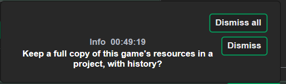

# Notifications

G3MStudio reports results, warnings and errors as notifications. A new notification shows as a toast at the bottom right and is kept in a list behind the **Notifications** button in the status bar. This page explains the levels, how long toasts stay, and how to read and clear the list.

## Levels

| Level | Word on the toast | Colour of the border | Stays |
|---|---|---|---|
| Info | **Info** | Info colour | 8 seconds |
| Warning | **Warning** | Warning colour | 8 seconds |
| Error | **Error** | Danger colour | Until dismissed |

The level is also written as a word, so it does not depend on the colour.

## Toasts

- A toast is 360 px wide. Several stack upward from the bottom right corner of the work area. A new toast slides in and a dismissed one fades out.
- The 8 second timer pauses while the pointer rests on a toast, so you can read it.
- The **x** button ("Dismiss notification") closes a toast. The toast is then only in the list.
- Some toasts carry an action button (for example to open a result). Pressing it runs the action and closes the toast.
- A toast is announced politely by screen readers as "{level}: {text}".

## Notifications list

The button at the right of the status bar reads **Notifications**. While there are unread messages it reads **Notifications ({count})**. Press it to open the list:

- Newest first. Each row shows the level and the time (`HH:mm:ss`), and the message.
- **Dismiss** removes one row. Focus moves to the next **Dismiss** button.
- **Dismiss all** empties the list and the toasts.
- "No notifications" shows when the list is empty.

Opening the list marks all messages read. The list keeps the last 100 messages and is cleared when G3MStudio closes.

The same messages also appear in the [Output panel](panels.md#output), prefixed "Error:", "Warning:" or "Info:". **Clear** in the Output panel clears this history as well.

## See also

- [Status bar](status-bar.md)
- [Panels](panels.md)
- [Main window](main-window.md)
