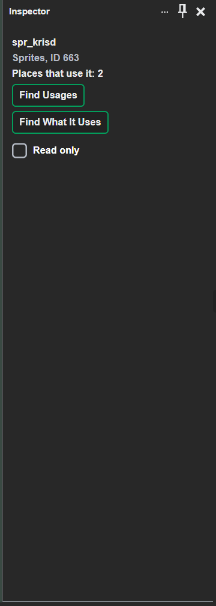

# Panels

Panels are the dockable tool windows around the editor tabs. This page describes each panel, how to show it again after closing it, and what its controls do. Docking, floating and layouts are on [Docking and layouts](docking-and-layouts.md).

## The panels

| Panel | Command | Purpose |
|---|---|---|
| Explorer | `view.panel.explorer` | Tree of everything in the data file. See [Explorer](explorer.md). |
| Search | `view.panel.search` | Find and replace in code. |
| Inspector | `view.panel.inspector` | Summary of the selected entry. |
| Problems | `view.panel.problems` | Compile errors of code entries. |
| Output | `view.panel.output` | Messages of G3MStudio and lines of the running game. |
| Usages | `view.panel.usages` | Where an entry is used, what it uses, and unused assets. |
| Function Reference | `view.panel.reference` | Built-in GML functions and variables. The tab shows "Reference". |
| History | `view.panel.history` | Edit history of the file. See [History](../projects/README.md). |
| Git | `view.panel.git` | Git status of a project. See [Git](../projects/README.md). |
| Open Editors | `view.panel.openeditors` | The open editor tabs as a list. Off by default. See [Open Editors](#open-editors). |

**View > Panels** lists all ten. Choosing one shows it (or brings it to the front) and focuses it. Each is also in the command palette as "Show {panel}". A closed panel returns through this menu.

## Inspector

The Inspector shows the entry of the tab in front. With no tab open it shows the Explorer selection. It reloads only when that changes.

| Part | Content |
|---|---|
| Room tools | For a room tab, the room's layer tools appear above the summary. |
| Name | The nickname, or the name. For **Game** the title reads "General Info". The real name shows below when a nickname is used. |
| Type line | "{type}, ID {id}", for example "Sprite, ID 12". |
| Places that use it | "Places that use it: {count}". |
| **Find Usages** | Fills the Usages panel. |
| **Find What It Uses** | Lists the assets the entry uses. |
| **Read only** | While checked, G3MStudio refuses edits of this resource. Tooltip: "G3MStudio refuses edits of this resource while this is checked. The data file itself is not write protected." |

With nothing selected it says "Select a resource in the Explorer." For a folder, collection, group, type or saved search row it shows the name, the kind (**Folder**, **Collection**, **Group**, **Type** or **Saved search**) and the entry count, with no buttons.

## Search (find and replace in code)

Search looks through the code of every entry in the data file. Open it with **Edit > Find in Code...** (`Ctrl+Shift+F`) or **Edit > Replace in Code...** (`Ctrl+Shift+H`, focuses the replace box).

1. Type text in **Find in code**.
2. Set options: **Match case**, **Whole word**, **Regular expression**.
3. Press `Enter` or **Search**. The status shows "Searching... {done} of {total} entries" and then "Matches: {hits}. Entries searched: {entries}." **Cancel** stops a running search ("Search cancelled."). A new search cancels the one before.
4. Double-click a result, or press `Enter` on it, to open the entry at that line in a tab of its own.

Results read `entry(line)  text`. Right-click a result: **Open**, **Copy** (one line), **Copy all**. Copy keeps the real entry name, not the nickname.

Unreadable entries are skipped: "Entries that could not be read and were skipped: {count}." An invalid pattern shows "This pattern is not valid: {reason}". A pattern that is too slow shows "The pattern takes too long on a line. Make it simpler."

In low-memory mode the search decompiles one entry at a time. Text typed in open code editors is applied first, as Save does.

### Replace

1. Type the new text in **Replace with**.
2. Press `Enter` in that box, or **Preview replace**. Each matching line is listed with its new text (`old  ->  new`) and a check box.
3. Use **All** and **None**, or the boxes, to choose lines. The count reads "{chosen} of {total} selected".
4. Press **Replace selected**.

The replacement is one undo step. The status reads "Replaced {lines} lines in {entries} entries. Undo takes it back in one step." Entries that no longer compile after the change stay as they were: "Left unchanged because they do not compile: {entries}." Entries whose code changed after the preview are skipped: "Skipped because the code changed since the preview: {entries}."

## Problems

Lists compile errors of code entries and run errors. Each row reads `source(line,column) code: message` with a thin bar in the colour of the severity (Error, Info, or Warning). Double-click a row or press `Enter` to open the entry at that position. The empty state reads "No problems." Code editor squiggles use the same colours. See [Code editor](../code/README.md) for how problems are found.

## Output

Shows, oldest first, the messages G3MStudio gave (each prefixed "Error:", "Warning:" or "Info:") and the lines the running game wrote. A game error line starts with `!`. A line that names a code entry and line is underlined: click it to open that place. The list scrolls to the newest line. The empty state reads "Nothing has been reported yet."

| Control | Function |
|---|---|
| **Filter** | Shows only lines that contain the text, without regard to case. |
| **Times** | Shows or hides the `HH:mm:ss.fff` time before each line. On by default. |
| **Copy** | Copies the visible lines to the clipboard. |
| **Clear** | Clears the game lines and the message history. |
| **Restart** | Restarts the game, or starts it when none runs. Greyed out while the game is preparing or stopping. |
| **Stop** | Stops the game. Works only while it runs. |

## Usages

Shows the result of **Edit > Find Usages** (`Shift+F12`), **Find What It Uses**, or **Find Unreferenced Assets**.

| Result | Status line |
|---|---|
| Find Usages | "Places that use {name}: {count}." Or "{name} is not used anywhere." |
| Find What It Uses | "Assets used by {name}: {count}. Double click one to open it." Or "{name} does not use any asset." |
| Find Unreferenced Assets | "Assets that are not used anywhere: {count}." Or "No asset is unused." |

Double-click a row, or press `Enter`, to open the entry that holds the reference. A row for code shows the line when it is ready. When unsaved code does not compile it is left out: "Unsaved text of {entry} does not compile and was left out of the search. The results show its saved state."

Under unreferenced assets two buttons appear:

- **Exclude selected** takes rows out of the list ("Excluded rows come back with the next search.").
- **Delete selected** deletes the selected assets through the usual delete question (see [Explorer context menus](explorer-context-menus.md)).

The panel warns: "Assets that the game finds by name while it runs (asset_get_index, a room started by name, the first room, an object created by name) can be listed here although they are in use. Exclude them before you remove anything." The empty panel reads "No usages to show yet. Use Find Usages on a resource."

## Function Reference

Lists built-in GML functions, variables and constants, plus the game's own functions. It also opens from a palette entry of kind **Reference**.

| Control | Function |
|---|---|
| **Search functions, variables, constants** | Filter box. |
| Category list | **All categories**, **Favourites**, **Game functions** and the manual categories. |
| **Only current file** | Limits the list to names used in the code tab in front. |
| Star on a function | **Add to favourites** or **Remove from favourites**. Favourites are saved in the settings. |
| **Insert** | Inserts a call (a function), or the name (a variable), at the caret of the code tab in front. A double-click on a row does the same. |
| **Open in manual** | Opens the page in the GameMaker manual. |
| **Find Usages** | Finds uses of the name in code. |
| **Go to Definition** | Opens the definition of a game function. |

## Open Editors

A list of the open editor tabs, one row per tab, in the order of the editor groups. Open it from **View > Panels > Open Editors**. It is not part of the default layout, so it costs nothing until you open it. It opens at the left dock and, like any panel, can be dragged to another dock or floated into its own window. It comes back with a saved layout.

| Action | Result |
|---|---|
| Click a row | Brings that tab to the front. |
| Cross on a row, or middle click | Closes the tab. A pinned tab has no cross. |
| Right click | The same menu as the tab itself (**Close Tab**, **Close Other Tabs**, **Close All Tabs**, **Pin Tab**, **Split Right** and the resource commands). |

A preview tab is shown in italics, as in the tab strip. Each row starts with the small picture or type icon of its resource.

The box **Hide Editor Tabs** at the top (also **Settings > Appearance > Hide editor tabs while Open Editors is open**) hides the tab strips of the editor groups, so the list replaces them and the editors get the height or width the tabs used. Closing the panel shows the strips again, so the tabs can never be lost. A hidden strip is not drawn or measured and has no pictures. `Ctrl+Tab` and the other tab commands work as before.

## Closing a panel

The close button of a panel (tooltip "Close panel") removes it from the layout. Show it again from **View > Panels**. **Layout > Reset Layout** restores the standard arrangement.

## See also

- [Docking and layouts](docking-and-layouts.md)
- [Command reference](command-reference.md)
- [Status bar](status-bar.md)
- [Notifications](notifications.md)
