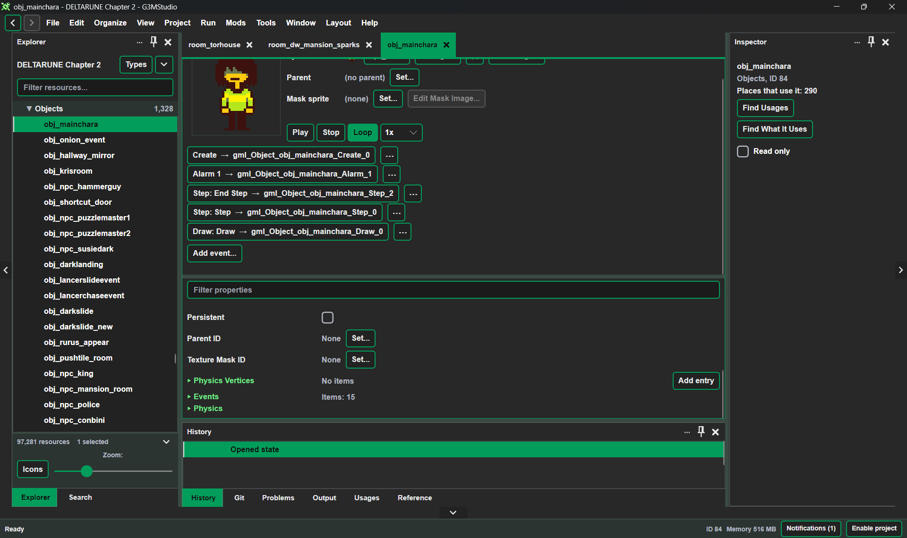

# Properties grid

Most resources open in a tab that lists their properties as a filtered list. This page explains how to read the list, change a value and undo the change. Resources with a dedicated editor (sprites, rooms, code) show the grid under or beside that editor.

## Reading the list

- Each row has a label and a value box. Labels are the readable names of the fields, for example **Parent ID** or **Texture Mask ID**.
- Fields GameMaker keeps in their own collapsible section (for example **Physics**, **Texture settings**, **Collision mask**) start closed and sit after the general fields. Click a heading to open or close it.
- Lists show "Items: {count}", or "No items" and "(empty)" when they hold nothing. List rows can be moved with **Up** and **Down**, and **Add entry** appends one.
- A field that a view above the grid already edits (shader sources, for example) is not listed twice.

## Filter

**Filter properties** (box at the top) narrows the rows to those whose name matches. A filter shows closed sections in place. Jumps from other places, such as a usage, can land on a single field this way.

## Changing a value

1. Click the value box and type, or choose a value from a list.
2. Press `Enter`, or move the focus away. The change is committed as one undo step (`Ctrl+Z` undoes it).
3. Text the field cannot hold is refused and the old value stays. The message reads "{path}: {reason}".

Fields that point at another resource show a link. Click it to open that entry. Its context menu offers **Find Usages** and, for pictures, **Edit Image...**. If the target does not exist: "{name} was not found in this data file."

Resources marked **Read only** in the [Inspector](panels.md#inspector) refuse edits.

## See also

- [Panels](panels.md)
- [Explorer](explorer.md)
