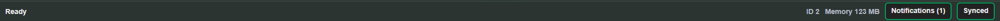

# Status bar

The status bar runs along the bottom of the main window. This page lists each item from left to right: the status message, then the items that sit at the right edge, and what they show and do.

## Items

| Item | Position | Shown | Content |
|---|---|---|---|
| Status message | Left, takes the free width | Always | The current state. Starts as "Ready". Long text is cut with `...`; the tooltip shows it whole. Screen readers announce changes politely. |
| Asset ID | Right | While a tab of a resource is in front | "ID {index}": the number of the open resource inside its list, counted from 0. |
| Memory | Right | Always | "Memory {used}", in MB, or in GB with one decimal from 1 GB. In low-memory mode: "Memory {used}, low-memory mode". |
| Run state | Right | While a game was started, or after a crash | "Preparing run...", "Running: {name}", "Stopping game...", or "Game crashed (code {code})". Shown in the accent colour. |
| Project button | Right | While a data file is open | The sync state of the project. A button. |
| Notifications button | Far right | Always | **Notifications**, or **Notifications ({count})** with unread messages. Opens the list. See [Notifications](notifications.md). |

### Status message

The message shows what G3MStudio is doing or did last. Examples:

- "Ready"
- "Saved {name}" after a save
- "Starting {name}..." and "{name} is running." for a game run
- "Opening {name}... {percent}%" while a file opens (also on the progress overlay with its **Cancel** button)

### Asset ID

The ID is the same number the Inspector and the hover card show. It changes with the tab in front, and again after edits that add or remove entries from the list.

### Memory

The number is the working set of G3MStudio. When memory runs low G3MStudio frees caches and switches to low-memory mode, where pictures stop loading in the Explorer and Go To and code search decompiles one entry at a time. A notification explains: "Memory is low, G3MStudio is running in low-memory mode." See [Memory settings](../settings/README.md) for the limit.

### Run state

Shows while a game started from the **Run** menu is active. **Run > Stop Game** (`Shift+F5`) stops it. After a crash the last exit code stays until the next run. The Output panel has the game's lines.

### Project button

The button text and what a press does depend on the project state (see [Projects](../projects/README.md)):

| State | Text | Press |
|---|---|---|
| No project linked | **Enable project** | Runs **Enable Project** |
| Linked, in step with the data file | **Synced** | Runs **Sync to Data File** |
| Linked, edits pending | **Changes not synced to data file: {count}** | Runs **Sync to Data File** |
| Syncing | **Syncing...** | Sync to Data File |
| Exporting | **Exporting project...** | Sync to Data File |
| Data file changed by another program | **Data file changed outside** | Runs **Resolve Outside Changes...** |

## See also

- [Notifications](notifications.md)
- [Main window](main-window.md)
- [Panels](panels.md)
