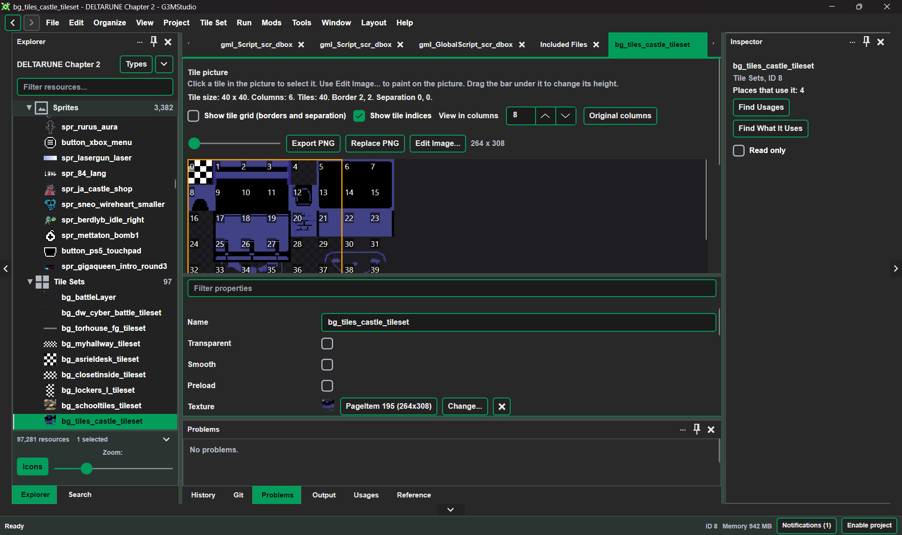

# Tile set view in columns

The tile set tab can draw its tiles in a different number of columns, so a scrambled sheet is easier to read. This page covers the **View in columns** box and its **Original columns** button. Only the view changes.

## Where it is

Open a tile set from the Explorer. In the **Tile picture** section, above the picture, one row holds:

| Control | Meaning |
|---|---|
| **Show tile grid (borders and separation)** | Draws the tile borders and the separation on the picture. |
| **Show tile indices** | Draws the number of each tile on the picture. |
| **View in columns** | A number box. Its range is 1 up to the number of tiles of the tile set. It starts at the number of columns the tile set has. |
| **Original columns** | Sets the box back to the columns of the tile set. |

The tooltip of the box reads: "Draws the tiles in this many columns so a scrambled sheet is easier to read. Only the view changes: the tile set, its picture and the tile numbers stay as they are."

## What happens

1. Enter a number in **View in columns**.
2. The picture is redrawn with the tiles laid out in that many columns. The tile that is selected in the list stays highlighted.
3. Press **Original columns** to return to the real layout.

The tile set, its picture, its columns value and the tile numbers are not edited and nothing is added to the undo history.

## See also

- [Explorer](explorer.md)
- [Tabs](tabs.md)
- [Tile sets and backgrounds](../graphics/README.md)
