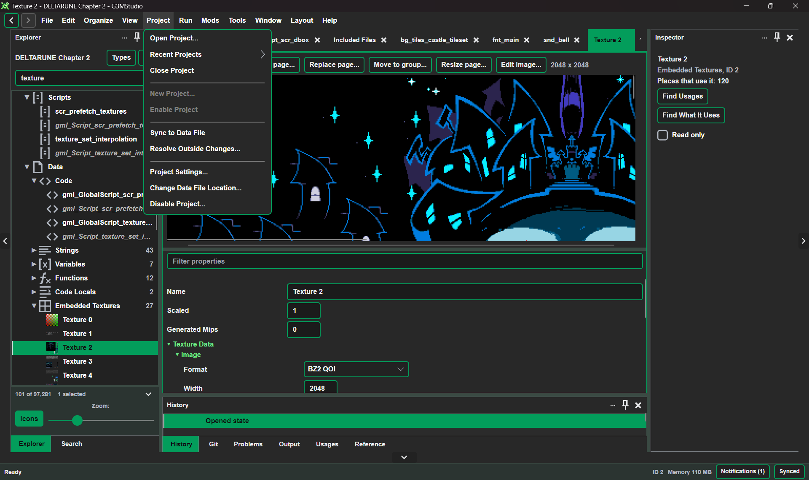

# Projects and Project mode

A project is a folder of files that holds the resources of one data file, plus a history of every sync. A **Full** holds every resource; a **Delta** project holds only what you changed (see [Full or Delta projects](project-types.md)). This page explains what Project mode is, what it keeps on disk and how it differs from editing the data file directly.

## Direct mode and Project mode

A data file (`data.win`, `game.ios`, `game.droid`, `game.unx`) opens in one of two modes.

| | Direct mode | Project mode |
|---|---|---|
| Where edits are written | The data file, when you save | The project folder (autosave), then the data file (sync) |
| Crash recovery | Journal | Journal and project folder |
| History of earlier states | Backups of the data file | Backups plus one snapshot per sync |
| Git | Not available | Git panel works on the project folder |
| Outside changes to the data file | Save asks before overwriting | Merge, replace or keep both apart |

Direct mode is the default. The status bar shows **Enable project** while the open file has no project. Once a project exists, the same item shows the sync state (see [The Project menu](project-menu.md)).

## What a project contains

A project folder is created inside the projects folder as `<name>-<id>`, where `<name>` is the data file name made safe for a file system (spaces and invalid characters become `_`, at most 60 characters; trailing dots are dropped; an empty name becomes `project`; names such as `CON` or `NUL` get a leading `_`) and `<id>` is 8 hex digits. It holds:

- `<name>.g3mproj`, the project file that lists the resources in the folder.
- One file or folder per resource (in a Delta project, per changed resource) (code as `.gml`, pictures as `.png`, and so on), written by the G3MLib project exporter.
- Optional Git files when you use the [Git panel](git.md): `.git`, `.gitignore` and `.gitattributes`.

The program keeps the rest in its own data folder, not in the project, under `projects/<id>/`:

| Item | Purpose |
|---|---|
| `base.g3mproj` | The project as it was at the last sync. It is the base of the three-way merge. |
| `snapshots/*.json` and `objects/` | The [snapshot history](snapshots.md). |
| `merge/` | Scratch space while an outside change is merged. |
| `original/` | Delta projects: the compressed copy of the game's own data file and the list of its resources. |

The list of known projects is `projects.json` in the same data folder. A damaged list loses the list of projects, not their folders.

## How a project is tied to a data file

When you open a data file, G3MStudio looks for its project in this order:

1. A project last synced at the same path.
2. A project whose recorded data file has the same size and MD5 hash as the opened file, at enable time or at the last sync. This is how a copy of the game in another folder finds its project; the project then follows the new path.

If the project folder or its `.g3mproj` file is gone, the file opens in Direct mode and **Enable project** exports it again.

When a file without a project opens, G3MStudio looks for a closed project beside it (same file recorded, a `.g3mproj` in the data folder, or in the folder above when its base file has the same name or content). If it finds one, a notification offers **Open project**. Otherwise a notification asks once per data file path: "Keep a full copy of this game's resources in a project, with history?" with the action **Enable project**.

## Settings that apply to projects

**Settings > Projects** holds the defaults for new projects: the **New project type**, the **Projects folder**, **Autosave to the project** and **Autosync to the data file**. Changing them also changes the open project. The same options are in **Project > Project Settings...** (see [Project settings](project-settings.md)).

## Limits

- One project belongs to one data file path at a time.
- Resources that exist only in the data file and that G3MLib cannot tell apart from the game's own stay in the data file when you replace it from the project.
- Snapshots are limited to the newest 500 per project.

## See also

- [Full or Delta projects](project-types.md)
- [The Project menu](project-menu.md)
- [Project settings](project-settings.md)
- [Outside changes, merge and conflicts](outside-changes.md)
- [Snapshots](snapshots.md)
- [Saving and backups](saving.md)
- [Guide: create a project from a data file](guide-create-project.md)
