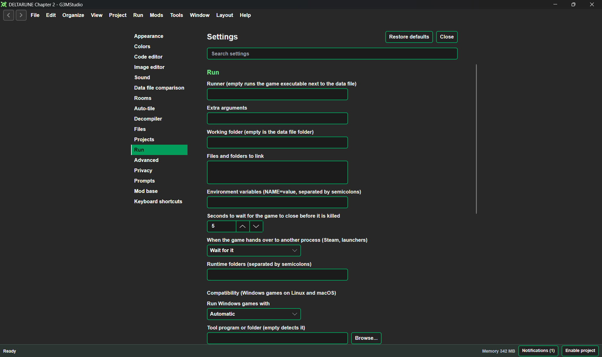
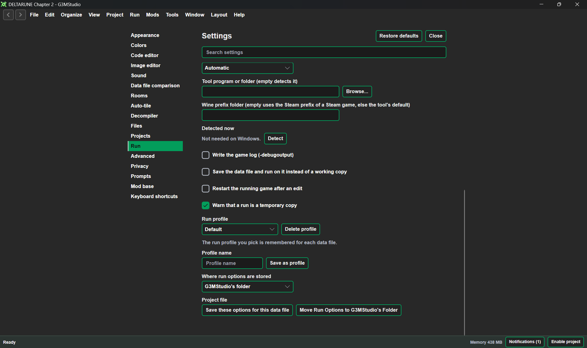

# Run settings and profiles

**Settings > Run** controls how the game is started: the program, its arguments and folders, extra files to link, compatibility tools on Linux and macOS, and saved run profiles. This page lists every option with its default.

## Options

| Option | Default | Meaning |
|---|---|---|
| **Runner (empty runs the game executable next to the data file)** | empty | The program to start. Empty means the game found by [the usual search](run-game.md#how-the-game-is-found). A bare name is looked up on `PATH`. |
| **Extra arguments** | empty | Added after `-game <data file>`. Double quotes group words. `{data}` stands for the data file; with it, G3MStudio does not add `-game <data file>` itself. |
| **Working folder (empty is the data file folder)** | empty | The folder the game starts in. |
| **Files and folders to link** | empty | See below. |
| **Environment variables (NAME=value, separated by semicolons)** | empty | Set for the game. They override anything a compatibility tool sets. Line breaks also separate. |
| **Seconds to wait for the game to close before it is killed** | 5 (1 to 60) | The grace time of **Stop Game** and **Restart Game**. |
| **When the game hands over to another process (Steam, launchers)** | **Wait for it** | The other choice is **Do not wait**. See [Games started through Steam](run-game.md#games-started-through-steam). |
| **Runtime folders (separated by semicolons)** | empty | Extra folders searched by **Run with Runtime...**. |
| Compatibility group | **Automatic** | See [Run on Linux and macOS](run-linux-macos.md). On Windows it shows "Not needed on Windows." |
| **Write the game log (-debugoutput)** | Off | Adds `-debugoutput <data file>.gamelog.txt`. |
| **Save the data file and run on it instead of a working copy** | Off | The run saves and uses your data file. |
| **Restart the running game after an edit** | Off | Restarts 1.5 seconds after edits pause. |
| **Warn that a run is a temporary copy** | On | Shows the notice once per session. |
| **Run profile** | **Default** | See below. |
| **Where run options are stored** | **G3MStudio's folder** | Where **Save these options for this data file** writes. The other choice is **Next to the data file**. |

## Files and folders to link

Some games read files that sit outside the data file folder. For example, a game started from a chapter folder may need a `mus` folder that lies one level up. **Files and folders to link** makes such items appear next to the game while it runs.

Enter one item per line, as `source` or `source => name`:

- `source` is a file or folder. A relative source starts at the folder of the data file. A full path works too.
- `name` is the name of the item in the run folder. Without it, the name of the source is used. A name is a single entry: it cannot contain `/` or `\`, and cannot be `.` or `..`.
- A line that starts with `#` is skipped. Empty lines are skipped.

Example, with the data file in `game/assets`:

```
../mus
../lang => lang
D:\shared\voices => voices
```

How it works:

1. Before the game starts, each item is made available in the run folder, which is the **Working folder** or, when that is empty, the data file folder. A symbolic link is tried first. Where links are not allowed (Windows without developer mode), the item is copied instead, which takes time and disk space for large folders.
2. An item whose name already exists in the run folder is left alone.
3. A source that does not exist, or cannot be linked or copied, shows a warning: "Could not link {path} for the run." The other items still go in.
4. When the game ends, the links are removed. A link removes only itself; a copy made for the run is deleted. A restart keeps them for the next start.

When the setting is empty, G3MStudio checks the folder above the run folder once per folder and session. If it holds `mus`, `lang`, `audiogroup` or `data` and the run folder does not, a notification says "The folder next to the game folder has {names}, but the game folder does not. If the game has no music or text, add it in Settings > Run > Files and folders to link (for example ../mus)."

This option is part of the settings, not of a run profile, so it applies to every run.

### Example: DELTARUNE from a chapter folder

The Steam game keeps `mus` and `lang` in the main DELTARUNE folder, one level above the chapter folders. Opening the `data.win` of a chapter and pressing **F5** then starts a game with no music and no text. To fix it:

1. Open **Settings > Run**.
2. In **Files and folders to link** enter two lines: `../mus` and `../lang`.
3. If the chapter folder has no game executable, set **Runner** to the `DELTARUNE.exe` of the main folder (for example `..\DELTARUNE.exe`).
4. Press **F5**. The two folders appear next to the chapter's `data.win` while the game runs and are removed when it ends.
5. To keep this for the chapter, type a **Profile name** such as `Chapter 1` and press **Save as profile**. Or press **Save these options for this data file** so the file always runs with them.

The layout of your install may differ. Check which folder holds `mus` and adjust the number of `../`.



## Run profiles

A run profile is a named set of run options. Use profiles to switch between, for example, the plain game and a debug launch.

A profile stores: **Runner**, **Extra arguments**, **Working folder**, **Environment variables**, **Write the game log (-debugoutput)** and the compatibility choices (mode, tool program, prefix folder, custom command). It does not store the link list, the stop time, the in-place option, auto restart or the temporary copy warning.

| Control | What it does |
|---|---|
| **Run profile** list | Picking a profile loads its values into the options above and makes it the active profile. "The run profile you pick is remembered for each data file." |
| **Delete profile** | Deletes the profile picked in the list. |
| **Profile name** and **Save as profile** | Saves the current options under that name. A profile with the same name is replaced. |



**Delete profile** also clears the active profile name.

## Run options of one data file

The button **Save these options for this data file** writes the current options (as one profile) for the open data file. A run of that file then uses them before the general settings. Without an open file it says "Open a data file first." The result says "Saved to {file}".

Where the file goes depends on **Where run options are stored**:

| Choice | File |
|---|---|
| **G3MStudio's folder** | `runoptions/<key>.json` in the G3MStudio data folder. No approval needed. |
| **Next to the data file** | `<data file>.g3mrun.json`. It can name any program, so it counts only after you approve it. |

When a run finds a file next to the data file that you have not approved, the dialog **Run options found next to this data file** shows the program, arguments, folder, environment and compatibility tool and asks "Use them? If you decline, your Settings are used." The approval is tied to the SHA-256 hash of the file, so a changed file asks again. This question is always shown; it cannot be silenced. Files over 256 KB are ignored.

The button **Move Run Options to G3MStudio's Folder** (command `run.migrateOptions`) copies the options file from beside the data file into G3MStudio's folder, after "Copy these run options into G3MStudio's folder? They then need no approval. The file next to the data file stays and is no longer used." Result: "Run options moved to G3MStudio's folder." With none: "No run options file next to the data file." After you approve a file next to the data file, G3MStudio offers this move when the location is G3MStudio's folder.

The order of what decides the program of a run: a runner chosen for this run (Run with Runtime...), then the approved options file, then **Runner** in Settings, then the search next to the data file.

## See also

- [Run the game](run-game.md)
- [Run on Linux and macOS](run-linux-macos.md)
- [Guide: run the game on Linux with Proton or Wine](guide-run-linux.md)
