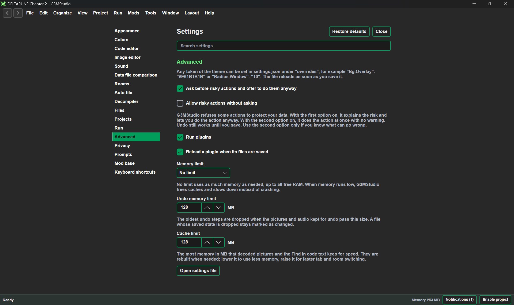

# Advanced settings

The **Advanced** category holds risky-action rules, the plugin switches, the memory limit, the undo memory, the cache limit and a shortcut to the settings file.

## Controls

| Label | Control | Default | Allowed values | Saved as |
| --- | --- | --- | --- | --- |
| **Ask before risky actions and offer to do them anyway** | Checkbox | On | On, off | `askRiskyActions` |
| **Allow risky actions without asking** | Checkbox | Off | On, off | `allowUnsafeSilently` |
| **Run plugins** | Checkbox | On | On, off | `pluginsEnabled` |
| **Reload a plugin when its files are saved** | Checkbox | On | On, off | `pluginsHotReload` |
| **Memory limit** | List and number | **No limit** | **No limit**, 1 GB, 2 GB, 4 GB, 8 GB, 16 GB, **Custom** | `memoryLimitMb` |
| **Undo memory limit** | Number | 128 MB | 16 to 1048576, step 64 | `undoLimitMb` |
| **Cache limit** | Number | 128 MB | 16 to 65536, step 64 | `cacheLimitMb` |
| **Open settings file** | Button | | | Opens `settings.json` in the program that handles it. |

The note at the top reads: "Any token of the theme can be set in settings.json under "overrides", for example "Bg.Overlay": "#E61B1B1B" or "Radius.Window": "10". The file reloads as soon as you save it." See [Colors and themes](colors-and-themes.md#advanced-overrides).

## Risky actions

G3MStudio refuses some actions to protect your data. The three states are:

| **Ask before risky actions...** | **Allow risky actions without asking** | Result |
| --- | --- | --- |
| On | Off | Explains the risk and lets you do the action anyway. |
| Off | Off | The plain refusal. |
| any | On | Does the action at once with no warning. Undo still works until you save. |

The same choice is the prompt **Risky edits and actions (yes: go on, no: refuse)** on [Prompts](prompts.md).

## Plugins

**Run plugins** turns every plugin on or off. Turning it off stops all plugins and remembers which ones were enabled. **Reload a plugin when its files are saved** recompiles a plugin when its source files change, so a plugin can be written while the app runs. The list, install and options of plugins are in [Plugins](plugins.md).

## Memory limit

- **No limit** uses as much memory as needed, up to the free RAM. A preset sets the limit in MB (1024, 2048, 4096, 8192, 16384). **Custom** shows a number box in MB, 0 to 1048576 with step 256.
- A saved limit is 0 (none) or from 256 to 1048576.
- When memory runs low, G3MStudio frees caches and slows down instead of crashing. The status bar then reads "Memory {used}, low-memory mode".
- If the runtime cannot apply the limit, a warning says "The runtime did not apply the memory limit ({reason}). G3MStudio still keeps within it where it can."

## Undo memory limit

The oldest undo steps are dropped when the pictures and audio kept for undo pass this size. A file whose saved state is dropped stays marked as changed.

## Cache limit

The most memory, in MB, that decoded pictures and the text for **Find in Code** keep for speed. Both are rebuilt when needed. A lower value uses less memory and makes tab and room switches slower. A higher value does the reverse. This is a separate limit from the **Mod base** cache on disk (see [Mod base](mod-base.md)).

## Restore defaults

Resets the overrides, the memory limit, the undo memory limit and both risky-action options. It does not reset the plugin switches or the cache limit.

## See also

- [Plugins](plugins.md)
- [Prompts](prompts.md)
- [Settings file](settings-file.md)
- [Colors and themes](colors-and-themes.md)
