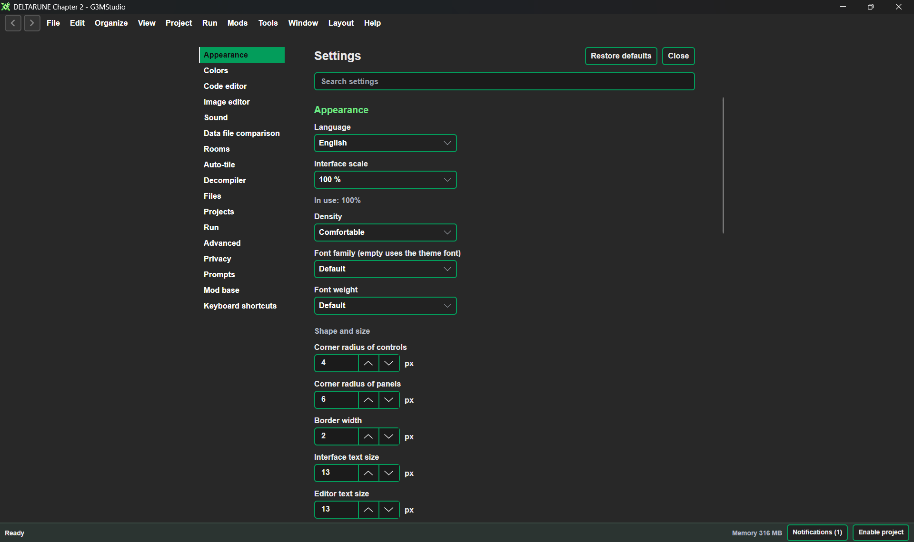

# Appearance settings

The **Appearance** category sets the language, the size of the interface, the fonts, animations and a few display switches. The Explorer options at the end of the category have their own page, [Explorer settings](explorer-settings.md).

Open it from **File** > **Settings**, then choose **Appearance**.

## Controls

| Label | Control | Default | Allowed values | What it does |
| --- | --- | --- | --- | --- |
| **Language** | List | English (`en`) | The languages installed with the app: English, Russian, Spanish, Japanese, Korean, Simplified Chinese, Traditional Chinese | Switches every label, menu and message at once. Saved as `language`. See [Languages](../getting-started/languages.md). |
| **Interface scale** | List | **Auto** | **Auto**, 50 %, 60 %, 70 %, 75 %, 80 %, 90 %, 100 %, 110 %, 125 %, 150 %, 175 %, 200 % | Scales the whole window. A value set by **Zoom In** or **Zoom Out** that is not in the list (for example 125 from an Auto scale of 115) also shows in its sorted place. Saved as `uiScale` (0 means Auto, otherwise 50 to 200). |
| (under the scale) | Text | | | **In use: {percent}%** shows the scale the window uses now. |
| **Density** | List | **Comfortable** | **Compact**, **Comfortable**, **Spacious** | Sets the control, row and tab heights, spacing and text sizes together. Your own values in **Shape and size** win over it. Saved as `density`. |
| **Font family (empty uses the theme font)** | List | **Default** | **Default**, every system font, every font you added | Font of the interface. **Default** is the theme font (Arial, Liberation Sans, Segoe UI and CJK fallbacks). Saved as `fontFamily`. |
| **Font weight** | List | **Default** | **Default**, **Normal**, **Medium**, **SemiBold**, **Bold** | Weight of interface text. **Default** is the theme weight, which is Bold. Saved as `fontWeight`. |
| **Animations** | List | **System default** (shows the level in use in brackets) | **System default**, **Full**, **Medium**, **Minimal**, **Off** | How much the interface moves. See below. Saved as `animations`. |
| **Previous and next tab buttons** | List | **Left of the menu bar** | **Left of the menu bar**, **Right of the menu bar**, **Hidden** | Where the back and forward tab buttons sit. Saved as `tabButtons`. |
| **Editor tabs** | List | **Along the top** | **Along the top**, **List at the left**, **List at the right** | Where the tabs of the editors sit. A list shows one tab per row beside the editor. It applies to every editor group. |
| **Width of the tab list** | Number | 170 px | 80 to 400 px | Width of the tab list when the tabs sit at a side. A title longer than the list is cut at its edge. |
| **Show a picture in editor tabs** | Checkbox | Off | On, off | Starts each editor tab with a small picture of its resource (a sprite, a background) or, when it has none, the icon of its type. |
| **Hide editor tabs while Open Editors is open** | Checkbox | Off | On, off | Hides the tab strips of the editor groups while the [Open Editors](../interface/panels.md) panel is open. The panel lists the same tabs. With the panel closed the tabs always show. The same box is at the top of the panel. |
| **Explanatory text** | List | **All** | **All**, **Hints**, **Details**, **Off** | Which help lines editors and dialogs show. Tip: "Hints say how to use something. Details tell about the item you are editing. Errors, warnings and questions always show." Saved as `helpLevel`. |
| **Show previews and IDs on hover** | Checkbox | On | On, off | Hovering a resource name shows a card with its picture and ID, wherever a resource is named. Saved as `hoverPreviews`. See [Hover cards](../interface/explorer-hover-cards.md). |
| **Show null entries in the resource tree** | Checkbox | Off | On, off | Lists the empty (null) entries of resource lists in the Explorer. Saved as `showNullEntries`. |
| **Add font file...** | Button | | Font files | Adds a font file of your own. See [Add a font](#add-a-font). |

## Interface scale

Scale is a percentage of the normal size.

- **Auto** computes a value from the screen. The screen height in logical pixels is compared with 1080 and the difference is applied at half strength. A 4K screen at 100 % system scaling gets 150 %, a 1440p screen gets 115 %. The result is rounded to steps of 5 and kept between 80 and 200. It is also capped so the window stays at least 960 units wide after scaling.
- A fixed percentage ranges from 50 to 200.
- Shortcuts: **Zoom In** (`Ctrl++`), **Zoom Out** (`Ctrl+-`) and **Reset Zoom** (`Ctrl+0`) change the scale in steps of 10 percent points between 50 and 200. **Reset Zoom** returns to **Auto**. These commands appear in the **View** menu and can be rebound.
- The window gets a minimum size of 840 by 460 at 100 %, grown with the scale but never beyond the screen.

The page is its own preview: the scale applies the moment you pick it.

## Zoom with Ctrl and the mouse wheel

`Ctrl` and the mouse wheel zoom the view under the pointer. They never scroll, and the point under the pointer stays in place. The wheel does not change **Interface scale**: use the **View** commands above for that.

| View | What the wheel changes | Remembered |
| --- | --- | --- |
| Explorer list | The zoom slider, 10 percent points a notch, 50 to 250 percent | Yes, as `explorerZoom` (default 100) |
| Sprite tab | The zoom of the picture | Yes, as `spriteZoom` (1 to 32, 0 means not set yet). A sprite opens at the zoom you used last |
| Picture views, image editor canvas, room editor, path editor | The zoom of the canvas | Per tab |
| Sound waveform | The time axis | No |
| Code editor | The text size, 8 to 32 | Yes, as **Text size** in [Code editor settings](editor.md) |

A touch pad adds up small movements to one notch. `Ctrl+Shift` with the wheel is not used for zoom. A horizontal wheel or a touchpad swipe pans sideways in every view that scrolls.

## Density and Shape and size

**Density** applies a preset to the values in the **Shape and size** block under it. The block shows the value now in force for each size: your own number if you set one, otherwise the density preset.

| Label | Unit | Range | Comfortable | Compact | Spacious |
| --- | --- | --- | --- | --- | --- |
| **Corner radius of controls** | px | 0 to 16 | 4 | 4 | 4 |
| **Corner radius of panels** | px | 0 to 20 | 6 | 6 | 6 |
| **Border width** | px | 1 to 4 | 2 | 2 | 2 |
| **Interface text size** | px | 10 to 20 | 13 | 12 | 14 |
| **Editor text size** | px | 8 to 32 | 13 | 12 | 14 |
| **Tooltip text size** | px | 10 to 20 | 12 | 11 | 13 |
| **Control height** | px | 28 to 56 | 30 | 28 | 36 |
| **Row height in lists** | px | 18 to 40 | 26 | 22 | 32 |
| **Tab height** | px | 24 to 48 | 32 | 28 | 38 |
| **Panel padding** | px | 4 to 24 | 12 | 8 | 16 |
| **Icon size** | px | 12 to 32 | 16 | 14 | 20 |
| **Scrollbar width** | px | 6 to 24 | 12 | 10 | 16 |
| **Spacing of controls** | % | 50 to 200 | 100 | 75 | 125 |

Notes:

- The row labels in the page are the ones in the first column. The block title is **Shape and size**.
- **Interface text size** also moves the other text steps with it: captions are 2 px smaller, small text 1 px smaller, titles 3 px larger and the page title 7 px larger.
- **Spacing of controls** scales the padding of buttons, text boxes, combo boxes and menu items.
- Your own sizes are stored in `sizes` in [settings.json](settings-file.md) by key (for example `Control.Height`). A key outside the table is dropped and a number outside the range is clamped.
- Changing **Density** rebuilds the block so the boxes show the values of the new density.
- **Editor text size** is the text size of text boxes. The text size of code tabs is **Text size** in [Code editor settings](editor.md).

## Animations

| Level | Duration factor | What moves |
| --- | --- | --- |
| **Full** | 1.0 | Slides, scales, fades and color changes. |
| **Medium** | 0.7 | Slides, scales, fades and color changes. |
| **Minimal** | 0.4 | Fades and color changes only. |
| **Off** | 0 | Nothing is animated. |

- No animation runs longer than 200 ms at **Full**.
- **System default** uses **Off** when the operating system asks for reduced motion, otherwise **Medium**. The list entry names the level in use, for example "System default (Medium)".
- Progress bars appear only after work has taken 300 ms.
- A list item flashes only when a single item is new or changed.

An older version stored a single reduce-motion switch. If it was set and no level was chosen, the level is **Off**.

## Add a font

1. In **Appearance**, press **Add font file...**.
2. Pick one or more font files. The dialog filter is named **Font files**.
3. G3MStudio copies the file into the `fonts` folder of the [user data folder](../getting-started/user-data.md) and chooses the first family of the file as **Font family**. Removing a font deletes that copy.

If a file is not a font, the note under the button reads "{file} is not a font file."

Added fonts are listed under the button with a **Remove** button each. Removing the font in use sets **Font family** back to **Default**.

The added fonts also show in the **Code font** list of [Code editor settings](editor.md).

## Restore defaults

**Restore defaults** on this category resets: **Interface scale**, **Font family**, **Font weight**, **Density**, **Explanatory text**, **Animations**, **Editor tabs**, **Width of the tab list**, **Show a picture in editor tabs**, **Hide editor tabs while Open Editors is open**, **Show null entries in the resource tree**, **Show previews and IDs on hover**, all own sizes, and these Explorer options: **Show the Explorer as folders instead of resource types**, **Show counts in the Explorer**, **Open folders and collections when they appear**, **Hide code that cannot be decompiled (and scripts using it)**, **Hide broken resources and entries with errors**, the two data list options (**Open Strings, Variables and the other data lists when I search** and **Leave out the data lists**), the three entry visibility rows, **Default sort order of the Explorer** and **Sprite previews start at**.

It does not reset **Language**, **Previous and next tab buttons** or **Size of the Explorer icons at 100% zoom**.

## See also

- [Colors and themes](colors-and-themes.md)
- [Explorer settings](explorer-settings.md)
- [Default values](defaults-table.md)
- [Languages](../getting-started/languages.md)
